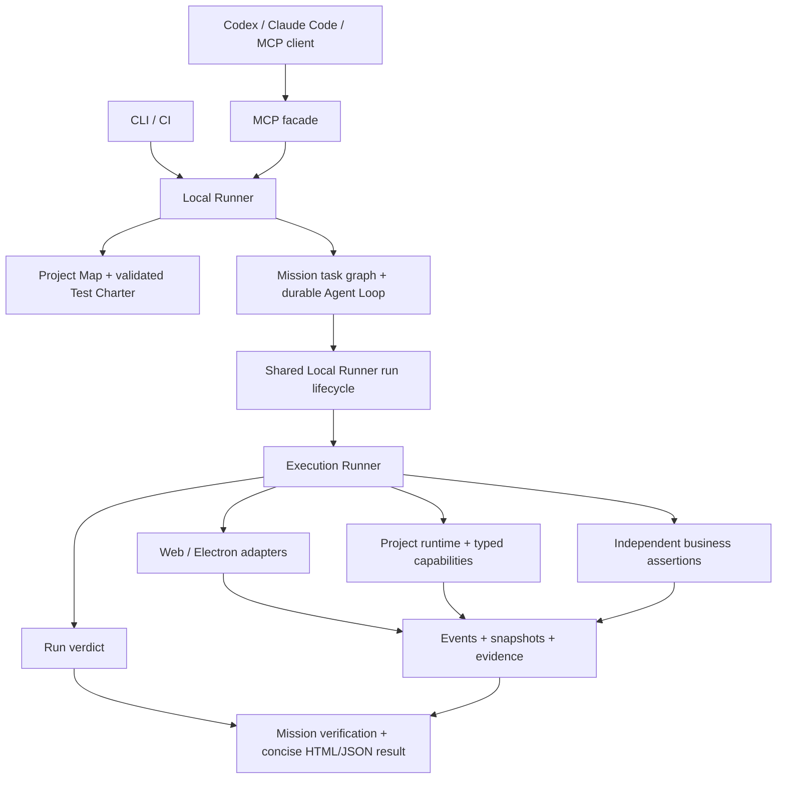

# ProofKit AI

**Evidence-driven system testing for Web, Electron and mobile.**

ProofKit turns a short product instruction into a reviewable test charter, runs it against a real browser or Electron app, observes the result, and stores the evidence behind every verdict.

It is designed for workflows where a green button is not enough: a resume must be acquired, parsed, attached to the right candidate and position, and reach the expected terminal state. ProofKit is local-first and uses independent business facts where available.

> Early development: the first vertical slice supports Chromium-based Web and Electron applications. CLI and data formats are still evolving.

See the [Chinese architecture overview](docs/architecture-overview.zh-CN.md) for the host-agent integration, execution layers and current capability boundaries.

## What it does

- Maps workspace manifests and common Web, Electron, and backend entry points.
- Produces a bounded path-level test map with source/test counts, framework signals, conventional entry points, static route hints and an explicit truncation flag.
- Gives host agents a read-only test scope view: source locations, level/surface-compatible plans, plan gaps, registered business checks and bounded capability input hints. Static declarations never count as executed coverage.
- Inspects an optional external `.proofkit/workflows.yaml` business workflow inventory for source freshness, Charter/platform links and explicit exclusions. A bounded source-candidate audit flags discovered entries or routes that lack a workflow owner, linked Charter route target, or consistent exclusion. A fresh, structurally linked inventory can directly generate a `quick`, `core` or `release` whole-project Mission with the declared Charter/platform pairs. Quick checks prove only observable surface assertions; full project acceptance remains gated until inventory completeness can be established.
- Checks configured Web/Electron endpoints or a one-time Web candidate URL, CDP discovery status and local source association before testing, with a bounded deadline and a hashed observation artifact. Login, samples and business readiness remain explicitly unchecked.
- Prioritizes a literal scope focus before retaining bounded routes and entry points; eligible Charter aliases also prioritize their reviewed route targets. Partial scans remain explicit.
- Matches one-sentence requests to curated, workspace-owned Charters by explicit aliases; ambiguous matches require a Charter ID, and missing assertions or business Oracles stop automatic execution.
- Exports a portable `proofkit-test` Agent Skill and native Codex/Claude Code MCP configuration, with optional personal Skill installation and an explicit unconnected setup result.
- Converts intent into a saved YAML Test Charter that can be reviewed and edited.
- Records plan quality, missing inputs and evidence gaps; a model's self-reported confidence cannot make a Mission pass.
- Separates test intensity from acceptance scope: a partial source map does not block a complete declared module scenario, while whole-project acceptance stays gated until workflow coverage can be proved.
- Executes Web and Electron actions through Playwright, including CDP attachment.
- Executes mobile actions through a W3C WebDriver/Appium-compatible server when a mobile surface is configured.
- Starts local project processes with health checks and captures runtime events in the same run timeline.
- Observes read-only business HTTP endpoints through a redacted oracle instead of treating a UI click as proof of success.
- Accepts programmatically registered, schema-validated project capabilities; only an explicit evidence projection is persisted.
- Runs an optional integration preflight before setup, browser connection or capability execution; a failed environment or test-scope check is blocked with a `preflight.json` artifact.
- Supports explicit negative Charters such as duplicate submission and requires their expected outcome and evidence to be present in the Mission result.
- Keeps configuration, connectors, Missions and run evidence in an external test workspace for new projects, with compatibility for existing project-local layouts.
- Loads an optional workspace-owned `.proofkit/integration.mjs` module for typed capabilities, business oracles, test setup and cleanup.
- Journals scoped setup resources before surface execution and verifies deletion through fresh scoped readback. After an owner process exits, CLI/MCP can recover registered resources using the original versioned connector and intact evidence; recovery keeps the original product verdict and evidence unchanged. See [connector setup and recovery](docs/agent-integration.md#scoped-setup-and-cleanup).
- Enforces a total run deadline and supports cancellation from the CLI or MCP while preserving the evidence directory.
- Enforces a separate Mission deadline across the AI task graph; expiry closes the active step and records a reviewable environment finding.
- Propagates Mission stops to primary, replay and negative Runs, waits up to 10 seconds for cleanup, and links cancelled Run reports to the Mission; unfinished cleanup is reported explicitly.
- Waits up to 5 seconds for an in-flight setup, adapter connection or event subscription to return a cleanup handle after cancellation. If that wait expires, the report states that resources may still be active; a handle returned later triggers a best-effort asynchronous release.
- Polls asynchronous HTTP business state to a bounded terminal verdict; a timeout remains inconclusive.
- Records action receipts, before/after snapshots, network and console events, screenshots, and a JSONL timeline.
- Supports `fill` values supplied by an environment variable reference; the saved Charter and Run record retain the variable name so a replay can use the current test credential.
- Selects prepared `.proofkit/fixtures/` files through unique Web/Electron file inputs, including hidden inputs. `setInputFiles` accepts 1–10 files with a 20 MiB total limit, records file hashes rather than contents, and blocks replay when input identity cannot be verified.
- Classifies configured page errors, console errors and failed responses as linked runtime findings; `record` reports them without changing a passing business verdict, while `fail` makes them a run failure.
- Reports `passed`, `failed`, `blocked`, `cancelled`, or `inconclusive`; missing evidence never becomes a pass.
- Links a replay Mission to its source and compares the same saved scope, Run matrix, and independent business facts. A repair is only `verified-in-scope` when the original evidenced defect is absent from a complete passing replay.
- Records bounded Git source fingerprints before and after a Mission; a detected mid-run change makes the current acceptance verdict inconclusive while preserving the saved Run verdict. Comparison applies the same boundary to repair verification.
- The default `core` mission runs one selected surface with an independent business Oracle and source facts, or the exact Charter/platform pairs of a fresh project workflow inventory. A `release` Mission adds replay for its selected pairs; explicit catalog suites still use a full Web/Electron matrix. Every declared negative or recovery case has its own run and cannot supply missing main-path evidence. Passing the declared matrix does not imply whole-project coverage.
- Release suites reconcile reviewed route-to-Charter declarations with the bounded project map. Their result separates discovered, mapped and observed Web/API routes, reports stale or ambiguous mappings, and keeps partial scans explicit. API observation requires a matching successful HTTP response and the same independent business gate as the surface run.
- Produces a compact Mission result with acceptance scope, a scenario/surface execution matrix, first failure, evidence links and scoped repair comparison, plus local JSON and HTML snapshots.

## Quick start

Requirements for source development: Node.js 22 or newer and pnpm 10.

```bash
pnpm install
pnpm build
pnpm --filter @proofkit/cli dev -- init --root /path/to/your/project
pnpm --filter @proofkit/cli dev -- doctor --root /path/to/your/project
```

The repository also builds one installable `proofkit-ai` npm tarball containing both `proofkit` and `proofkit-mcp`. The internal `@proofkit/*` packages remain development modules; users do not need to install them separately. Registry publication has not happened yet. To verify the artifact and install a locally built copy:

```bash
pnpm test:distribution
pnpm pack --pack-destination /path/to/output
npm install -g /path/to/output/proofkit-ai-0.1.0.tgz
proofkit --version
```

The distribution test packs the project, installs only that tarball in a fresh temporary directory, runs CLI onboarding, and calls the installed MCP server over stdio. A registry release can later use `npm install -g proofkit-ai` with the same two commands.

For host-agent use, generate the onboarding bundle and install its testing Skill:

```bash
proofkit agent setup --harness codex --root /path/to/your/project --workspace /path/to/test-workspace --install-skill
# Alternatively: --harness claude-code
# Optional one-command Skill installation, local MCP check and host registration:
proofkit agent setup --harness codex --root /path/to/your/project --workspace /path/to/test-workspace --register-host
```

The command returns an external bundle containing `proofkit-test/SKILL.md`, a Charter reference, a native `mcp.toml` or `mcp.json` fragment, and `setup.json`. Without `--register-host`, use the returned `connection.registration` command and argument array, or merge the fragment through the host's supported MCP configuration workflow. With `--register-host`, inspect the separate `hostRegistration` result; existing entries are never overwritten. Verify the host can call `inspect_test_scope` and confirm its `projectRoot` before testing. The Skill guides default `core` testing, independent business checks, evidence reporting and repair replay; it still relies on the host's reasoning. See [agent onboarding](docs/agent-integration.md#agent-onboarding) for discovery paths and limits.

Add `--check-connection` to `agent setup` to launch the emitted MCP server,
verify its high-level tools and check its source/workspace binding. The result
appears under `localConnection`; host registration, model behavior and product
testing remain explicitly unchecked.

Setup always uses an external workspace, including projects with a legacy source-local `.proofkit`. By default it does not register MCP, load connectors, start applications or assert product correctness. `--check-connection` loads trusted connector registration code in the emitted local server, but still starts no application or test. Optional Skill installation preserves custom content and reuses identical files. A generic MCP harness uses `--harness generic`; installing its Skill also requires `--skills-dir` pointing to its documented discovery directory.

`--root` identifies the tested source. For a new project, ProofKit writes its test files to `~/.proofkit/workspaces/<project-name>-<path-hash>/.proofkit/`. Add `--workspace /path/to/test-workspace` to any command to select an explicit workspace. An existing source project's `.proofkit` keeps its legacy layout unless you supply `--workspace`.

`proofkit init` also creates a starter integration module in that test workspace. Leave its arrays empty for UI-only checks, or add typed business capabilities and independent oracles when a workflow needs backend proof. Initialization does not add files to the source tree when an external workspace is selected.

For a whole-project workflow declaration, an operator can run `proofkit review-workflows --root <project> --workspace <test-workspace> --key-id <reviewer-id> --private-key <external-private.pem>` after reviewing the inventory, full candidate set and registered Charters. ProofKit saves a signed `.proofkit/workflow-review.json` in the test workspace. Set `PROOFKIT_WORKFLOW_REVIEW_TRUST_PATH` to a JSON map of reviewer IDs to Ed25519 public PEM keys outside both the source project and test workspace; `scope` then reports whether the declaration authenticates. The signature binds the source fingerprint, candidate records, Charter registrations and Charter file and execution digests. A new `core` or `release` Mission admits that reviewed scope only when the signed candidate set is complete, has no exclusions, and exactly matches its Charter/platform matrix. It can pass only after the required Runs, independent business evidence, route observations, source binding, Web/Electron listener ownership and end-of-run continuity, and current trust all pass their audits. Electron HTTP pages require separate ownership and continuity evidence for the page server and Electron CDP process. Mobile lacks an equivalent application-source proof and cannot yet pass reviewed project acceptance. The result is explicitly scoped to **reviewed source workflows**: a signature authenticates the trusted signing key and exact declaration, while semantic completeness still depends on the review. `quick` and older Missions cannot gain this pass retroactively.

Inspect what is available before authoring a test:

```bash
proofkit scope --root /path/to/your/project --surface web --level core --limit 20
# Optionally narrow by a literal source-path or registration substring:
proofkit scope --root /path/to/your/project --focus resume
# Include the bounded Git fingerprint needed to bind a workflow inventory:
proofkit scope --root /path/to/your/project --source-state
```

Scope routes are static candidates. Gin group prefixes are composed within a file; unresolved declarations appear in `inventory.routeDiagnostics` with source locations. Other framework literals may need manual interpretation. Neither route mapping nor inspection proves a business result.

MCP clients use `inspect_test_scope` for the same view, then `inspect_test_environment` for a Web/Electron target and `inspect_surface` to observe the live page. A structurally ready catalog case can proceed to `run_test`; without one, the scope result points to `plan_test` first. Scope inspection defaults to `core`; it returns `not-asserted`, full scanned counts, omitted counts and the inventory's truncation flag with specific `truncationReasons` when a bound is reached. `planReady` checks saved plan structure and registered operations, not login, test data or runtime readiness. Capability input hints omit defaults and user callbacks; runtime Zod validation remains authoritative. Workspace connector registration is trusted code loaded by the service; scope inspection invokes none of its execution hooks.

High-level Mission creation infers an omitted surface only from explicit Web, Electron/desktop, or mobile wording in the intent; otherwise it uses Web. It rejects a Mission whose actual execution matrix omits a platform named in the request. A multi-surface `core` request therefore needs a project workflow inventory with those platform checks, while a `release` Charter or suite can use its declared Web/Electron matrix. The low-level Run and inspection tools retain their explicit Web defaults.

Observe configured endpoints or a one-time Web candidate before attaching to a page:

```bash
proofkit environment --root /path/to/your/project --surface electron --timeout-ms 10000
# Check a candidate Web listener once without editing the test workspace:
proofkit environment --root /path/to/your/project --surface web --url http://127.0.0.1:5173/ --timeout-ms 10000
```

MCP uses `inspect_test_environment({ surface: "electron", timeoutMs: 10000 })` or `inspect_test_environment({ surface: "web", url: "http://127.0.0.1:5173/" })` for one candidate Web listener. The override applies only to this observation and its source-process association; it does not change the configured URL for a later Run. MCP accepts loopback or the configured Web origin, while Electron keeps its configured CDP endpoint. Both paths use the same Local Runner and save a JSON artifact plus SHA-256 under the test workspace's `.proofkit/inspections/`. Checks share a total deadline of 100–15000 ms (default 10000 ms) and probe at most eight declared backend health endpoints. The command returns exit code 0 for `checks-passed`, 1 for `blocked`, or 2 for `incomplete`. These are environment observations with `testVerdict: not-asserted`; inspect `notChecked` before moving on to page inspection and business testing. HTTP probes use GET, retain the status and endpoint without its query or fragment, do not follow redirects, and finish at response headers without retaining response bodies, headers or raw network errors. No app, browser or connector operation is started by the inspection; service creation still loads trusted connector registration code.

Plan and review a test:

```bash
pnpm --filter @proofkit/cli dev -- plan \
  "Verify the resume page shows a successful result" \
  --root /path/to/your/project \
  --url http://127.0.0.1:5173 \
  --expect "Resume ready" \
  --out resume-check.yaml
```

For one-sentence planning with a local or OpenAI-compatible model, set `planning.provider: openai-compatible`, `planning.baseUrl`, and `planning.model` in `<workspaceRoot>/.proofkit/config.yaml`. The default planner stays deterministic. An optional `apiKeyEnv` names an environment variable; the key is never written to the config file.

For asynchronous business outcomes, register a read-only status endpoint and terminal values in that same config:

```yaml
planning:
  provider: openai-compatible
  baseUrl: http://127.0.0.1:11434/v1
  model: local-model
oracles:
  - name: resume-status
    url: http://127.0.0.1:8080/api/v1/resume-status
    query:
      runId:
        source: runId
    statusPointer: /data/status
    successValues: [complete]
    failureValues: [failed]
    intervalMs: 500
    deadlineMs: 30000
```

Use `--oracle resume-status` with `plan` or `run`. The charter records the oracle name, and the runner waits for a declared terminal state. A project capability can also bind a sanitized ID from an earlier step into an oracle query parameter.

Run it in Chromium:

```bash
pnpm --filter @proofkit/cli dev -- run "resume check" \
  --root /path/to/your/project \
  --charter resume-check.yaml \
  --adapter web \
  --headful
```

Attach to an existing Electron instance. Start that app with remote debugging enabled and point ProofKit at its loopback CDP endpoint or `DevToolsActivePort` file:

```bash
pnpm --filter @proofkit/cli dev -- run "resume check" \
  --root /path/to/your/project \
  --charter resume-check.yaml \
  --adapter electron \
  --devtools-port-file /path/to/user-data/DevToolsActivePort
```

For CDP attachment, ProofKit waits for an application page and requires a unique target. If the browser or Electron app has several windows, set `surfaces.electron.targetUrlPrefix` or `targetTitleContains` in the external workspace's `.proofkit/config.yaml` (the Web surface accepts the same fields). It never picks an arbitrary first tab. A configured Web `baseUrl` also narrows attached pages to that origin when no explicit target is set.

On Windows and Linux hosts with usable `/proc` socket metadata, a loopback Web/Electron target also records the listening process's Git checkout. For an Electron `file:` page, ProofKit checks the configured CDP listener when there is no HTTP page server; a port file is resolved at inspection time. A different checkout blocks the run by default, so a server left running from another working tree cannot silently count as this project's test. `unverified` means ProofKit could not establish that association; a matching process path still does not attest the served source bytes. Linux process association has parser tests and an Ubuntu CI smoke but has not yet passed a real Linux host run in this checkout; WSL 1 does not expose the required socket table.

When a unique local listener PID is known, `core` and `release` Runs check it again before closing the surface, including after an assertion or Oracle error. A changed or unverified listener makes an otherwise passed or failed Run inconclusive; cancellation and pre-connection blocks keep their own verdicts. Both observations are saved when the final check returns; a probe error records unverified continuity in the Run. The Run report shows this check and its artifacts. `quick` keeps the initial check only. These point-in-time checks cannot detect a replacement that happens and reverses between observations.

For a mobile surface, configure an Appium or W3C WebDriver server in the external workspace:

```yaml
surfaces:
  mobile:
    serverUrl: http://127.0.0.1:4723
    platformName: Android
    deviceName: emulator-5554
    automationName: UiAutomator2
    app: /path/to/app.apk
```

Then run the same Charter with `--adapter mobile`. Mobile selectors may use `accessibility=`, `id=`, `xpath=`, `class=` or `css=` prefixes. The mobile driver must be loopback when invoked through MCP.

Mobile text assertions use WebDriver element lookup and `/displayed`, so hidden source text is not treated as visible. `inspect_surface({surface:"mobile"})` observes the configured driver before Charter authoring and returns bounded, scrubbed non-editable XML labels plus a screenshot; it reports `not-asserted` and does not offer device-validated selector hints. Creating an Appium session may launch or reset the app according to its configured capabilities, even though inspection sends no UI action. The MCP-to-Mission path has a fake-driver HTTP smoke (`pnpm test:smoke:mobile`) covering inspection, a passed core test and an independently confirmed backend defect. Emulator and physical-device acceptance are still pending.

Relative Charter and output paths resolve against the selected test workspace. Runs are stored under `<workspaceRoot>/.proofkit/runs/<run-id>/` by default. Each run contains `run.json`, `events.jsonl`, artifacts, and `report.html`.

For a Mission, `get_mission_evidence` returns `summary`, `evidenceIntegrity` for the compact presentation, `acceptanceEvidenceIntegrity` for all saved Mission references (up to 2048), and a `report` path. Use audited `testVerdict` for the current acceptance claim; `verdict` is the saved historical result. A partial compact presentation can still support a pass when the full reference audit is intact. A saved failure cannot support a current product-defect claim after its cited evidence or Oracle classification becomes unverified. CLI users can generate the same result:

```bash
proofkit mission report <mission-id> --root /path/to/source --workspace /path/to/test-workspace
```

Open `<workspaceRoot>/.proofkit/missions/<mission-id>/report.html` for the compact result, or read its adjacent `summary.json`. These are snapshots of a saved Mission revision; regenerate during or after execution to see the latest state. Both show the current audited `testVerdict` alongside the saved `verdict`, missing executions and coverage limits, and a negative case's expected outcome separately from its raw Run verdict. Evidence links become unavailable when a file is missing, outside its Run/workspace boundary, or differs from its recorded digest. A report-write failure returns `reportUnavailable` while retaining the structured result and original evidence.

For CI, `proofkit mission check <mission-id> --root <source> --workspace <test-workspace>` re-audits saved evidence without re-running the product or loading the workspace integration module. Its JSON contains both the historical `verdict` and current `testVerdict`; the nested `summary` follows the versioned `MissionResult` contract. Exit code 0 means audited `passed`, 1 means observed `failed`, and 2 means `blocked`, `cancelled`, `inconclusive`, or `not-asserted`. `mission run` and `mission replay` apply the same exit rule to their audited result. `mission report` only writes a report snapshot; use `mission check` as the acceptance gate. A saved pass whose evidence later changes returns exit code 2 until the scenario is rerun.

The repository also contains a [GitHub Composite Action](docs/ci-action.md) that builds its own ProofKit revision, creates and runs a configured Mission from an intent, or re-audits an existing Mission. Its current action wrapper has a local real-browser regression; publication and GitHub-hosted runner validation remain pending.

For local Web runs, `surfaces.web.executablePath` in the external workspace takes precedence over the optional `PROOFKIT_BROWSER_PATH` environment variable. Without either, Playwright uses its installed Chromium browser.

For an AI client, register `proofkit-mcp` after installing the tarball, or run the server from a source checkout. It exposes only project discovery, charter planning, run start, status, bounded evidence, and replay, and it uses the same Local Runner as the CLI. MCP does not execute the configured project start command; start your test environment first:

An agent can call `run_test` with a reviewed catalog ID or submit a schema-validated `charter` inline for a new workflow. Inline Charters are stored in the Mission, reassessed for evidence gaps, and executed without adding files to the tested source. See [Agent integration](docs/agent-integration.md) for the request shape and side-effect rules.

For a new workflow with a read-only terminal-status API, the Charter can also declare bounded `httpOracles` that bind a `captureResponse` ID to an independent GET result. This avoids pre-registering a simple business reader; authenticated or multi-entity checks still use an external workspace connector. See [the response identity example](docs/agent-integration.md) for the contract and limits.

For a new UI workflow, `inspect_surface` (or `proofkit inspect`) first records a read-only Web/Electron observation with visible control hints and evidence links. Its `not-asserted` result is not a product verdict; use the observed selectors in a Charter and verify them during the test Run.

```bash
pnpm --filter @proofkit/mcp build
PROOFKIT_ROOT=/path/to/your/project PROOFKIT_WORKSPACE_ROOT=/path/to/test-workspace node packages/mcp/dist/server.js
```

The shortest agent workflow is `run_test({ intent, level, surface })`, followed by bounded `await_test_result({ missionId })` calls and `get_mission_evidence` for detail. The supported levels are `quick` (fast observable path), `core` (the default, with an independent business Oracle), and `release` (pre-release regression scope). When no level is supplied, ProofKit infers one from the intent or defaults to `core`; an explicit `suiteId` selects `release`. Register suites in the external workspace, inspect them with `proofkit suites` or MCP `list_test_suites`, then run one with `run_test({ intent: "上线完整回归", suiteId: "release-critical", surface: "web" })`. See [docs/agent-integration.md](docs/agent-integration.md) for Codex, Claude Code and DeepSeek Harness usage.

After changing the tested application, call `replay_mission({ missionId })`, wait for its new Mission to finish, then read `get_mission_evidence` or call `compare_missions({ baselineMissionId, candidateMissionId })`. CLI offers `proofkit mission replay <missionId>` and `proofkit mission compare <baselineMissionId> <candidateMissionId>`. The comparison pairs primary, replay, and declared negative Runs; it reports missing scope or source facts as `inconclusive`. `verified-in-scope` means the original business defect was not reproduced in the same configured test scope, not that a particular code edit was proven causal.

For known business flows, add `charters` entries to the external workspace config with an ID, path, natural-language aliases, level and surfaces, then keep the validated YAML Charter in that workspace. `proofkit charters` or MCP `list_test_charters` lists them. An MCP server can run trusted write capabilities only when its operator sets `PROOFKIT_ALLOW_CAPABILITY_WRITES=1` and the workspace, Charter and capability all permit the isolated test operation; a project integration can add a preflight gate.

Planner quality can be checked without starting a browser or the tested project:

```bash
pnpm benchmark:planner
```

The benchmark reports level selection, action safety, assertion and Oracle presence for fixed quick/core/release cases. It is a planning-structure check; a passing benchmark does not replace a real business run.

For host integration, `pnpm benchmark:host:baseline` exercises six synthetic
cases through the generated native MCP launcher and real Chrome. It verifies
saved Mission/Run results and evidence, but uses scripted calls. After that,
`node tests/host-evaluation.mjs --run --cases core-pass,core-defect` evaluates
actual Codex Skill/MCP behavior using the configured provider; add
`--implicit-skill` to test discovery without an explicit Skill mention. The
host evaluator stops on provider access or MCP cancellation and reports those
cases as infrastructure-blocked. See [host effectiveness check](docs/agent-integration.md#host-effectiveness-check).
Set `PROOFKIT_ELECTRON_PATH` and run `pnpm benchmark:host:electron` for the
two optional native-MCP Electron/CDP cases.
With the same executable, `node tests/host-evaluation-baseline.mjs --cases inline-electron-pass,inline-electron-defect` checks first-use desktop Charters with no catalog or pre-registered business Oracle. The corresponding real Codex cases use `node tests/host-evaluation.mjs --run --implicit-skill --cases inline-electron-pass,inline-electron-defect`; on this Windows host the isolated evaluator needed `--windows-sandbox unelevated`.

To evaluate an OpenAI-compatible or local model with the same cases, set the endpoint and model before running it:

```bash
PROOFKIT_PLANNER_PROVIDER=openai-compatible \
PROOFKIT_PLANNER_BASE_URL=https://api.example.com/v1 \
PROOFKIT_PLANNER_MODEL=your-model \
PROOFKIT_PLANNER_API_KEY=... \
pnpm benchmark:planner
```

The key is read only from the process environment and is not included in the report.

Project-specific capabilities can live outside the tested source under `<workspaceRoot>/.proofkit/integration.mjs`. The module is trusted local code and may export a `name`, typed `capabilities`, business `oracles`, and a setup function that returns cleanup:

```js
export default {
  name: "aihr-test-integration",
  version: "1",
  capabilities: [],
  oracles: [],
  async setup({ runId, emit, signal }) {
    await emit({ type: "finding.created", timestamp: new Date().toISOString(), payload: { runId, message: "integration ready" } });
    if (signal.aborted) throw signal.reason;
    return async () => {};
  },
};
```

Set `run.timeoutMs` in the workspace's `.proofkit/config.yaml` to bound the complete run. Press `Ctrl+C` during a CLI run or call the MCP `cancel_run` tool to cancel it; its report and evidence are retained with a `cancelled` verdict.

Mission execution also has its own `MissionPolicy.timeoutMs` deadline. It covers project discovery, all surface runs, recovery and final verification; expiry remains `cancelled` and includes a `Mission timed out` finding so an AI client can distinguish it from a user cancellation.

## Architecture



The repository is a pnpm workspace with explicit package boundaries:

| Package | Responsibility |
| --- | --- |
| `@proofkit/contracts` | Runtime schemas for charters, actions, receipts, events, evidence and verdicts |
| `@proofkit/project` | Project scan, `doctor` inputs, local configuration |
| `@proofkit/planner` | Deterministic intent scaffolding and YAML charter validation |
| `@proofkit/agent` | Mission task graphs, recoverable task scheduling, evidence gates and failure analysis |
| `@proofkit/runner` | Execution lifecycle, step receipts, assertions and verdicts |
| `@proofkit/adapters` | Playwright Web, Electron CDP and W3C WebDriver mobile surfaces |
| `@proofkit/runtime` | Application process startup, health checks and runtime events |
| `@proofkit/oracles` | Independent business checks and bounded read-only HTTP polling |
| `@proofkit/evidence` | JSONL timeline, artifacts, redaction and static report data |
| `@proofkit/local-runner` | Shared CLI/MCP/CI orchestration, test scope inspection, status, replay and evidence lookup |
| `@proofkit/mcp` | Narrow MCP facade over the shared Local Runner |
| `@proofkit/cli` | Local user interface and CI entry point |

## Verdicts

| Verdict | Meaning |
| --- | --- |
| `passed` | Every declared business assertion passed against an observed state. |
| `failed` | An action or assertion produced a concrete failure. |
| `blocked` | An explicit human, permission, authentication, or environment condition stopped execution. |
| `cancelled` | The user cancelled the run or its total deadline expired; the evidence remains available. |
| `inconclusive` | Execution ended without enough business assertions to prove success or failure. |

Screenshots are supporting evidence. They do not override failed API, worker, file, or business-state assertions.

## Safety and data

- Use a dedicated test profile and test data. CDP attachment controls the selected browser session.
- File selection requires an allowed scenario and workspace side-effect policy. Input facts prove selected bytes; business Oracles prove the outcome. Fixtures are checked at the file step, and page snapshots or screenshots can retain application echoes of file contents.
- Keep CDP bound to loopback; never expose a debugging port to a public network.
- MCP model planning and configured business oracles accept loopback endpoints only. Model-generated navigation stays within the configured or explicitly supplied Web origin; interactive model actions require `sideEffects: allow` in the project config.
- ProofKit core does not seed or mutate application databases. Project-specific test writes must be explicit typed capabilities in the project integration, restricted to test environments and paired with cleanup.
- Authorization, cookies, passwords, secrets, tokens, and phone fields are redacted from structured evidence by default.
- Do not use production accounts or real candidate data for exploratory runs.

## Development

```bash
pnpm install
pnpm build
pnpm typecheck
pnpm test
pnpm test:smoke:suite
pnpm test:smoke:target-continuity
pnpm test:smoke:target-linux
node tests/web-smoke.mjs
node tests/electron-smoke.mjs
```

The Electron smoke test uses an isolated temporary profile. The Web smoke test serves a local fixture page. Neither contacts a production system.
On Windows, the target-continuity smoke starts two real Node listeners from a temporary Git checkout, uses Chrome for a core Mission, replaces the listener during its business Oracle, and verifies the Run, Mission, and report verdicts. It removes its temporary source and external test workspace afterward.
On Linux, the target-binding smoke checks `/proc` socket ownership, stable and replaced listener PIDs, and a different Git checkout. The Ubuntu CI job requires this check; local WSL 1 skips because its socket table is unavailable.

For real file-input verification across Web and Electron, set
`PROOFKIT_ELECTRON_PATH` to a local Electron executable and run
`pnpm test:smoke:upload`. Set `PROOFKIT_BROWSER_PATH` when Chromium is not at
the default location. This smoke creates its own Electron app and profile,
checks multipart bytes against independent server facts, and retains local
reports for passing, defective and repaired scenarios.

With the same browser/Electron paths, `pnpm test:smoke:response` verifies
current-submission response IDs, independent identity/status checks, fresh
IDs on replay, and evidence-backed defect/fix comparison. Its isolated fixture
also covers ambiguous requests, delayed processing and chunked/compressed JSON;
live application business acceptance remains a separate validation step.

## Design principles

1. Reuse mature execution engines; focus on project understanding, cross-layer observation, business oracles and evidence.
2. Keep CLI, MCP and CI attached to the same local Runner and result model.
3. Persist every natural-language plan as a reviewable Test Charter.
4. Distinguish action receipts from assertions: an action receipt proves dispatch, not business success.
5. Keep the core deterministic and make AI planning an optional provider behind a validated schema.

See [docs/architecture.md](docs/architecture.md) for package boundaries, extension points, and the first end-to-end vertical slice. See [docs/research.md](docs/research.md) for the open-source project comparison and reuse decisions. See [docs/aihr-resume-integration.md](docs/aihr-resume-integration.md) for the first business-flow integration contract. The concrete AIHR gateway integration is [.proofkit/integration.mjs](.proofkit/integration.mjs), which imports [.proofkit/aihr-manual-intake.mjs](.proofkit/aihr-manual-intake.mjs); copy both to the external test workspace. Starter Charters are [.proofkit/charters/aihr-resume-upload.yml](.proofkit/charters/aihr-resume-upload.yml) and [.proofkit/charters/aihr-online-resume.yml](.proofkit/charters/aihr-online-resume.yml). See [docs/aihr-resume-testing-map.md](docs/aihr-resume-testing-map.md) for the verified source flow. The ordinary PDF upload Charter is the default AIHR path; online intake remains a compatibility flow. Manual intake has an independent submission-bound Oracle; its live page actions and positive assertion still require inspection.
See [docs/product-direction.md](docs/product-direction.md) for the current status, adoption path, and next implementation decisions.

## License

MIT. See [LICENSE](LICENSE).
