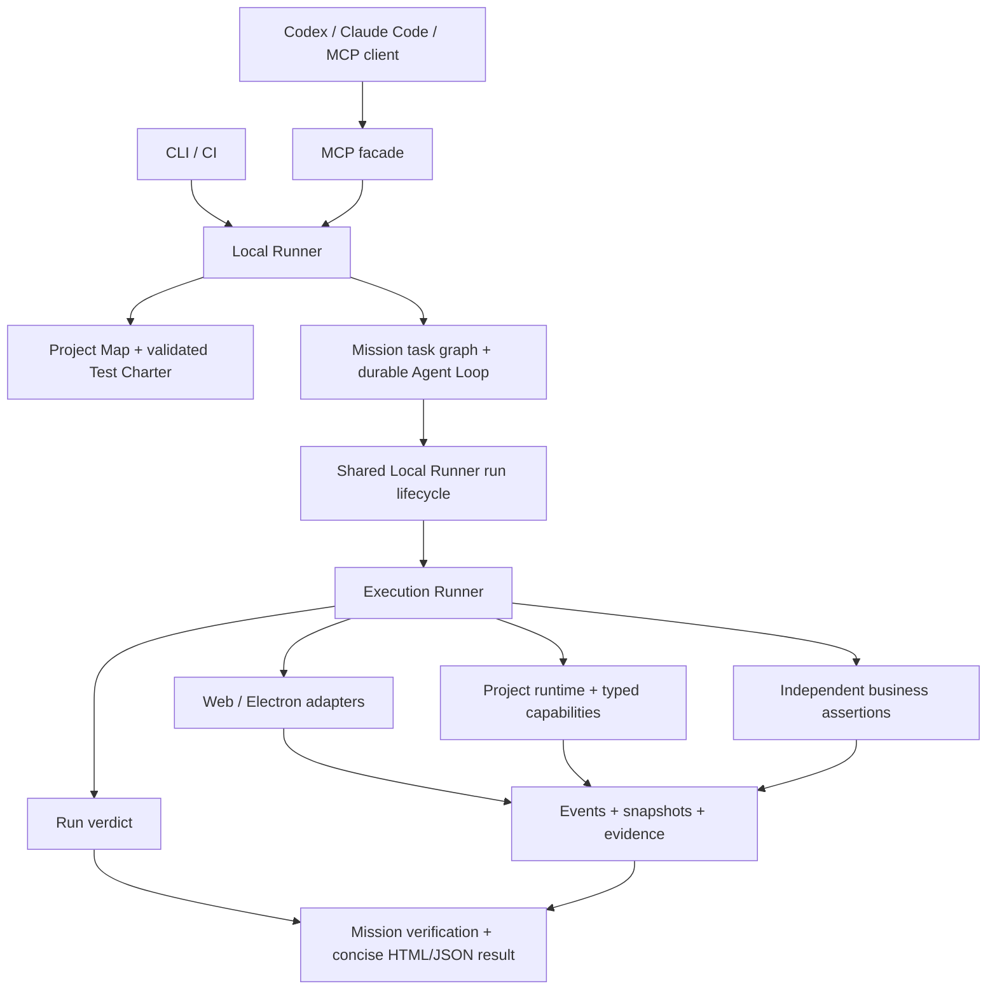

# ProofKit AI

**Evidence-driven system testing for Web, Electron and mobile.**

ProofKit turns a short product instruction into a reviewable test charter, runs it against a real browser or Electron app, observes the result, and stores the evidence behind every verdict.

It is designed for workflows where a green button is not enough: a resume must be acquired, parsed, attached to the right candidate and position, and reach the expected terminal state. ProofKit is local-first and uses independent business facts where available.

> Early development: the first vertical slice supports Chromium-based Web and Electron applications. CLI and data formats are still evolving.

## What it does

- Maps workspace manifests and common Web, Electron, and backend entry points.
- Produces a bounded path-level test map with source/test counts, framework signals, conventional entry points, static route hints and an explicit truncation flag.
- Gives host agents a read-only test scope view: source locations, level/surface-compatible plans, plan gaps, registered business checks and bounded capability input hints. Static declarations never count as executed coverage.
- Prioritizes a literal scope focus before retaining bounded routes and entry points; eligible Charter aliases also prioritize their reviewed route targets. Partial scans remain explicit.
- Matches one-sentence requests to curated, workspace-owned Charters by explicit aliases; ambiguous matches require a Charter ID, and missing assertions or business Oracles stop automatic execution.
- Converts intent into a saved YAML Test Charter that can be reviewed and edited.
- Records plan quality, missing inputs and evidence gaps; a model's self-reported confidence cannot make a Mission pass.
- Executes Web and Electron actions through Playwright, including CDP attachment.
- Executes mobile actions through a W3C WebDriver/Appium-compatible server when a mobile surface is configured.
- Starts local project processes with health checks and captures runtime events in the same run timeline.
- Observes read-only business HTTP endpoints through a redacted oracle instead of treating a UI click as proof of success.
- Accepts programmatically registered, schema-validated project capabilities; only an explicit evidence projection is persisted.
- Runs an optional integration preflight before setup, browser connection or capability execution; a failed environment or test-scope check is blocked with a `preflight.json` artifact.
- Supports explicit negative Charters such as duplicate submission and requires their expected outcome and evidence to be present in the Mission result.
- Keeps configuration, connectors, Missions and run evidence in an external test workspace for new projects, with compatibility for existing project-local layouts.
- Loads an optional workspace-owned `.proofkit/integration.mjs` module for typed capabilities, business oracles, test setup and cleanup.
- Enforces a total run deadline and supports cancellation from the CLI or MCP while preserving the evidence directory.
- Enforces a separate Mission deadline across the AI task graph; expiry closes the active step and records a reviewable environment finding.
- Propagates Mission stops to primary, replay and negative Runs, waits up to 10 seconds for cleanup, and links cancelled Run reports to the Mission; unfinished cleanup is reported explicitly.
- Waits up to 5 seconds for an in-flight setup, adapter connection or event subscription to return a cleanup handle after cancellation. If that wait expires, the report states that resources may still be active; a handle returned later triggers a best-effort asynchronous release.
- Polls asynchronous HTTP business state to a bounded terminal verdict; a timeout remains inconclusive.
- Records action receipts, before/after snapshots, network and console events, screenshots, and a JSONL timeline.
- Supports `fill` values supplied by an environment variable reference; the saved Charter and Run record retain the variable name so a replay can use the current test credential.
- Classifies configured page errors, console errors and failed responses as linked runtime findings; `record` reports them without changing a passing business verdict, while `fail` makes them a run failure.
- Reports `passed`, `failed`, `blocked`, `cancelled`, or `inconclusive`; missing evidence never becomes a pass.
- Links a replay Mission to its source and compares the same saved scope, Run matrix, and independent business facts. A repair is only `verified-in-scope` when the original evidenced defect is absent from a complete passing replay.
- Records bounded Git source fingerprints before and after a Mission; comparison reports source changes and treats a mid-run change as inconclusive.
- The default `core` mission runs one selected surface with an independent business Oracle and source facts. A `release` Mission can run one Charter or an explicitly configured multi-Charter suite across Web/Electron primary and replay runs. Every declared negative or recovery case has its own run and cannot supply missing main-path evidence. A suite reports registered release Charters outside its scope; it does not imply whole-project coverage.
- Release suites reconcile reviewed route-to-Charter declarations with the bounded project map. Their result separates discovered, mapped and observed Web/API routes, reports stale or ambiguous mappings, and keeps partial scans explicit. API observation requires a matching successful HTTP response and the same independent business gate as the surface run.
- Produces local JSON and HTML reports without a hosted service.

## Quick start

Requirements for source development: Node.js 22 or newer and pnpm 10.

```bash
pnpm install
pnpm build
pnpm --filter @proofkit/cli dev -- init --root /path/to/your/project
pnpm --filter @proofkit/cli dev -- doctor --root /path/to/your/project
```

The repository also builds one installable `proofkit-ai` npm tarball containing both `proofkit` and `proofkit-mcp`. The internal `@proofkit/*` packages remain development modules; users do not need to install them separately. Registry publication has not happened yet. To verify the artifact and install a locally built copy:

```bash
pnpm test:distribution
pnpm pack --pack-destination /path/to/output
npm install -g /path/to/output/proofkit-ai-0.1.0.tgz
proofkit --version
```

The distribution test packs the project, installs only that tarball in a fresh temporary directory, runs CLI onboarding, and calls the installed MCP server over stdio. A registry release can later use `npm install -g proofkit-ai` with the same two commands.

`--root` identifies the tested source. For a new project, ProofKit writes its test files to `~/.proofkit/workspaces/<project-name>-<path-hash>/.proofkit/`. Add `--workspace /path/to/test-workspace` to any command to select an explicit workspace. An existing source project's `.proofkit` keeps its legacy layout unless you supply `--workspace`.

`proofkit init` also creates a starter integration module in that test workspace. Leave its arrays empty for UI-only checks, or add typed business capabilities and independent oracles when a workflow needs backend proof. Initialization does not add files to the source tree when an external workspace is selected.

Inspect what is available before authoring a test:

```bash
proofkit scope --root /path/to/your/project --surface web --level core --limit 20
# Optionally narrow by a literal source-path or registration substring:
proofkit scope --root /path/to/your/project --focus resume
```

Scope routes are static candidates. Gin group prefixes are composed within a file; unresolved declarations appear in `inventory.routeDiagnostics` with source locations. Other framework literals may need manual interpretation. Neither route mapping nor inspection proves a business result.

MCP clients use `inspect_test_scope` for the same view, then `inspect_surface` to observe the live page and `run_test` to execute a validated Charter. Scope inspection defaults to `core`; it returns `not-asserted`, full scanned counts, omitted counts and the inventory's truncation flag. `planReady` checks saved plan structure and registered operations, not login, test data or runtime readiness. Capability input hints omit defaults and user callbacks; runtime Zod validation remains authoritative. Workspace connector registration is trusted code loaded by the service; scope inspection invokes none of its execution hooks.

Plan and review a test:

```bash
pnpm --filter @proofkit/cli dev -- plan \
  "Verify the resume page shows a successful result" \
  --root /path/to/your/project \
  --url http://127.0.0.1:5173 \
  --expect "Resume ready" \
  --out resume-check.yaml
```

For one-sentence planning with a local or OpenAI-compatible model, set `planning.provider: openai-compatible`, `planning.baseUrl`, and `planning.model` in `<workspaceRoot>/.proofkit/config.yaml`. The default planner stays deterministic. An optional `apiKeyEnv` names an environment variable; the key is never written to the config file.

For asynchronous business outcomes, register a read-only status endpoint and terminal values in that same config:

```yaml
planning:
  provider: openai-compatible
  baseUrl: http://127.0.0.1:11434/v1
  model: local-model
oracles:
  - name: resume-status
    url: http://127.0.0.1:8080/api/v1/resume-status
    query:
      runId:
        source: runId
    statusPointer: /data/status
    successValues: [complete]
    failureValues: [failed]
    intervalMs: 500
    deadlineMs: 30000
```

Use `--oracle resume-status` with `plan` or `run`. The charter records the oracle name, and the runner waits for a declared terminal state. A project capability can also bind a sanitized ID from an earlier step into an oracle query parameter.

Run it in Chromium:

```bash
pnpm --filter @proofkit/cli dev -- run "resume check" \
  --root /path/to/your/project \
  --charter resume-check.yaml \
  --adapter web \
  --headful
```

Attach to an existing Electron instance. Start that app with remote debugging enabled and point ProofKit at its loopback CDP endpoint or `DevToolsActivePort` file:

```bash
pnpm --filter @proofkit/cli dev -- run "resume check" \
  --root /path/to/your/project \
  --charter resume-check.yaml \
  --adapter electron \
  --devtools-port-file /path/to/user-data/DevToolsActivePort
```

For CDP attachment, ProofKit waits for an application page and requires a unique target. If the browser or Electron app has several windows, set `surfaces.electron.targetUrlPrefix` or `targetTitleContains` in the external workspace's `.proofkit/config.yaml` (the Web surface accepts the same fields). It never picks an arbitrary first tab. A configured Web `baseUrl` also narrows attached pages to that origin when no explicit target is set.

On Windows, a loopback Web/Electron target also records the listening process's Git checkout. A different checkout blocks the run by default, so a server left running from another working tree cannot silently count as this project's test. `unverified` means ProofKit could not establish that association; a matching process path still does not attest the served source bytes.

For a mobile surface, configure an Appium or W3C WebDriver server in the external workspace:

```yaml
surfaces:
  mobile:
    serverUrl: http://127.0.0.1:4723
    platformName: Android
    deviceName: emulator-5554
    automationName: UiAutomator2
    app: /path/to/app.apk
```

Then run the same Charter with `--adapter mobile`. Mobile selectors may use `accessibility=`, `id=`, `xpath=`, `class=` or `css=` prefixes. The mobile driver must be loopback when invoked through MCP.

Relative Charter and output paths resolve against the selected test workspace. Runs are stored under `<workspaceRoot>/.proofkit/runs/<run-id>/` by default. Each run contains `run.json`, `events.jsonl`, artifacts, and `report.html`.

For an AI client, register `proofkit-mcp` after installing the tarball, or run the server from a source checkout. It exposes only project discovery, charter planning, run start, status, bounded evidence, and replay, and it uses the same Local Runner as the CLI. MCP does not execute the configured project start command; start your test environment first:

An agent can call `run_test` with a reviewed catalog ID or submit a schema-validated `charter` inline for a new workflow. Inline Charters are stored in the Mission, reassessed for evidence gaps, and executed without adding files to the tested source. See [Agent integration](docs/agent-integration.md) for the request shape and side-effect rules.

For a new UI workflow, `inspect_surface` (or `proofkit inspect`) first records a read-only Web/Electron observation with visible control hints and evidence links. Its `not-asserted` result is not a product verdict; use the observed selectors in a Charter and verify them during the test Run.

```bash
pnpm --filter @proofkit/mcp build
PROOFKIT_ROOT=/path/to/your/project PROOFKIT_WORKSPACE_ROOT=/path/to/test-workspace node packages/mcp/dist/server.js
```

The shortest agent workflow is `run_test({ intent, level, surface })`, followed by `get_mission_status` and `get_mission_evidence`. The supported levels are `quick` (fast observable path), `core` (the default, with an independent business Oracle), and `release` (pre-release regression scope). When no level is supplied, ProofKit infers one from the intent or defaults to `core`; an explicit `suiteId` selects `release`. Register suites in the external workspace, inspect them with `proofkit suites` or MCP `list_test_suites`, then run one with `run_test({ intent: "上线完整回归", suiteId: "release-critical", surface: "web" })`. See [docs/agent-integration.md](docs/agent-integration.md) for Codex, Claude Code and DeepSeek Harness usage.

After changing the tested application, call `replay_mission({ missionId })`, wait for its new Mission to finish, then read `get_mission_evidence` or call `compare_missions({ baselineMissionId, candidateMissionId })`. CLI offers `proofkit mission replay <missionId>` and `proofkit mission compare <baselineMissionId> <candidateMissionId>`. The comparison pairs primary, replay, and declared negative Runs; it reports missing scope or source facts as `inconclusive`. `verified-in-scope` means the original business defect was not reproduced in the same configured test scope, not that a particular code edit was proven causal.

For known business flows, add `charters` entries to the external workspace config with an ID, path, natural-language aliases, level and surfaces, then keep the validated YAML Charter in that workspace. `proofkit charters` or MCP `list_test_charters` lists them. An MCP server can run trusted write capabilities only when its operator sets `PROOFKIT_ALLOW_CAPABILITY_WRITES=1` and the workspace, Charter and capability all permit the isolated test operation; a project integration can add a preflight gate.

Planner quality can be checked without starting a browser or the tested project:

```bash
pnpm benchmark:planner
```

The benchmark reports level selection, action safety, assertion and Oracle presence for fixed quick/core/release cases. It is a planning-structure check; a passing benchmark does not replace a real business run.

To evaluate an OpenAI-compatible or local model with the same cases, set the endpoint and model before running it:

```bash
PROOFKIT_PLANNER_PROVIDER=openai-compatible \
PROOFKIT_PLANNER_BASE_URL=https://api.example.com/v1 \
PROOFKIT_PLANNER_MODEL=your-model \
PROOFKIT_PLANNER_API_KEY=... \
pnpm benchmark:planner
```

The key is read only from the process environment and is not included in the report.

Project-specific capabilities can live outside the tested source under `<workspaceRoot>/.proofkit/integration.mjs`. The module is trusted local code and may export a `name`, typed `capabilities`, business `oracles`, and a setup function that returns cleanup:

```js
export default {
  name: "aihr-test-integration",
  version: "1",
  capabilities: [],
  oracles: [],
  async setup({ runId, emit, signal }) {
    await emit({ type: "finding.created", timestamp: new Date().toISOString(), payload: { runId, message: "integration ready" } });
    if (signal.aborted) throw signal.reason;
    return async () => {};
  },
};
```

Set `run.timeoutMs` in the workspace's `.proofkit/config.yaml` to bound the complete run. Press `Ctrl+C` during a CLI run or call the MCP `cancel_run` tool to cancel it; its report and evidence are retained with a `cancelled` verdict.

Mission execution also has its own `MissionPolicy.timeoutMs` deadline. It covers project discovery, all surface runs, recovery and final verification; expiry remains `cancelled` and includes a `Mission timed out` finding so an AI client can distinguish it from a user cancellation.

## Architecture



The repository is a pnpm workspace with explicit package boundaries:

| Package | Responsibility |
| --- | --- |
| `@proofkit/contracts` | Runtime schemas for charters, actions, receipts, events, evidence and verdicts |
| `@proofkit/project` | Project scan, `doctor` inputs, local configuration |
| `@proofkit/planner` | Deterministic intent scaffolding and YAML charter validation |
| `@proofkit/agent` | Mission task graphs, recoverable task scheduling, evidence gates and failure analysis |
| `@proofkit/runner` | Execution lifecycle, step receipts, assertions and verdicts |
| `@proofkit/adapters` | Playwright Web, Electron CDP and W3C WebDriver mobile surfaces |
| `@proofkit/runtime` | Application process startup, health checks and runtime events |
| `@proofkit/oracles` | Independent business checks and bounded read-only HTTP polling |
| `@proofkit/evidence` | JSONL timeline, artifacts, redaction and static report data |
| `@proofkit/local-runner` | Shared CLI/MCP/CI orchestration, test scope inspection, status, replay and evidence lookup |
| `@proofkit/mcp` | Narrow MCP facade over the shared Local Runner |
| `@proofkit/cli` | Local user interface and CI entry point |

## Verdicts

| Verdict | Meaning |
| --- | --- |
| `passed` | Every declared business assertion passed against an observed state. |
| `failed` | An action or assertion produced a concrete failure. |
| `blocked` | An explicit human, permission, authentication, or environment condition stopped execution. |
| `cancelled` | The user cancelled the run or its total deadline expired; the evidence remains available. |
| `inconclusive` | Execution ended without enough business assertions to prove success or failure. |

Screenshots are supporting evidence. They do not override failed API, worker, file, or business-state assertions.

## Safety and data

- Use a dedicated test profile and test data. CDP attachment controls the selected browser session.
- Keep CDP bound to loopback; never expose a debugging port to a public network.
- MCP model planning and configured business oracles accept loopback endpoints only. Model-generated navigation stays within the configured or explicitly supplied Web origin; interactive model actions require `sideEffects: allow` in the project config.
- ProofKit core does not seed or mutate application databases. Project-specific test writes must be explicit typed capabilities in the project integration, restricted to test environments and paired with cleanup.
- Authorization, cookies, passwords, secrets, tokens, and phone fields are redacted from structured evidence by default.
- Do not use production accounts or real candidate data for exploratory runs.

## Development

```bash
pnpm install
pnpm build
pnpm typecheck
pnpm test
pnpm test:smoke:suite
node tests/web-smoke.mjs
node tests/electron-smoke.mjs
```

The Electron smoke test uses an isolated temporary profile. The Web smoke test serves a local fixture page. Neither contacts a production system.

## Design principles

1. Reuse mature execution engines; focus on project understanding, cross-layer observation, business oracles and evidence.
2. Keep CLI, MCP and CI attached to the same local Runner and result model.
3. Persist every natural-language plan as a reviewable Test Charter.
4. Distinguish action receipts from assertions: an action receipt proves dispatch, not business success.
5. Keep the core deterministic and make AI planning an optional provider behind a validated schema.

See [docs/architecture.md](docs/architecture.md) for package boundaries, extension points, and the first end-to-end vertical slice. See [docs/research.md](docs/research.md) for the open-source project comparison and reuse decisions. See [docs/aihr-resume-integration.md](docs/aihr-resume-integration.md) for the first business-flow integration contract. The concrete AIHR gateway integration and starter Charters are in [.proofkit/integration.mjs](.proofkit/integration.mjs), [.proofkit/charters/aihr-resume-upload.yml](.proofkit/charters/aihr-resume-upload.yml), [.proofkit/charters/aihr-online-resume.yml](.proofkit/charters/aihr-online-resume.yml), and [docs/aihr-resume-testing-map.md](docs/aihr-resume-testing-map.md). The ordinary PDF upload Charter is the default AIHR path; online intake remains a compatibility flow.
See [docs/product-direction.md](docs/product-direction.md) for the current status, adoption path, and next implementation decisions.

## License

MIT. See [LICENSE](LICENSE).
