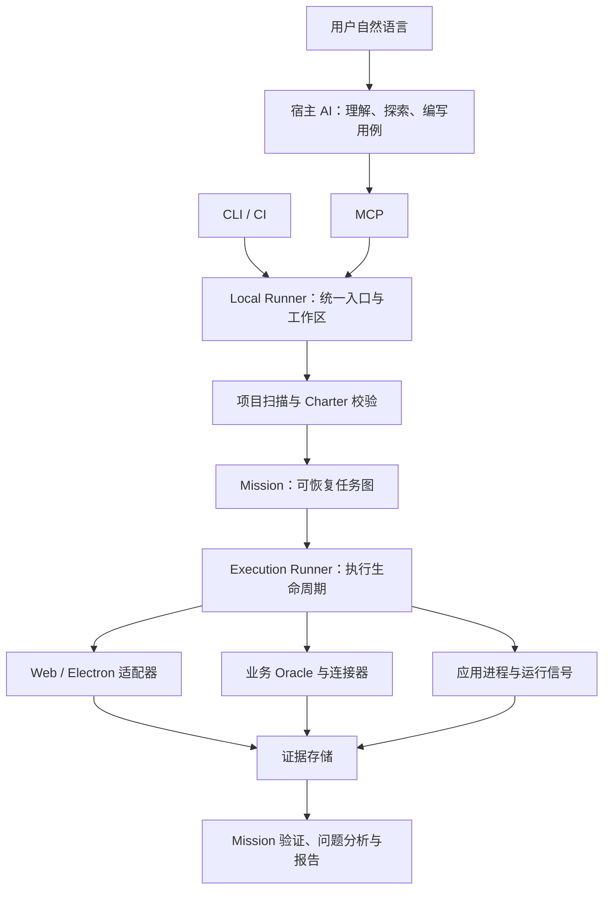

# ProofKit 架构概览

ProofKit 为 Codex、Claude Code 和支持 MCP 的 Harness 提供标准化测试工具。宿主 AI 理解用户需求、阅读代码和设计场景；ProofKit 执行受控测试、验证业务结果并保存证据。当前是本地工具，用户安装一个包，内部使用 12 个 TypeScript 模块，无需云服务或数据库。

## 模块与职责

| 层 | 内部包 | 职责 |
| --- | --- | --- |
| 接入 | `mcp`、`cli` | 给 AI、开发者和 CI 提供入口 |
| 统一编排 | `local-runner` | 项目绑定、运行注册、状态、取消、回放与结果比较 |
| 项目与规划 | `project`、`planner` | 有界源码地图、范围分析、目录用例选择、结构化计划校验 |
| 任务调度 | `agent` | 保存 Mission、调度任务图、超时、恢复与工具权限 |
| 执行 | `runner`、`adapters`、`runtime` | 执行步骤、控制页面、监听浏览器和应用进程、清理资源 |
| 业务验证 | `oracles` | 从独立接口或项目连接器读取业务事实，等待终态 |
| 证据与协议 | `evidence`、`contracts` | 截图、快照、事件、业务来源、报告及 Zod 类型协议 |

`Charter` 定义一个场景的动作、断言、业务检查和副作用策略；`Mission` 组织场景、平台与回放；`Run` 保存一次执行的事实和证据。内部 MissionAgent 目前按确定性任务图调度；自动探索和用例创作主要由宿主 AI 完成。可选兼容 OpenAI 的模型只生成经过校验的 Charter。

## 核心链路

1. 初次接入：绑定源项目和外部测试工作区，配置 Web 地址或 Electron CDP，并声明必要业务检查。
2. AI 先用 `inspect_test_scope` 看源码候选入口及现有场景，用 `inspect_surface` 看真实页面与定位线索。
3. `run_test` 复用目录用例，或接收 AI 提交的结构化 Charter；缺少必要断言或业务检查时报告缺口。
4. Mission 调度主运行、所需回放和显式负向场景；Runner 统一管理动作、观测、超时与清理。
5. 汇总业务事实和页面断言，输出结论、范围、首个失败位置、问题和证据链接；修复后用同范围回放比较。

例如简历获取：页面操作只证明动作已执行；业务检查还需确认获取、解析、候选人和岗位关联以及筛选终态。具体不变量由外部工作区连接器表达，可由 AI 编写，无需往被测应用加入 ProofKit 代码。

## 测试强度与验收范围

| 强度 | 执行要求 |
| --- | --- |
| `quick` | 最短路径、可观察断言及证据 |
| `core`（默认） | 页面断言、独立业务检查及来源证据 |
| `release` | 按声明场景执行 Web/Electron 矩阵、回放与全部已声明负向场景 |

验收范围另由 `coverage` 指定：`declared` 只验收保存的场景；`project` 要求全项目业务流程覆盖证明。静态地图截断会明确显示，完整的模块场景仍可执行。全项目覆盖证明尚未实现，即使已选场景全部通过，也不会给全项目通过结论。AI 必须保留用户请求的范围。

结果分为 `passed`、`failed`、`blocked`、`cancelled`、`inconclusive`。产品缺陷需有证据支持；登录、环境或覆盖缺口按实际原因报告。修复比较只确认原缺陷在相同测试范围内未再复现。

## 接入与技术栈

用户侧安装单个 `proofkit-ai` 包，提供 `proofkit` 和 `proofkit-mcp` 命令。源码开发采用 Node.js 22+、TypeScript、pnpm、Zod、Playwright Core 和 MCP SDK；计划使用 YAML，任务与证据使用本地 JSON/JSONL。npm tarball 已可独立安装，注册表发布尚未完成。

源项目供扫描和应用启动；配置、用例、连接器、Mission 和证据默认放外部工作区。Electron 地址和窗口筛选配置一次，后续自然语言测试复用。业务写入使用声明的测试环境、权限与清理机制。

## 当前边界与下一阶段

Web/Electron 已有真实隔离样例验证，包含跨端回放、注入缺陷、业务来源证据和结果比较。AIHR 已完成只读源码分析并有连接器参考，真实部署的简历业务验收仍待完成。移动端已有 W3C/Appium 适配器，真实设备尚未验收。

Mission 紧凑结果页汇总结论、验收范围、场景与各端执行、首个失败、证据和修复回放比较。MCP `get_mission_evidence` 返回 `summary` 与报告路径；CLI `mission report` 生成同一静态快照。报告保留缺失运行、覆盖缺口及负向测试的预期结果，证据缺失、越界或摘要不符时显示不可用。结论仍由原有验收门禁决定。

下一阶段重点是用真实业务完善项目知识与场景目录、测试数据隔离、业务终态观测、覆盖度量及 AI 规划评测。各阶段用可复现的验收结果推进，不把静态路由数量当业务覆盖率。
