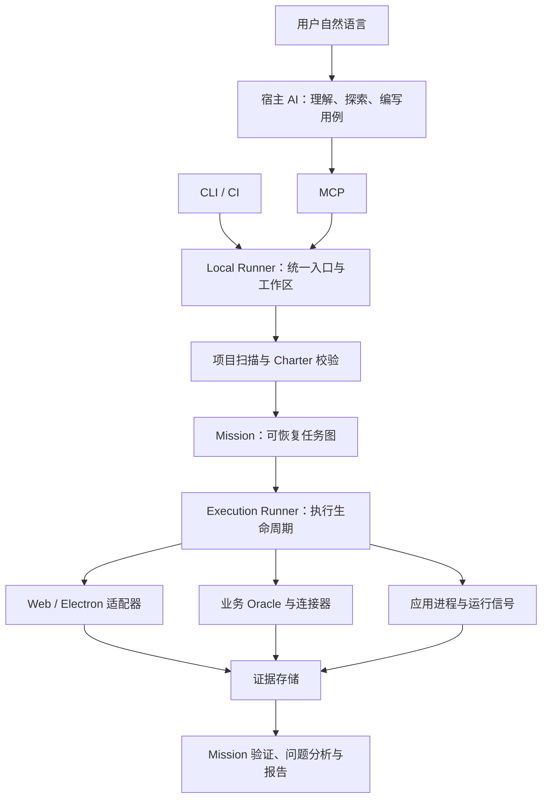

# ProofKit 架构概览

ProofKit 为 Codex、Claude Code 和支持 MCP 的 Harness 提供标准化测试工具。宿主 AI 理解用户需求、阅读代码和设计场景；ProofKit 执行受控测试、验证业务结果并保存证据。当前是本地工具，用户安装一个包，内部使用 12 个 TypeScript 模块，无需云服务或数据库。

## 模块与职责

| 层 | 内部包 | 职责 |
| --- | --- | --- |
| 接入 | `mcp`、`cli` | 给 AI、开发者和 CI 提供入口 |
| 统一编排 | `local-runner` | 项目绑定、运行注册、状态、取消、回放与结果比较 |
| 项目与规划 | `project`、`planner` | 有界源码地图、范围分析、目录用例选择、结构化计划校验 |
| 任务调度 | `agent` | 保存 Mission、调度任务图、超时、恢复与工具权限 |
| 执行 | `runner`、`adapters`、`runtime` | 执行步骤、控制页面、监听浏览器和应用进程、清理资源 |
| 业务验证 | `oracles` | 从独立接口或项目连接器读取业务事实，等待终态 |
| 证据与协议 | `evidence`、`contracts` | 截图、快照、事件、业务来源、报告及 Zod 类型协议 |

`Charter` 定义一个场景的动作、断言、业务检查和副作用策略；`Mission` 组织场景、平台与回放；`Run` 保存一次执行的事实和证据。内部 MissionAgent 目前按确定性任务图调度；自动探索和用例创作主要由宿主 AI 完成。可选兼容 OpenAI 的模型只生成经过校验的 Charter。

## 核心链路

1. 初次接入：绑定源项目和外部测试工作区，配置 Web 地址或 Electron CDP，并声明必要业务检查。
2. AI 先用 `inspect_test_scope` 看源码候选入口及现有场景，用 `inspect_test_environment` 检查已配置端点和源码关联，再用 `inspect_surface` 看真实页面与定位线索。
3. `run_test` 复用目录用例，或接收 AI 提交的结构化 Charter；缺少必要断言或业务检查时报告缺口。
4. Mission 调度主运行、所需回放和显式负向场景；Runner 统一管理动作、观测、超时与清理。宿主用 `await_test_result` 对同一 Mission 做有界等待，超时只返回仍在运行，不重新启动或取消测试。未就绪的 Mission 返回 `testVerdict: not-asserted`、缺口与安全的下一步，不把尚未执行误称为产品测试阻断。
5. 汇总业务事实和页面断言，输出结论、范围、首个失败位置、问题和证据链接；修复后用同范围回放比较。

连接器可通过 `setupPolicy` 声明写入权限、测试环境和清理时限，返回本次资源及清理句柄。Runner 登记资源后执行页面步骤，结束或取消时逆序清理；独立清理总时限为 100–5000 毫秒。清理验证要求删除后读取同一作用域，确认资源已不存在。资源残留、读取缺失、作用域错误或超时会阻止通过；Mission、上线测试和修复比较还会核对实际清理文件、Run 归属及 SHA-256。旧清理函数兼容为 `completed`，不会标为独立验证成功。连接器需自行处理返回句柄前的部分创建失败。

Runner 在执行页面步骤前原子保存资源登记日志。若进程退出导致已登记资源未清理，`inspect_run_resources` 会校验 Run、项目/工作区、连接器版本、事件来源和摘要后，才报告 `recoverable`；`recover_run_resources` 会先取得同一个 Run 租约，并要求操作者写权限、工作区 `policies.sideEffects: allow`、原连接器的显式版本以及 `recover` 钩子。恢复结果写入独立的 `.proofkit/recoveries/` 目录，不修改原 Run 的证据和产品 Verdict。活动或无法确认的占用者、路径重定向、篡改或缺失证据都会拒绝自动清理；事件来源校验最多读取日志前 16 MiB，每条最多 256 KiB，超出限制会拒绝恢复。可信 JavaScript 仍然是协作式的；钩子超时后租约会保留到钩子真正结束或进程退出。声明的版本用于匹配，不能代替代码签名；文件 flush 和原子替换也尚无断电可靠性证明。句柄返回前发生的部分创建仍由连接器自行回滚。

页面检查可在 Web/Electron 配置一次 `readyWhen: { text: "登录", timeoutMs: 5000 }`，也可通过 MCP/CLI 覆盖。它复用 Runner 的 `waitForText → observe` 步骤，在已有总截止时间内等待主页面的可见文字，再保存控件、截图和事件。返回 `readiness` 区分未要求、已观察和未验证；缺少条件不会返回成功快照，也不证明产品有缺陷。结果同时返回最多十条已有运行异常及省略数量，完整异常保留在 Run 证据中。观察到文字只证明这一时刻的条件，页面仍可能有运行异常；产品结论始终是 `not-asserted`。配置了可信连接器时，检查仍使用其 preflight/setup/cleanup 生命周期，隔离责任由连接器承担。

环境检查与页面检查都不产生产品通过结论。CLI `proofkit environment` 与 MCP 共用 Local Runner，在一个总截止时间内检查配置、HTTP/CDP 状态、最多八个后端健康端点及本地进程源码关联，保存带 SHA-256 的 JSON 快照；不启动应用、浏览器或调用连接器操作。HTTP 检查收到响应头即可结束，不跟随重定向，不保存响应正文、响应头、查询参数或原始网络错误；端点路径仍可见。结果明确列出未检查的登录、样本、连接器隔离门禁、业务终态与项目覆盖，不能把“端点可达”当作“功能已验收”。服务创建仍会加载可信连接器的注册代码。

例如简历获取：页面操作只证明动作已执行；业务检查还需确认获取、解析、候选人和岗位关联以及筛选终态。具体不变量由外部工作区连接器表达，可由 AI 编写，无需往被测应用加入 ProofKit 代码。

一次性 HTTP 业务检查读不到接口、超时、响应过大，或收到非预期的 401/403/429 时保持 `inconclusive`；这些情况不能证明产品业务缺陷。明确声明期望 401/403 的负向用例仍可通过。证据只保留响应状态与摘要或有限原因，不保存原始错误与响应正文。

一次性 HTTP 检查仅返回 200、但没有业务谓词时，只能证明接口可达，结果为 `inconclusive`；即使显式期望 200 也不能替代业务终态检查。CLI `--oracle-url` 与 MCP `start_run.oracleUrl` 属于这种观察入口。核心模块验收应使用带业务谓词的 Oracle、配置的终态 Oracle 或工作区连接器；显式期望 4xx/5xx 的负向状态检查仍可验证其声明的 HTTP 契约。新 Run 的 Oracle 结果用 `verificationKind` 区分 `business` 与 `http-contract`；后者的状态与摘要仍保留为证据，但不计入 Mission 的业务 Oracle、业务事实或修复证明，也不会单独确认业务产品缺陷。历史 Mission `verdict` 不会被改写；`proofClassification: unverified` 标出未分类的旧 Oracle 或读不到的 Run。已保存的核心/上线测试通过若缺少明确分类，或已保存的通过结果有损坏、缺失证据，高层 MCP 的 `testVerdict` 会给出 `inconclusive` 和原因，提示重新执行。
历史审计分别统计通过与失败的业务 Oracle 及 HTTP 契约检查；仅有“已分类”的状态不构成业务证明。核心/上线测试的当前通过至少需要一次已分类且通过的业务检查；当前确认产品缺陷至少需要一次已分类且失败的业务检查，并须核对该问题引用的证据。

文件上传使用 `setInputFiles`，引用外部工作区的 `.proofkit/fixtures/<file>`，一次可选择 1–10 个文件、总量不超过 20 MiB。Web/Electron 共用执行器，支持唯一的隐藏文件控件；场景与工作区都需允许副作用。上传动作只保存文件名、大小、SHA-256、MIME 等输入事实，业务成功仍需独立 Oracle。样本在上传步骤读取，因此前置页面动作可能已执行；页面回显也可能进入截图或快照，应使用脱敏样本。

回放按场景、平台和负向用例匹配原 Run 的文件事实。文件变化、缺失或未执行到文件校验，不能被当作“符合预期的阻塞”；修复比较缺少一致输入时为 `inconclusive`。更换样本应创建新 Mission。移动端暂不支持文件选择。

`captureResponse` 在点击或按键前安装监听，捕获动作窗口内同一主页面发起、与声明端点和方法匹配的唯一请求，并保存其响应中显式选择的业务 ID 等标量。独立 Oracle 使用这些 ID 查询本次对象，先核对返回身份，再等待业务终态；旧对象成功无法代替本次结果。重复请求、缺失响应、超时或字段无效均为 `inconclusive`。窗口关联只证明时间关系，业务因果仍需隔离测试与独立检查。

响应捕获与文件选择均要求允许副作用。捕获共享一个截止时间，超时或取消后不会因定位器迟到而开始新的点击；已发送的动作可能仍继续执行。捕获产物保存字段、正文大小和摘要，接受不超过 64 KiB 的 JSON；Playwright 会先取得完整正文，这不是硬内存上限。回放重新捕获本次 ID，可以与基线不同，样本事实仍需一致。移动端暂不支持响应捕获。

## 测试强度与验收范围

| 强度 | 执行要求 |
| --- | --- |
| `quick` | 最短路径、可观察断言及证据 |
| `core`（默认） | 页面断言、独立业务检查及来源证据 |
| `release` | 按声明场景执行 Web/Electron 矩阵、回放与全部已声明负向场景 |

验收范围另由 `coverage` 指定：`declared` 只验收保存的场景；`project` 要求全项目业务流程覆盖证明。静态地图截断会明确显示，完整的模块场景仍可执行。声明场景的执行覆盖现已可度量，但清单完整性证明尚未实现；即使已选场景全部通过，也不会给全项目通过结论。AI 必须保留用户请求的范围。

外部工作区可放 `.proofkit/workflows.yaml`：逐项声明业务流程、源码位置、Charter×目标平台，并绑定 `scope --source-state` 提供的 Git 指纹。`inspect_test_scope` 会报告文件缺失、源码变化、无效映射和明确排除项，并把有界源码地图中的入口与路由同清单交叉核对，列出未归属入口、没有关联 Charter 路由声明的候选路由、排除项重叠及静态扫描不完整的位置。清单新鲜且关联完整时，未指定单个 Charter 或套件的全项目请求会直接从清单生成 Mission：默认 `core` 只运行各平台主路径，`release` 还运行对应回放，显式负向场景在两个级别均执行。结果按冻结清单逐项核对页面断言、独立业务事实、清理和运行证据，显示已证明与缺失的检查。静态候选不等于业务流程全集；即使所有声明检查通过，清单的复核者身份和完整性仍未独立证明，`project` 通过门禁保持有效。

结果分为 `passed`、`failed`、`blocked`、`cancelled`、`inconclusive`。产品缺陷需有证据支持；登录、环境或覆盖缺口按实际原因报告。修复比较只确认原缺陷在相同测试范围内未再复现。

Runner 会在每条页面断言执行后立即保存页面快照，并尽力保存截图，把这些文件直接关联到该断言。断言观察文件均无法保存时，该次页面检查为 `inconclusive`；诊断器不会拿此前成功步骤的快照补作缺陷证据。截图或快照只记录断言附近的页面状态，仍需结合断言语义和业务 Oracle 判断影响。

有直接页面快照的断言失败会被记录为已观察到的场景不匹配，不能单独归类为“已确认产品缺陷”。鉴权失效、环境配置和用例预期也可能导致同一页面状态；报告先指向这些核对项。独立业务事实证明错误结果时，才确认业务产品问题。

连接器返回的 `sourceLocations` 是源码排查线索。Run 保留其原始声明；Mission 诊断只接纳本次所选源码根目录内真实存在的普通文件，拒绝绝对路径、父目录跳转、越界符号链接及缺失文件，并限制检查数量。文件存在不能证明根因，也不会提高失败边界的诊断置信度；修复建议保持“待定位、待回放”的状态。无效线索不会抹去已有独立业务证据支持的产品问题。

Mission 采集 Run 证据时，业务事实、断言快照等 artifact 必须同时存在于本次 Run、列在 Run 摘要中，并与 `artifact.created` 事件当时记录的字节数和 SHA-256 相符；引用保存该摘要。事件日志解析限制为 16 MiB、单条 256 KiB，单个证据文件校验限制为 64 MiB；缺失、越界、无效或内容改变的 artifact 不进入可确认的证据集合。修复比较再次核对摘要；旧 Mission 没有摘要的引用在结果页标为“完整性未验证”，不会用于确认修复。`run.json`、`report.html` 和 `events.jsonl` 的摘要在 Mission 采集时形成，不能证明采集前未被本地可信代码修改，也不能抵御能同时改写 Run 与 Mission 状态的恶意工作区操作者。

## 接入与技术栈

用户侧安装单个 `proofkit-ai` 包，提供 `proofkit` 和 `proofkit-mcp` 命令。源码开发采用 Node.js 22+、TypeScript、pnpm、Zod、Playwright Core 和 MCP SDK；计划使用 YAML，任务与证据使用本地 JSON/JSONL。npm tarball 已可独立安装，注册表发布尚未完成。

源项目供扫描和应用启动；配置、用例、连接器、Mission 和证据默认放外部工作区。Electron 地址和窗口筛选配置一次，后续自然语言测试复用。业务写入使用声明的测试环境、权限与清理机制。

`proofkit agent setup --harness codex|claude-code|generic` 生成便于宿主接入的配置与 `proofkit-test` Skill。配置采用当前安装的绝对 Node/MCP 路径，服务器名绑定源项目与外部工作区；可用 `--install-skill` 安装个人 Skill。Codex 默认 `~/.agents/skills`，Claude Code 默认 `~/.claude/skills`，generic 安装需显式指定宿主的 Skill 目录。接入产物使用内容摘要目录，重复生成复用，已有自定义 Skill 不覆盖。默认不加载连接器、不启动应用、不修改宿主 MCP 设置，返回未检查连接及 `not-asserted`；用户或宿主仍需注册配置并调用 `inspect_test_scope` 核对绑定。显式传入 `--register-host` 时，Codex/Claude Code 的 Skill 安装和本地 MCP 检查通过后，才调用宿主 CLI 注册；同名配置不覆盖，返回独立的注册状态。Skill 固化测试流程，实际模型执行质量仍需评测。

可选 `--check-connection` 会启动刚生成的本地 MCP 服务，检查高层工具与源码/工作区绑定，返回独立的 `localConnection` 结果；它会加载可信连接器的注册代码，但不创建 Mission 或 Run。宿主注册、Skill 发现、模型执行与产品测试仍保持未检查。

宿主链路有六个脚本驱动的合成 Web 基线及两个 Electron 基线；脚本调用不代表模型行为。新基线要求点击获取动作、捕获本次文件 ID，并核对独立 Oracle 对同一 ID 的读取来源；八个脚本案例已通过。真实 Codex 使用隐式 Skill 分别通过同样八个隔离案例：快速页面检查、核心通过、错误岗位关联、异步未完成、全项目覆盖缺口、内联 Charter 编写，以及 Electron 核心通过与缺陷。全项目案例没有执行产品 Run，返回 `not-asserted`。此前一轮八个真实宿主案例使用固定历史对象，不能作为本次动作因果的证据；这轮才验证了本次 ID。真实 AIHR 和 Claude Code 宿主验收仍未完成，隔离案例不能推算广泛项目的误报率。

另有两个可选 Electron/CDP 案例，通过同一原生 MCP 接口验证核心测试通过和业务关联缺陷；需设置 `PROOFKIT_ELECTRON_PATH`。评测器会核对用户指定的平台与 Mission、Run 页面快照，拒绝把 Web 执行冒充为 Electron 验收。

## 当前边界与下一阶段

Web/Electron 已有真实隔离样例验证，包含跨端回放、注入缺陷、业务来源证据和结果比较。AIHR 普通上传、在线采集和手动录入均有连接器参考；手动录入用本次响应的身份和文件摘要核对五个业务 reader，缺失身份、重试或合法版本改绑保持证据不足。真实部署的简历业务验收仍待完成。移动端已有 W3C/Appium 适配器，真实设备尚未验收。

Mission 紧凑结果页汇总结论、验收范围、场景与各端执行、首个失败、证据和修复回放比较。MCP `get_mission_evidence` 返回 `summary`、报告路径及当前 `evidenceIntegrity`：`intact`、`degraded`、`partial` 或 `no-evidence`，并列出已检查引用和可继续支持的可见产品问题数。它只覆盖有界展示结果；独立的 `acceptanceEvidenceIntegrity` 审计整个 Mission 保存的证据引用，最多检查 2048 条。结果页因展示上限为 `partial` 时，只要完整证据审计为 `intact`，仍可保留通过结论；完整审计损坏、缺失或超限则把历史通过降为 `inconclusive`。已保存的失败若声称确认产品缺陷，却缺少明确分类的业务证明或其引用证据已经失效，当前结论也降为 `inconclusive`；证据完好的普通测试失败仍为 `failed`。CLI `mission report` 生成同一静态快照；`summary.json`、MCP 和报告页面共用当前审计后的 `testVerdict`，同时保留历史 `verdict`。报告保留缺失运行、覆盖缺口及负向测试的预期结果，证据缺失、越界或摘要不符时显示不可用。完整证据审计不等于全项目覆盖证明；修复比较需要重新运行才能给出当前证明。

下一阶段重点是用真实业务完善项目知识与场景目录、测试数据隔离、业务终态观测、覆盖度量及 AI 规划评测。各阶段用可复现的验收结果推进，不把静态路由数量当业务覆盖率。
