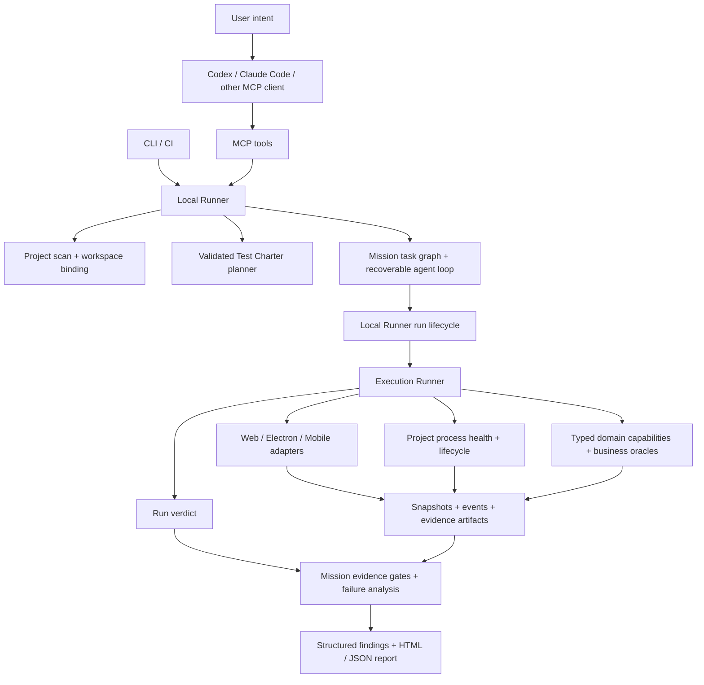

# ProofKit Architecture

## Product boundary

ProofKit is a local-first, evidence-driven system verification tool. It connects user intent to real Web/Electron execution, then connects the observed result to independent assertions and a reviewable report. CLI, MCP and CI all use the same `@proofkit/local-runner` lifecycle.

The first implementation supports Web and Electron. A mobile adapter now speaks the W3C WebDriver protocol used by Appium-compatible servers; device provisioning, hosted device management and protocol replay remain deployment concerns outside the local kernel.

## Current system shape



The host coding agent supplies the user-facing reasoning and can inspect source code using its own tools. ProofKit's internal Mission Agent currently schedules a deterministic task graph; it is not a general model-driven exploration loop. The optional model provider generates a schema-validated Charter. The run kernel owns surface verdicts; mission verification aggregates them and enforces level-specific evidence requirements.

The implementation uses Node.js 22+, TypeScript, a pnpm workspace, Zod contracts, Playwright Core, the MCP SDK, YAML Charters and local JSON/JSONL artifacts. The core requires no hosted service or database.

## Source and test workspace

`ProjectContext` separates `projectRoot` (the tested source and process working directory) from `workspaceRoot` (ProofKit configuration, connectors, plans, mission state and evidence). New projects default to `~/.proofkit/workspaces/<project-name>-<path-hash>/`; users can choose an explicit workspace through CLI `--workspace` or MCP `PROOFKIT_WORKSPACE_ROOT`. `PROOFKIT_WORKSPACE_HOME` selects the parent directory for automatic workspaces.

```text
<projectRoot>/                  # source scan and application startup
<workspaceRoot>/
  .proofkit/
    config.yaml                 # bound to the source project
    integration.mjs             # optional trusted business connector
    charters/
    missions/<mission-id>.json
    runs/<run-id>/
      run.json
      events.jsonl
      report.html
      artifacts/
```

Initialization writes to the test workspace. If an existing source project already contains `.proofkit`, the resolver retains that legacy layout unless an explicit workspace is supplied. Config, Mission and Run reads validate the project/workspace binding. Connector and Charter paths are constrained to the workspace, including resolved symlinks. This is an ownership boundary, not a sandbox for trusted connector JavaScript or application startup commands.

## Why these boundaries

- **CLI + Local Runner:** works without an Agent platform, cloud account, project code changes, or always-on service. CI can invoke the same deterministic command.
- **Playwright:** owns browser mechanics, waits, pages, frames, downloads and CDP. ProofKit does not rebuild those primitives.
- **Electron via CDP:** supports launching a test instance or attaching to an explicitly selected local instance. Loopback is required; an open remote debugging port is a powerful control surface.
- **MCP as an adapter:** an MCP server should call the same Runner methods as the CLI. It must not create a second execution lifecycle or expose arbitrary shell/database writes.
- **Local Runner as the control plane:** `@proofkit/local-runner` owns project configuration, adapter selection, run IDs, asynchronous status, replay and evidence lookup. It composes the lower-level Runner; it does not replace it.
- **Mission Agent as the intent control plane:** `@proofkit/agent` turns a natural-language objective into a persisted, reviewable task graph. It can only invoke registered MissionTools, and it delegates surface execution to the existing Local Runner and ExecutionRunner.
- **Capability extension:** domain operations can be exposed later through typed schemas with environment, side-effect and cleanup declarations.

## Package ownership

| Package | Owns | Must not own |
| --- | --- | --- |
| `contracts` | Zod schemas and shared event/result types | Process startup, browser state or report rendering |
| `project` | Manifest/config discovery and project map | Business test execution |
| `planner` | Intent scaffolding and charter parsing/validation | Unvalidated model-authored commands |
| `runner` | Run lifecycle, step orchestration and verdict reduction | Browser-specific APIs |
| `adapters` | Web/Electron/Mobile interaction and surface event collection | Business pass/fail policy |
| `runtime` | Local application process lifecycle, health checks and process events | Business pass/fail policy or arbitrary model-authored commands |
| `oracles` | Independent business assertions and bounded read-only HTTP observation | Surface interaction or model-only success claims |
| `evidence` | Run layout, timeline, redaction and report artifacts | Credentials or production data access |
| `agent` | Mission, plan, task graph, tool policy, durable state and agent loop | Browser control, shell execution or business-specific assertions |
| `local-runner` | CLI/MCP/CI shared orchestration, run registry, replay and bounded evidence lookup | New execution semantics or unrestricted project commands |
| `mcp` | Narrow Model Context Protocol facade over `local-runner` | Direct shell, filesystem, SQL, raw CDP or a second run lifecycle |
| `cli` | Human and CI commands | Separate runner state or direct adapter internals |

## Stable contracts

### Test Charter

A charter is a versionable execution plan with intent, preconditions, typed actions, assertions, named oracles, mode and side-effect policy. YAML is the human-editable encoding; Zod schemas are the runtime authority. The deterministic planner supports URL navigation and visible-text assertions. An opt-in OpenAI-compatible provider is connected to CLI and MCP through the same Local Runner. Its output is validated against action kind, registered oracle names, side-effect policy and approved navigation origin. Planning does not prove that free-form intent was understood correctly; the saved Charter remains reviewable.

The external workspace can register curated Charters by ID, explicit natural-language aliases, level and supported surfaces. The Local Runner selects a specific alias only when all other matches are its generic substrings; distinct workflow matches require `charterId`. Automatic matching applies only without ad-hoc planning options. A `release` entry must support its whole Web/Electron matrix. The runner validates the selected file's level, a surface assertion, required business Oracle names, registered capabilities and MCP origin policy before creating a Mission. The chosen `catalogId` is retained in Charter metadata. This catalog is an executable workflow contract, not an inference that every discovered route is tested.

A workspace can also declare a `release` suite with an ID, aliases, an explicit list of at least two Charter IDs, and a required surface matrix. Web/Electron suites must include both surfaces. Selection by `suiteId` or an unambiguous release alias snapshots those Charters and their reviewed `routeTargets` into one Mission; no directory scan silently adds workflows. Every Charter must support the whole matrix and pass its normal catalog validation before the suite is persisted. The saved suite, rather than later catalog edits, is the source for replay and interruption recovery.

### Project test map

`project.discover` returns a bounded, path-level inventory in addition to
package and surface detection. It counts source, test and configuration files,
identifies test framework signals, records conventional Web/Electron/backend
entry points, and extracts static route-shaped literals with source path and line
number. It skips dependency, build, VCS, ProofKit and agent metadata
directories, reads at most one megabyte per source file, and caps the scan at
4,000 files. Git projects use tracked and nonignored untracked files, excluding
tool metadata even when tracked; an independent source root inside a parent
repository's ignored directory falls back to its own filesystem walk. Other
projects use a priority-first bounded
filesystem walk. The inventory records this source and
the `truncated` flag; a partial map is
never treated as whole-project coverage. These hints guide the host agent and
planner toward candidate workflows while the source repository remains
unchanged. They are not proof that a route works or that a test is complete.

For an explicit release suite, each catalog Charter may declare static Web or API `routeTargets`, optionally qualified by the repository-relative source path. An API target additionally declares its HTTP method and exact gateway origin. The suite verifier reconciles declarations against the Project Map and reports candidate, mapped and observed counts. A Web candidate becomes observed only when a mapped Charter has passing primary and replay results on every required surface and each Run's snapshots or receipts contain a matching URL path. An API candidate needs matching method, origin and path in a 2xx browser response event for each required Run, plus the same independent business gate. The Run's `events.jsonl` is linked as network evidence. Mission coverage observations retain only matched declared route patterns and configured API origins; concrete path parameters, runtime queries and fragments are not copied into them. Duplicate route paths from different files remain unobserved when the runtime URL cannot identify the owning source. Missing, ambiguous, and unobserved mappings remain visible. Coverage gaps are informational rather than a new suite verdict gate; backend-only calls are outside browser traffic evidence. The inventory marks `truncated` when file, entry-point or route-hint caps are reached. This is a measured candidate-route slice, not an estimate of total product or statement coverage.

A `capability` action names a project-registered operation with schema-validated input and output. The Runner checks its environment allowlist, deadline and side-effect class. `write` requires both a Charter `allow` policy and a separate Runner `allowCapabilityWrites` opt-in, which defaults to false. Only the capability's evidence projection is persisted; a project integration must choose opaque IDs and sanitized facts. An optional `<workspaceRoot>/.proofkit/integration.mjs` supplies those capabilities, oracles and lifecycle hooks without adding test code to the application's business modules.

### Test Mission and Agent Loop

`TestMission` is the durable envelope for an AI-led test request. It records the user intent, selected surface, policy, generated `MissionPlan`, task graph, agent steps, tool calls, observations, evidence, findings, diagnosis and repair suggestions. The mission is saved at `<workspaceRoot>/.proofkit/missions/<mission-id>.json`, so a CLI or MCP client can disconnect and later inspect, cancel or replay the same work.

Mission updates are written to a unique temporary file in the same directory and then renamed over the current JSON file. On Windows, a bounded retry handles a reader briefly holding the destination open. Status polling therefore sees a complete prior or new revision rather than a partially written document.

The first planner is deterministic and creates explicit tasks for `project.discover`, one or more `surface.run-charter` executions, optional `surface.replay-charter` executions, explicitly declared `surface.run-negative-charter` executions, and `mission.verify`. `quick` and `core` use one selected surface. A single-Charter `release` uses its Web/Electron matrix. A suite expands each declared Charter across its configured surfaces into separate primary, replay, and negative-case tasks. Surface tasks and observations carry `charterId`; replay looks up only the matching Charter and surface. Suite tasks may continue after a product failure so the remaining workflows still produce results, while cancellation and unsafe recovery still stop execution. An LLM planner can be added behind the same `MissionPlanner` interface, but its output must still validate against `MissionPlanSchema`, `TaskNodeSchema` and the registered tool schemas. Model output never becomes a shell command, raw CDP call, SQL statement or arbitrary JavaScript execution.

The Agent loop is deliberately narrow:

1. Load the mission and select the next dependency-ready task.
2. Check environment, side-effect policy, input schema and tool timeout.
3. Execute one registered `MissionTool` with an abort signal.
4. Append typed observations, evidence, findings and a `ToolCall` receipt.
5. Persist a new revision before selecting the next task.
6. Reduce the terminal mission status and verdict without overwriting a failed or blocked result with `passed`.

`TaskGraphSchema` rejects duplicate IDs, unknown or duplicate dependencies, cycles, missing terminals, and branches that do not reach a declared terminal. It caps a graph at 10,000 tasks. A recovered Mission with unfinished tasks but no dependency-ready task is blocked with a graph-stall Finding and first-failure boundary; it cannot be reduced to `passed` merely because the scheduler found nothing to run. This validation is also applied to future model-authored plans before a Mission is persisted.

`MissionPolicy.timeoutMs` is the deadline for the complete Agent Loop,
including recovery, surface runs and final verification. When it expires, the
active ToolCall and AgentStep are closed with a cancellation receipt, the
Mission is stored as `cancelled`, and an environment Finding titled `Mission
timed out` keeps the reason reviewable. The lower-level `run.timeoutMs`
remains the deadline for one surface Run; both deadlines are retained so a
slow business workflow cannot keep an AI client waiting indefinitely.

Mission cancellation and deadlines propagate through primary, replay and
negative-case tools to the Local Runner's Run signal. Business observers and
capabilities receive that signal; local startup health probes also abort.
Surface tools allow a bounded 10-second cancellation grace period for adapter
and integration cleanup and final Run evidence. When the tool settles, the
cancelled Mission retains its Run observation, report and ToolCall/AgentStep
evidence links. If it does not settle within that period, the Mission records
`Tool cleanup did not finish` and explicitly reports that resources may still
be active. The grace period is additional to the execution deadline and is
not a guarantee that uncooperative trusted integration code has stopped.

The Run kernel also waits up to five seconds for setup, adapter connection or
event subscription that was already in progress when cancellation arrived.
If acquisition settles within that window, normal cleanup completes before the
Run report is finalized. If it does not, the cancelled Run records that
resources may still be active; a cleanup handle returned later triggers a
best-effort asynchronous release. The report does not claim that late cleanup
has finished.

Every task is persisted as `running` before its tool starts and receives a `started` ToolCall with an attempt number. If the local process is restarted, the Agent Loop closes stale started receipts and resumes only side-effect-free or read-only tasks whose `maxAttempts` has not been reached. A task that may write data, has exhausted its attempts, or no longer has a registered tool is marked `blocked` and requires review; ProofKit never blindly replays an interrupted write.

`surface.run-charter` and `surface.replay-charter` call `LocalRunnerService.start()`, `wait()` and `replay()`, which in turn reuse the existing `ExecutionRunner`; the Agent does not create a second browser or Electron engine. Primary and replay observations include the surface and source run ID, so the verifier can distinguish a real cross-surface matrix from duplicate evidence. This keeps natural-language use and deterministic CLI/CI use on one lifecycle and one evidence format.

Mission status describes orchestration (`awaiting-approval`, `running`, `completed`, `failed`, `blocked`, or `cancelled`). The nested Run verdict describes the actual surface execution. A mission can therefore explain that a test was blocked by policy even when no product run was attempted.

The high-level MCP tools are `create_test_mission`, `approve_test_plan`, `start_mission`, `get_mission_status`, `get_mission_evidence`, `cancel_mission` and `replay_mission`. The equivalent CLI is `proofkit mission create|approve|run|status|evidence|replay`. Existing run-level tools remain available for users who already have a charter.

### Mission audit records

The mission protocol keeps five related records with separate responsibilities:

| Record | Meaning | Typical contents |
| --- | --- | --- |
| `AgentStep` | The agent's decision and control-loop lifecycle | selected task, decision, phase, status, linked tool/observation/evidence IDs |
| `ToolCall` | The concrete registered tool invocation | tool name, validated input, attempt, execution status, timing and error |
| `Observation` | A typed fact observed during planning or execution | project map, surface run summary, business state or runtime event |
| `Evidence` | A reviewable artifact or reference | snapshot, screenshot, report, business response or event log |
| `Finding` | A classified outcome that needs attention | severity, category, confidence status and linked evidence |

`AgentStep` is the control-plane audit record; it is not a replacement for `ToolCall`. The full mission file keeps the original task input/output for local recovery. `get_mission_evidence` exposes a bounded AgentStep summary containing the decision, lifecycle, links and evidence references, while omitting potentially large input/output payloads. This gives an AI client enough context to explain what it did without turning the evidence endpoint into an unbounded transcript.

### Local Runner and MCP

`@proofkit/local-runner` is the only application-level entry point for starting a run. It resolves a charter, selects a Web or Electron adapter, optionally starts the project, loads the workspace's `.proofkit/integration.mjs` module, accepts registered business oracles/capabilities, and stores the result under the configured evidence directory. A run is addressable by its `runId`, so an interactive client can start, cancel and poll status without holding an open browser tool call.

The integration module is trusted local code, loaded only from inside the selected test workspace. It exports a name, optional typed capabilities, business oracles, an optional preflight function and a setup function that returns cleanup. Preflight runs after the run record is created but before project setup, browser connection or any capability. It returns a schema-validated pass/fail result and sanitized scalar evidence; a failed preflight produces a `blocked` verdict and a `preflight.json` artifact. The Local Runner composes integration cleanup with project process cleanup and adapter close. Cleanup failures prevent a green verdict.

Project configuration can register read-only HTTP oracles by name, JSON Pointer status path, terminal values, interval and deadline. Query bindings can carry the ProofKit `runId` or a sanitized scalar from an earlier capability step. The adapter never interprets these business facts. The URL is parsed and query parameters are encoded with the platform URL API.

The MCP server exposes both run-level tools (`discover_project`, `plan_test`, `start_run`, `get_run_status`, `cancel_run`, `get_evidence`, `replay_run`) and mission-level tools (`create_test_mission`, `approve_test_plan`, `start_mission`, `get_mission_status`, `get_mission_evidence`, `cancel_mission`, `replay_mission`). MCP inputs are validated with Zod. The server is started against one configured local project; it does not accept arbitrary commands or paths. MCP runs cannot execute `project.start`; users start their test environment through the CLI or independently. Both surfaces call the same Local Runner and never create a second execution lifecycle.

`list_test_charters` exposes curated IDs and aliases. High-level `run_test` selects one when possible and refuses to auto-start an incomplete Charter; its response names missing structural assertions or Oracles. Test-environment capability writes remain disabled in MCP unless the server operator starts it with `PROOFKIT_ALLOW_CAPABILITY_WRITES=1`; this process-level switch still requires an allow-policy Charter, allow-policy workspace and typed registered capability.

### Surface Adapter

An adapter exposes `connect`, `discover`, `snapshot`, `act`, `assert`, `capture`, `subscribeEvents` and `close`. Browser and driver locator details stay inside the adapter. Web and Electron use Playwright; mobile uses a W3C WebDriver/Appium session with `accessibility=`, `id=`, `xpath=`, `class=` and `css=` selector prefixes. The runner receives typed receipts and snapshots, so business Charters, Oracles and Evidence remain unchanged across surfaces. Mobile driver events are currently represented through snapshots and action receipts; device logs and video are future evidence sources.

### Evidence

Each run gets a unique directory with:

```text
<run-id>/
  run.json
  events.jsonl
  report.html
  artifacts/
    step-001-before.json
    step-001-after.json
    step-001.png
```

Mission state is separate from run artifacts under the selected workspace:

```text
.proofkit/
  missions/<mission-id>.json
  runs/<run-id>/run.json
```

The mission references run evidence through typed `EvidenceRef` records. A mission file is orchestration state and can be replayed; a run directory is immutable execution evidence and remains the source of truth for what the surface actually did. Agent decisions and tool receipts remain auditable in the mission, while screenshots, snapshots, reports and runtime events remain in the run evidence directory.

Every event has a run ID and timestamp. Each step stores before/after snapshots and the action receipt. Screenshot capture is best-effort with a bounded adapter timeout; an offscreen or unavailable renderer is recorded as a finding and cannot silently turn into a business failure or hold the run for the browser's default long timeout.

An Oracle result is validated against its registered name and schema. `sourceEvidenceCount` records how many nonempty evidence items the Oracle supplied before the Runner writes its own result file. That result file is an audit record, not an independent business fact: an Oracle with no source evidence cannot satisfy a `core` or `release` business gate or confirm a product defect. The project-owned Oracle remains responsible for supplying sanitized, trustworthy facts from the tested system.

## Verdict model

- `passed`: all declared assertions pass.
- `failed`: an action or assertion fails with a concrete finding.
- `blocked`: a declared human/permission/environment gate prevents safe continuation.
- `cancelled`: the user cancelled the run or the total run deadline expired; evidence is retained.
- `inconclusive`: no business oracle was declared, or a bounded observer never saw a terminal state.

`queued` and `running` are transport statuses used by Local Runner; they are not verdicts. A verdict is emitted only after the run has completed or been cancelled or blocked.

An action receipt means an operation was dispatched. It does not mean the product workflow succeeded. Visual/LLM interpretation cannot be the sole pass oracle for critical business behavior.

## Test levels

Every natural-language request is resolved to one immutable `TestLevelSelection` and copied into the Charter, Mission policy, Mission plan and final result. The precedence is explicit `level` input, then recognizable intent keywords, then the default `core` level. A client can therefore see whether `core` was requested, inferred, or selected as the safe default.

| Level | Intended use | Required gate |
| --- | --- | --- |
| `quick` | Fast health check and shortest happy path | At least one executable assertion and traceable run evidence |
| `core` | Default for feature work and the important module path | Assertions, an independent business Oracle, and traceable evidence |
| `release` | Pre-release regression and cross-surface confidence | Core gates plus terminal evidence, replay inputs and the configured Web/Electron matrix; every explicitly declared negative or recovery case must run on every required surface |

The current Mission verifier enforces a passed surface assertion for each primary run, and for every required release replay. Each `core` or `release` primary/replay run must also have a passed business Oracle with source evidence. A negative case cannot supply missing proof for the main path. The lower-level Execution Runner evaluates the assertions and oracles declared by its Charter; it does not independently enforce Mission-level coverage obligations. `release` expands its surface matrix and replay requirement into separate task graph nodes and marks verification incomplete when a surface or replay run is missing. A Charter may explicitly declare negative or recovery cases; ProofKit creates an isolated task for each case, preserves its `negativeCaseId` in observations and evidence, and marks verification incomplete when any declared case is missing. A case can also declare an `expectedVerdict` such as `failed` or `blocked`; the raw surface verdict remains in evidence while the Mission evaluates whether the expected outcome matched. ProofKit never invents destructive actions from a category label. A missing gate produces `inconclusive` with a first failure boundary of `evidence`, never a false `passed` verdict.

A `release` Mission can exercise one Charter or an explicitly declared multi-Charter suite. The suite verifier checks each `charterId × surface × run kind` independently: primary and replay each need a passed assertion, a passed business Oracle, an independent source fact, and traceable evidence; a replay must point to that exact primary run. A declared negative case needs its own matching outcome and evidence. `get_mission_evidence` returns one compact result per Charter and surface, registered release Charters outside the suite, and bounded candidate-route coverage with unresolved declarations. These are configured-catalog and static-map coverage gaps, not a claim that every route or workflow in the source project has been discovered. A partial project map remains partial.

## First vertical slice

1. Scan the project and identify Web/Electron entry points, scripts and health URLs.
2. Convert intent into a reviewable charter and save it before execution.
3. Start or attach the selected local surface; profile isolation for attached sessions is a future capability.
4. Execute bounded actions with observable waits and action receipts.
5. Observe UI state and browser events while the backend workflow runs.
6. Assert the final business state using explicit APIs, logs, file metadata, worker state or read-only queries supplied by a project integration.
7. Save the evidence timeline, concise verdict, first failure and replay inputs.

For an AI client, the normal interaction is a single MCP call such as `run_test({ intent: "测试简历获取", level: "core", surface: "electron" })`. The tool returns a `missionId`; the client polls `get_mission_status`, then reads `get_mission_evidence`. The client does not need to remember CDP instructions, browser tool names, evidence paths or cleanup rules. Those remain inside the shared Local Runner.

The first real business sample is ordinary resume acquisition: collection run -> PDF upload -> text extraction -> candidate identification -> position binding -> screening terminal state. The default AIHR connector is `.proofkit/integration.mjs`, with `.proofkit/charters/aihr-resume-upload.yml` as the core path and the online intake Charter retained for compatibility. The checked-in Web and Electron smoke uses a loopback gateway fixture and verifies both a passing terminal state and a seeded stale-binding defect with a linked Oracle artifact. Its registered fixture Charter also runs through the real MCP `run_test` -> `get_mission_status` -> `get_mission_evidence` path from the one-sentence intent “测试简历获取”; the default `core` level and catalog selection are asserted. The UI adapter supplies interaction; project-specific read-only oracles supply business truth. No generic scanner can infer those invariants reliably without project knowledge.

The checked-in ordinary-upload Charter is currently a connector-level reference with no surface assertion. The smoke test saves a fixture-specific UI assertion in its external workspace before registering a core catalog entry. This verifies the MCP and adapter path against the fixture, not a live AIHR deployment. Before the reference Charter can be registered for one-sentence live AIHR testing, it needs a real Web/Electron assertion and isolated deployment verification; the catalog validator deliberately rejects it as-is.

## Research and reuse

- [ego-lite](https://github.com/citrolabs/ego-lite): learn from isolated TaskSpaces, semantic snapshots, action receipts, explicit page lifecycle, event buffers, downloads and user hand-off. It is a browser runtime/agent interface, not a full system test orchestrator. ProofKit keeps those concepts behind its adapter and run contracts.
- [Playwright](https://github.com/microsoft/playwright): use as the Web/Electron mechanics layer; retain its locator, wait, trace and CDP strengths rather than maintaining a fork.
- [Playwright MCP](https://github.com/microsoft/playwright-mcp): treat persistent tool context and MCP discoverability as an optional front end to the same Runner.
- [Midscene](https://github.com/web-infra-dev/midscene): study natural-language assertions, task descriptions and reusable nodes; keep model actions optional and validate all outputs against the charter schema.
- [Maestro](https://github.com/mobile-dev-inc/Maestro) and [Appium](https://github.com/appium/appium): future mobile engines behind Surface Adapter.
- [Keploy](https://github.com/keploy/keploy): future protocol capture/replay for deterministic backend fixtures, not the cross-surface control plane.

We use these as compatible components or design references. We do not copy their code into ProofKit; third-party dependencies stay versioned packages with their upstream licenses.

## Extension rules

- Add an adapter when the surface has a distinct control protocol; keep the same Run, Step and evidence contracts.
- Add an Oracle when a product invariant needs an authoritative source; every oracle declares source, query scope, environment and evidence output.
- Add a Capability only for stable domain operations that cannot be expressed as safe UI actions. Every capability has a schema, side-effect classification, environment allowlist, timeout and cleanup behavior.
- Add an LLM provider only behind a provider interface and validated structured output. Model output cannot directly run shell, SQL, or arbitrary JavaScript.
- Add persistent database indexes only after filesystem run artifacts show a clear query or concurrency need.

## Delivery sequence

1. **Current:** Web/Electron adapters, project runtime, read-only HTTP oracle, evidence hashes, shared Local Runner, bounded MCP facade, validated Planner Provider interface, project integration loading, run deadline and cancellation, the persisted Mission Agent loop, the release Web/Electron primary-plus-replay task matrix, and explicit negative/recovery case execution with evidence gates.
2. **Next:** measure generated Charters and Missions against real projects, implement scoped test data, and add worker/file/candidate/billing observers. Negative and recovery cases still require explicit Charter declarations; ProofKit does not infer destructive actions from generic categories.
3. **Later:** retry/idempotency classification, isolated browser profiles, first-failure diagnosis and evidence-backed repair suggestions.
4. **After the Web/Electron slice is stable:** verify the existing Appium-compatible mobile adapter on a real emulator, evaluate Maestro as an additional mobile engine, and add Keploy-style traffic fixtures for deterministic backend replay.

Mobile and hosted device orchestration stay outside the first install. They can implement the same Surface Adapter and Evidence contracts without changing Test Charter or verdict semantics.

## Security boundaries

- Default to local-only endpoints and test environments.
- Attach to CDP only on loopback or a user-provided secure tunnel.
- The MCP facade permits Web URLs only on loopback or the configured Web origin, permits HTTP business oracles and CDP endpoints only on loopback, and refuses configured project shell startup.
- Do not persist browser profiles, cookies, raw resume documents or authorization headers in evidence.
- Structured evidence redacts sensitive key names. Integrations must also sanitize values embedded in text and binary payloads.
- No arbitrary command, file, or database mutation capability is exposed by the initial CLI/MCP interface.
