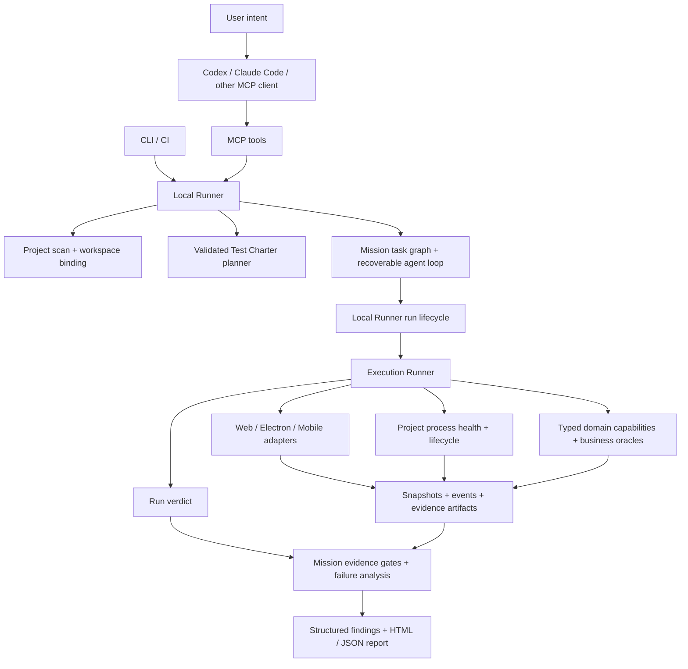

# ProofKit Architecture

## Product boundary

ProofKit is a local-first, evidence-driven system verification tool. It connects user intent to real Web/Electron execution, then connects the observed result to independent assertions and a reviewable report. CLI, MCP and CI all use the same `@proofkit/local-runner` lifecycle.

The first implementation supports Web and Electron. A mobile adapter now speaks the W3C WebDriver protocol used by Appium-compatible servers; device provisioning, hosted device management and protocol replay remain deployment concerns outside the local kernel.

## Current system shape



The host coding agent supplies the user-facing reasoning and can inspect source code using its own tools. ProofKit's internal Mission Agent currently schedules a deterministic task graph; it is not a general model-driven exploration loop. The optional model provider generates a schema-validated Charter. The run kernel owns surface verdicts; mission verification aggregates them and enforces level-specific evidence requirements.

The implementation uses Node.js 22+, TypeScript, a pnpm workspace, Zod contracts, Playwright Core, the MCP SDK, YAML Charters and local JSON/JSONL artifacts. The core requires no hosted service or database. A `text-not-visible` assertion can reject a known error state; it cannot be the only surface assertion in an automatically accepted Mission, because absence alone does not prove that the intended page loaded. Web visibility is checked on rendered matches. The mobile adapter conservatively checks full driver source for this assertion until device-backed visibility semantics are validated.

The Runner saves a page snapshot immediately after each surface assertion and attempts a screenshot. Only these Runner-created observation files are attached to that assertion; an earlier successful step artifact cannot confirm a later failure. If neither observation can be saved, the surface result is inconclusive and failure analysis leaves the assertion unverified. Direct observation confirms a Charter/UI mismatch, but the resulting Finding has unknown cause rather than confirmed product attribution. Authentication, environment setup and the Charter expectation must be checked before proposing a product repair; independent business facts can establish a confirmed business defect.

The public installation boundary is a single `proofkit-ai` npm tarball with `proofkit` and `proofkit-mcp` commands. Its build bundles the internal workspace modules, keeps third-party runtime dependencies explicit, and includes only the two entrypoints, README and license. A distribution smoke installs that tarball outside the repository and exercises both CLI and MCP. The internal `@proofkit/*` package names are not the user installation contract; npm registry publication has not occurred.

The CLI's `agent setup` composes the existing project initializer with embedded
portable Skill templates and native Codex TOML/Claude-compatible JSON exports.
Plain setup does not instantiate Local Runner, import connectors or execute host
registration. Explicit `--register-host` first checks the generated local MCP
connection, then invokes the Codex or Claude Code CLI without a shell. It
checks the reported launcher and binding after registration; an existing name
is left for manual review. All bundle artifacts are published in an external workspace;
optional personal Skill installation refuses conflicting or redirected trees.
Source/workspace identity determines the server name; launcher/config/Skill
content determines the immutable bundle directory. Structured registration
argv avoids introducing shell evaluation. Export and installation status are
separate from actual MCP connection and product acceptance. Installed-package
smoke launches the MCP server using the generated native JSON configuration.
Host Skill discovery and model adherence still require host-level evaluation.

## Source and test workspace

`ProjectContext` separates `projectRoot` (the tested source and process working directory) from `workspaceRoot` (ProofKit configuration, connectors, plans, mission state and evidence). New projects default to `~/.proofkit/workspaces/<project-name>-<path-hash>/`; users can choose an explicit workspace through CLI `--workspace` or MCP `PROOFKIT_WORKSPACE_ROOT`. `PROOFKIT_WORKSPACE_HOME` selects the parent directory for automatic workspaces.

```text
<projectRoot>/                  # source scan and application startup
<workspaceRoot>/
  .proofkit/
    config.yaml                 # bound to the source project
    integration.mjs             # optional trusted business connector
    charters/
    fixtures/                   # explicitly prepared file-input fixtures
    inspections/<inspection-id>.json # endpoint observations; no product verdict
    missions/<mission-id>.json
    recoveries/<run-id>/<attempt-id>/ # separate cleanup proof after owner exit
    runs/<run-id>/
      run.json
      events.jsonl
      report.html
      artifacts/
```

Initialization writes to the test workspace. If an existing source project already contains `.proofkit`, the resolver retains that legacy layout unless an explicit workspace is supplied. Config, Mission and Run reads validate the project/workspace binding. Connector and Charter paths are constrained to the workspace, including resolved symlinks. This is an ownership boundary, not a sandbox for trusted connector JavaScript or application startup commands.

### Project workflow inventory

An optional `<workspaceRoot>/.proofkit/workflows.yaml` is a versioned, bounded declaration of business workflows. It remains outside the tested source. Each workflow names owning source paths, explicit Charter × surface checks and required Web/Electron/mobile surfaces; `charterIds` is a shorthand requiring every listed Charter on every workflow surface. Exclusions carry an explicit reason. The file also records the Git HEAD and bounded worktree SHA-256 returned by `proofkit scope --source-state` or MCP `inspect_test_scope({ includeSourceState: true })`. A review declaration records who assessed the list and how, but ProofKit cannot authenticate that identity or infer completeness from it.

The read-only scope inspection reports missing or invalid files, source changes, unavailable fingerprints, stale source paths, missing Charter IDs, incomplete surface links and exclusions. A whole-project Mission freezes the parsed declaration and its inspection in its saved state. Each workflow may bind specific Charters to specific surfaces; the older `charterIds` shorthand requires every listed Charter on every workflow surface. When the source fingerprint matches and every declared check has a registered Charter at the requested level, a whole-project request without an explicit Charter or suite generates a Mission graph directly from the inventory. `core` schedules each declared primary pair and explicit negative cases; `release` adds replay for the same pairs. The saved matrix never expands a platform-specific Charter to another surface. The Mission result measures each frozen Charter × surface check against the scheduled tasks, saved Runs, independent business source facts and cleanup proof. It reports evidenced checks and workflows, missing slots and source binding at both Mission endpoints. A ready project Mission may execute through MCP while acceptance-only coverage gaps remain, and the response lists those gaps separately from execution blockers. An explicitly selected catalog suite retains its existing reviewed scope.

The same inspection cross-checks the bounded project map against workflow `sourcePaths`, exclusions and route targets of included Charters. `candidateAudit` counts route and entry-point candidates, unclaimed sources, owned routes without a linked Charter declaration, and sources claimed by both a workflow and an exclusion; at most 20 gaps are returned with omitted counts. Truncation, focused scans, unresolved Gin declarations and unusable source paths mark this review partial. A matched source directory is only an ownership hint. Route-shaped literals may be incidental and dynamic registrations may be absent, so candidate review neither proves completeness nor changes the product verdict. The audit is frozen with a whole-project Mission for later comparison and shown in the compact report.

A valid file, matching fingerprint, or even `all-declared-evidenced` execution is **not** proof that the inventory contains every product workflow or that its reviewer identity is authentic. `project-workflow-coverage` therefore remains an acceptance gate. Static route counts cannot discharge it. The next gate needs a defensible completeness review of source and product flows, stable source and target association, and a policy for explicit exclusions before a whole-project pass can be issued.

```yaml
schemaVersion: 1
source:
  headSha: <scope.sourceState.headSha>
  worktreeSha256: <scope.sourceState.worktreeSha256>
review:
  by: "team reviewer"
  at: "2026-10-10T08:00:00Z"
  method: "Reviewed business entry points and lifecycle ownership"
workflows:
  - id: resume-acquisition
    title: Resume acquisition and candidate binding
    sourcePaths: [services/resume-service, apps/micro-resume]
    checks:
      - charterId: resume-acquisition-release
        surfaces: [web, electron]
    surfaces: [web, electron]
exclusions: []
```

Catalog release suites still require each included Charter to support their complete suite surface matrix. Inventory-driven Missions support one or more Charter/platform pairs per workflow; the same Charter can be reused by multiple workflows without duplicating the Run. A missing or stale inventory, unsupported Charter level, or invalid mapping cannot silently become a whole-project pass. `quick` whole-project graph generation and authenticated inventory completeness review remain open.

For a loopback Web or Electron HTTP target on Windows, the local runner also inspects the listening process before preflight, setup or surface connection, then checks again after a configured project startup. It derives a Git checkout from the process's executable or script path without saving its command line. A different checkout is `blocked` by default (`policies.targetBinding: block-different`); `record` retains the mismatch for a deliberately cross-checkout diagnostic. A matching process path is recorded as an association, not proof of which bytes the server delivered. Missing ports, ambiguous process paths, non-Git roots, remote URLs and unsupported platforms remain `unverified` and are visible in Run and Mission evidence. Each check is a point-in-time observation; release-grade source attestation and continuous process-change detection remain future work.

## Why these boundaries

- **CLI + Local Runner:** works without an Agent platform, cloud account, project code changes, or always-on service. CI can invoke the same deterministic command.
- **Playwright:** owns browser mechanics, waits, pages, frames, downloads and CDP. ProofKit does not rebuild those primitives.
- **Electron via CDP:** supports launching a test instance or attaching to an explicitly selected local instance. Loopback is required; an open remote debugging port is a powerful control surface.
- **MCP as an adapter:** an MCP server should call the same Runner methods as the CLI. It must not create a second execution lifecycle or expose arbitrary shell/database writes.
- **Local Runner as the control plane:** `@proofkit/local-runner` owns project configuration, adapter selection, run IDs, asynchronous status, replay and evidence lookup. It composes the lower-level Runner; it does not replace it.
- **Mission Agent as the intent control plane:** `@proofkit/agent` turns a natural-language objective into a persisted, reviewable task graph. It can only invoke registered MissionTools, and it delegates surface execution to the existing Local Runner and ExecutionRunner.
- **Capability extension:** domain operations can be exposed later through typed schemas with environment, side-effect and cleanup declarations.

## Package ownership

| Package | Owns | Must not own |
| --- | --- | --- |
| `contracts` | Zod schemas and shared event/result types | Process startup, browser state or report rendering |
| `project` | Manifest/config discovery and project map | Business test execution |
| `planner` | Intent scaffolding and charter parsing/validation | Unvalidated model-authored commands |
| `runner` | Run lifecycle, step orchestration and verdict reduction | Browser-specific APIs |
| `adapters` | Web/Electron/Mobile interaction and surface event collection | Business pass/fail policy |
| `runtime` | Local application process lifecycle, health checks and process events | Business pass/fail policy or arbitrary model-authored commands |
| `oracles` | Independent business assertions and bounded read-only HTTP observation | Surface interaction or model-only success claims |
| `evidence` | Run layout, timeline, redaction and report artifacts | Credentials or production data access |
| `agent` | Mission, plan, task graph, tool policy, durable state and agent loop | Browser control, shell execution or business-specific assertions |
| `local-runner` | CLI/MCP/CI shared orchestration, run registry, replay and bounded evidence lookup | New execution semantics or unrestricted project commands |
| `mcp` | Narrow Model Context Protocol facade over `local-runner` | Direct shell, filesystem, SQL, raw CDP or a second run lifecycle |
| `cli` | Human and CI commands | Separate runner state or direct adapter internals |

## Stable contracts

### Test Charter

A charter is a versionable execution plan with intent, preconditions, typed actions, assertions, named oracles, mode and side-effect policy. YAML is the human-editable encoding; Zod schemas are the runtime authority. The deterministic planner supports URL navigation and visible-text assertions. An opt-in OpenAI-compatible provider is connected to CLI and MCP through the same Local Runner. Its output is validated against action kind, registered oracle names, side-effect policy and approved navigation origin. Planning does not prove that free-form intent was understood correctly; the saved Charter remains reviewable.

Newly generated Charters also record `PlanningQuality`: source (`catalog`, `deterministic`, `model` or `submitted`), a heuristic confidence score, assumptions, missing inputs, execution evidence-gap codes and a coverage assessment. This score describes plan readiness, not test success and not a calibrated probability. ProofKit recomputes missing assertions, required business Oracles, missing generated-release negative cases and the requested acceptance scope from validated inputs; a model's self-reported confidence or gap claims do not decide the verdict. The deterministic Local Runner scans the Project Map before calculating this quality. An agent-submitted inline MCP Charter is marked `submitted` and reassessed against the host's original intent before Mission persistence. Mission planning retains model or catalog provenance instead of relabeling every Charter deterministic. Older saved Charters and Mission plans without the field remain readable. MCP returns the planning quality and holds automatic execution when a new plan has a known execution evidence gap; if execution is started explicitly, both single-Charter and release-suite Mission verification return `inconclusive` rather than `passed` while that gap remains. Runtime evidence and business Oracle facts are evaluated separately.

The external workspace can register curated Charters by ID, explicit natural-language aliases, level and supported surfaces. The Local Runner selects a specific alias only when all other matches are its generic substrings; distinct workflow matches require `charterId`. Automatic matching applies only without ad-hoc planning options. A `release` entry must support its whole Web/Electron matrix. The runner validates the selected file's level, a surface assertion, required business Oracle names, registered capabilities and MCP origin policy before creating a Mission. The chosen `catalogId` is retained in Charter metadata. This catalog is an executable workflow contract, not an inference that every discovered route is tested.

A workspace can also declare a `release` suite with an ID, aliases, an explicit list of at least two Charter IDs, and a required surface matrix. Web/Electron suites must include both surfaces. Selection by `suiteId` or an unambiguous release alias snapshots those Charters and their reviewed `routeTargets` into one Mission; no directory scan silently adds workflows. Every Charter must support the whole matrix and pass its normal catalog validation before the suite is persisted. The saved suite, rather than later catalog edits, is the source for replay and interruption recovery.

### Project test map

`project.discover` returns a bounded, path-level inventory in addition to
package and surface detection. It counts source, test and configuration files,
identifies test framework signals, records conventional Web/Electron/backend
entry points, and extracts static route-shaped literals with source path and line
number. It skips dependency, build, VCS, ProofKit and agent metadata
directories, reads at most one megabyte per source file, and caps the scan at
4,000 files. Git projects use tracked and nonignored untracked files, excluding
tool metadata even when tracked; an independent source root inside a parent
repository's ignored directory falls back to its own filesystem walk. Other
projects use a priority-first bounded
filesystem walk. The inventory records this source and
the `truncated` flag; a partial map is
never treated as whole-project coverage. These hints guide the host agent and
planner toward candidate workflows while the source repository remains
unchanged. They are not proof that a route works or that a test is complete.

Go files with a Gin import use a conservative file-local extractor rather than the literal regex. It composes static `New`/`Default`, `Group` chains and aliases, including empty method paths, and retains the HTTP method and declaration line. Typed helper parameters, dynamic paths, conditional header bindings and unsupported `Any`/`Handle` registrations produce bounded `routeDiagnostics` instead of incomplete paths. It does not propagate prefixes across functions or evaluate conditional registration. The diagnostics report total/omitted counts separately from scan truncation; they inform planning assumptions and do not themselves fail a scoped test. Other frameworks still use route-shaped literals; relative frontend child routes are not composed.

For an explicit release suite, each catalog Charter may declare static Web or API `routeTargets`, optionally qualified by the repository-relative source path. An API target additionally declares its HTTP method and exact gateway origin. The suite verifier reconciles declarations against the Project Map and reports candidate, mapped and observed counts. A Web candidate becomes observed only when a mapped Charter has passing primary and replay results on every required surface and each Run's snapshots or receipts contain a matching URL path. An API candidate needs matching method, origin and path in a 2xx browser response event for each required Run, plus the same independent business gate. The Run's `events.jsonl` is linked as network evidence. Mission coverage observations retain only matched declared route patterns and configured API origins; concrete path parameters, runtime queries and fragments are not copied into them. Duplicate route paths from different files remain unobserved when the runtime URL cannot identify the owning source. Missing, ambiguous, and unobserved mappings remain visible. Coverage gaps are informational rather than a new suite verdict gate; backend-only calls are outside browser traffic evidence. The inventory marks `truncated` when file, entry-point or route-hint caps are reached. This is a measured candidate-route slice, not an estimate of total product or statement coverage.

A `capability` action names a project-registered operation with schema-validated input and output. The Runner checks its environment allowlist, deadline and side-effect class. `write` requires both a Charter `allow` policy and a separate Runner `allowCapabilityWrites` opt-in, which defaults to false. Only the capability's evidence projection is persisted; a project integration must choose opaque IDs and sanitized facts. An optional `<workspaceRoot>/.proofkit/integration.mjs` supplies those capabilities, oracles and lifecycle hooks without adding test code to the application's business modules.

### File inputs and replay identity

`setInputFiles` selects 1–10 prepared files referenced by portable
`.proofkit/fixtures/<file>` paths relative to the test workspace. Each action
has a 20 MiB aggregate limit. The ExecutionRunner resolves real paths, rejects
fixture-root redirection and escapes, checks regular-file identity around
opening, and reads bounded bytes. File selection requires the Charter's
`sideEffectPolicy: allow`, the Runner's `allowFileUploads` opt-in (derived from
workspace `policies.sideEffects: allow`), and an adapter declaring file support.
These policy checks precede connection; fixture reads occur at the file step,
so preceding actions may already have run.

Web and Electron share Playwright execution. A file selector must match one
attached `HTMLInputElement` of type `file`; hidden inputs are supported without
opening a native dialog. The adapter receives transient bytes, a basename and
an extension-derived MIME type, never an operating-system path. Run evidence
retains fixture reference, name, size, SHA-256 and MIME type. Those facts prove
selected input identity; an independent Oracle must prove server storage and
the required business terminal state. Upload actions do not persist file
contents, but page snapshots and screenshots can show application echoes.

Run replay and direct Mission replay compare file facts with the matching
baseline Run, separately for each Charter, surface and negative case. Missing,
changed or unreached inputs cannot certify an expected blocked negative
outcome. Repair comparison is inconclusive when either side lacks matching
facts. Different inputs require a new Mission. The mobile adapter currently
blocks this action; the fixture checks are not a hostile-filesystem sandbox.

### Action response identity and independent acceptance

`captureResponse` installs listeners before a unique-selector `click` or
`press`. It observes requests started by the selected page's main frame
during the trigger and the declared post-trigger window, matching exact
origin, pathname and method. Query values are ignored and are not copied into
the capture artifact. It binds the response to the observed request object;
pre-existing responses, other frames and worker requests cannot supply the ID.
Exactly one matching request is required. Redirects, duplicate requests,
missing responses, request failure, page closure, unaccepted status, invalid
JSON or unavailable selected fields produce `inconclusive` evidence gaps.

The action selects 1–16 scalar fields through bounded RFC 6901 pointers.
Decimal IDs are normalized without accepting unsafe JavaScript integers;
other ID formats can use the `string` field type. The saved step and response
artifact retain the selected fields, endpoint, method, status, temporal
window, body size and SHA-256, rather than the body or headers. JSON bodies
must contain 1–65,536 decoded bytes; a declared oversized Content-Length is
rejected before body acquisition. Small chunked and compressed responses are
supported. Playwright materializes response bodies, so this is an acceptance
bound rather than a hard bound on transient memory. Other page/network
observations remain subject to their existing evidence and redaction rules.

Trigger discovery, interaction, window waiting and body acquisition share
one deadline and cancellation signal. A locator that completes after expiry
cannot start a new click; an interaction already sent to the browser cannot
be rolled back. Listeners and timers are released at the boundary. The
Charter and workspace must allow side effects, and the adapter must declare
capture support before connection. Web and Electron share this implementation;
mobile currently blocks the action.

A configured HTTP Oracle query may bind `source: response` to a completed
capture step and selected field. Its required `matchPointer` independently
checks the returned object's identity before terminal status evaluation.
Missing capture facts reject the binding before the GET. Missing independent
identity remains pending until an inconclusive deadline; a valid mismatching
identity fails even when its status reports success. There is no fallback to
a historical object. Richer byte, candidate, job and assessment invariants
remain the responsibility of a trusted workspace connector.

`association: action-window` describes temporal association, not causal proof.
Isolated data, controlled background activity and independent business facts
remain necessary. Direct replay captures fresh response IDs; they need not
equal the baseline IDs, while selected fixture bytes and ordered input facts
must still match. A declared negative case cannot turn missing response facts
into successful acceptance. Capture gaps remain test-evidence findings and
do not produce a confirmed product diagnosis or repair suggestion.

### Test scope inspection

`inspect_test_scope` and `proofkit scope` use one Local Runner method to join the bounded Project Map with the external workspace's Charter/Suite catalog and registered capabilities/Oracles. The result reports source path and line, route declarations and unresolved mappings, compatible plan checks, capability side effects/environment and bounded input structure hints. It defaults to `core`/`web`; `focus` is an NFKC-normalized, case-insensitive literal substring in paths or registration metadata, not semantic intent resolution. `limit` caps each detail section at 1–50 items (default 20); retained candidate totals, matched counts, omitted counts and inventory truncation remain explicit.

A focused query rescans with retention priority instead of filtering an already truncated global map. File-path matches are ranked before the Git file cap; filesystem discovery prioritizes matching discovered directories, known source-path ancestors and files before its cap. Routes, entry points and Gin diagnostic details use bounded ordered retention, so a later matching declaration can replace an unrelated earlier one. A matching eligible Charter's reviewed `routeTargets` also guide retention, with exact kind/method/source-qualified routes ranked first. `inventory.retentionFocus` records this normalized focus. The 4,000-file, 200-route/entry and 20-diagnostic-detail caps remain; route-text focus cannot recover declarations from files that were not scanned, and filesystem matching can only prioritize discovered paths. Scope route totals deduplicate retained declarations by kind/method/path/source and may be lower than the route-hint count. No focus query claims a full product map.

Route reconciliation is shared with release-suite coverage, but this entry point only reports static `declared`/`unmapped` status. It never reports observed coverage. Gin prefixes are composed only within a file; unresolved declarations carry diagnostic locations. Other extractors can include non-router literals and do not compose relative child routes. Only returned eligible plans are read and checked with the existing catalog/Suite validators. `planReady` means structural prerequisites passed; runtime endpoints, login, fixtures, preflight, capability input validation and business outcomes remain untested. Invalid YAML/schema errors omit rejected values and raw source snippets.

Scope inspection returns `testVerdict: not-asserted` and `executionChecks: not-run`, creates no Mission or Run, invokes no setup/preflight/capability/Oracle, and connects to no surface. Service creation still loads trusted connector registration code; this is not a JavaScript sandbox. Capability `inputShape` is a bounded Zod-v3 structural hint, not JSON Schema or a second validator: default values and refinement/transform/preprocess callbacks are omitted, unsupported types and size limits mark the hint partial. It uses no model or additional schema-conversion dependency.

### Environment inspection

`inspect_test_environment` and `proofkit environment` delegate to the same Local Runner method before live surface attachment. It composes configuration checks, header-only HTTP probes from `runtime`, the shared Electron endpoint resolver from `adapters`, and listener/source association from `project`. It creates no Mission or Run and calls no app startup, surface attachment or connector execution hook. Creating the service still loads trusted connector registration code.

Checks share one 100–15000 ms observation deadline (default 10000 ms). At most eight configured backend health endpoints are probed concurrently; omitted checks remain visible. The HTTP primitive issues GET, follows no redirect, closes the response at its headers and records only endpoint origin/path, expected/observed status, duration and bounded reason codes. It omits body, response headers, query, fragment and raw network errors, and rejects URL user information. The same primitive now powers application startup health polling, bounded by the remaining startup deadline. Health success proves the configured HTTP status only.

Electron inspection and attachment share `resolveElectronCdpUrl`: explicit endpoint, configured DevToolsActivePort file, then the environment fallback. Port files must be regular files with at most 4096 bytes and a port in 1–65535. An HTTP CDP discovery check does not parse `/json/version` or establish a protocol session; WebSocket endpoints remain unverified pending `inspect_surface`. MCP health/CDP observations require loopback, while the configured Web surface follows its ordinary configured-origin policy.

The result carries `testVerdict: not-asserted`, `checks-passed`/`blocked`/`incomplete`, and explicit unchecked browser session, authentication, fixtures, connector preflight, business terminal state and project coverage. A different listener checkout blocks under the existing target-binding policy; unsupported or ambiguous source association remains unverified. Caller cancellation propagates its original reason. On observation timeout, incomplete checks resolve as unverified and late results cannot modify the snapshot. The Local Runner saves the bounded JSON under workspace-owned `.proofkit/inspections/` and returns its SHA-256; CLI exit codes are 0/1/2 for the three statuses. This is a point-in-time readiness aid, never a product acceptance gate.

### Test Mission and Agent Loop

`TestMission` is the durable envelope for an AI-led test request. It records the user intent, selected surface, policy, generated `MissionPlan`, task graph, agent steps, tool calls, observations, evidence, findings, diagnosis and repair suggestions. The mission is saved at `<workspaceRoot>/.proofkit/missions/<mission-id>.json`, so a CLI or MCP client can disconnect and later inspect, cancel or replay the same work.

Mission updates are written to a unique temporary file in the same directory and then renamed over the current JSON file. On Windows, a bounded retry handles a reader briefly holding the destination open. Status polling therefore sees a complete prior or new revision rather than a partially written document.

One process on a host owns a Mission's execution at a time. Before approval or run recovery, `JsonMissionStore` claims an OS-owned local endpoint derived from the canonical mission directory and Mission ID: a named pipe on Windows, an abstract Unix socket on Linux, or a deterministic loopback address on other platforms. Another CLI/MCP process joins the active owner instead of treating its `running` task as interrupted. Status and evidence report whether the endpoint is actually active; a second runner can wait for the owner or request cancellation through that endpoint. If the owner process exits, the OS releases the endpoint and a new start applies the existing read-only retry / write-review recovery policy. An occupied but unresponsive endpoint fails closed, so a rare address collision or unrelated local listener can block a Mission rather than cause duplicate execution. This is per-Mission, same-host ownership. A workspace shared across hosts needs a distributed coordinator; different Missions sharing a browser profile, account or test environment still need isolation.

The first planner is deterministic and creates explicit tasks for `project.discover`, one or more `surface.run-charter` executions, optional `surface.replay-charter` executions, explicitly declared `surface.run-negative-charter` executions, and `mission.verify`. `quick` and `core` use one selected surface. A single-Charter `release` uses its Web/Electron matrix. A suite expands each declared Charter across its configured surfaces into separate primary, replay, and negative-case tasks. Surface tasks and observations carry `charterId`; replay looks up only the matching Charter and surface. Suite tasks may continue after a product failure so the remaining workflows still produce results, while cancellation and unsafe recovery still stop execution. An LLM planner can be added behind the same `MissionPlanner` interface, but its output must still validate against `MissionPlanSchema`, `TaskNodeSchema` and the registered tool schemas. Model output never becomes a shell command, raw CDP call, SQL statement or arbitrary JavaScript execution.

The Agent loop is deliberately narrow:

1. Load the mission and select the next dependency-ready task.
2. Check environment, side-effect policy, input schema and tool timeout.
3. Execute one registered `MissionTool` with an abort signal.
4. Append typed observations, evidence, findings and a `ToolCall` receipt.
5. Persist a new revision before selecting the next task.
6. Reduce the terminal mission status and verdict without overwriting a failed or blocked result with `passed`.

`TaskGraphSchema` rejects duplicate IDs, unknown or duplicate dependencies, cycles, missing terminals, and branches that do not reach a declared terminal. It caps a graph at 10,000 tasks. A recovered Mission with unfinished tasks but no dependency-ready task is blocked with a graph-stall Finding and first-failure boundary; it cannot be reduced to `passed` merely because the scheduler found nothing to run. This validation is also applied to future model-authored plans before a Mission is persisted.

`MissionPolicy.timeoutMs` is the deadline for the complete Agent Loop,
including recovery, surface runs and final verification. When it expires, the
active ToolCall and AgentStep are closed with a cancellation receipt, the
Mission is stored as `cancelled`, and an environment Finding titled `Mission
timed out` keeps the reason reviewable. The lower-level `run.timeoutMs`
remains the deadline for one surface Run; both deadlines are retained so a
slow business workflow cannot keep an AI client waiting indefinitely.

Mission cancellation and deadlines propagate through primary, replay and
negative-case tools to the Local Runner's Run signal. Business observers and
capabilities receive that signal; local startup health probes also abort.
Surface tools allow a bounded 10-second cancellation grace period for adapter
and integration cleanup and final Run evidence. When the tool settles, the
cancelled Mission retains its Run observation, report and ToolCall/AgentStep
evidence links. If it does not settle within that period, the Mission records
`Tool cleanup did not finish` and explicitly reports that resources may still
be active. The grace period is additional to the execution deadline and is
not a guarantee that uncooperative trusted integration code has stopped.

The Run kernel also waits up to five seconds for setup, adapter connection or
event subscription that was already in progress when cancellation arrived.
If acquisition settles within that window, normal cleanup completes before the
Run report is finalized. If it does not, the cancelled Run records that
resources may still be active; a cleanup handle returned later triggers a
best-effort asynchronous release. The report does not claim that late cleanup
has finished.

Every task is persisted as `running` before its tool starts and receives a `started` ToolCall with an attempt number. If the local process is restarted, the Agent Loop closes stale started receipts and resumes only side-effect-free or read-only tasks whose `maxAttempts` has not been reached. A task that may write data, has exhausted its attempts, or no longer has a registered tool is marked `blocked` and requires review; ProofKit never blindly replays an interrupted write.

`surface.run-charter` and `surface.replay-charter` call `LocalRunnerService.start()`, `wait()` and `replay()`, which in turn reuse the existing `ExecutionRunner`; the Agent does not create a second browser or Electron engine. Primary and replay observations include the surface and source run ID, so the verifier can distinguish a real cross-surface matrix from duplicate evidence. This keeps natural-language use and deterministic CLI/CI use on one lifecycle and one evidence format.

Mission status describes orchestration (`awaiting-approval`, `running`, `completed`, `failed`, `blocked`, or `cancelled`). The nested Run verdict describes the actual surface execution. A mission can therefore explain that a test was blocked by policy even when no product run was attempted.

The high-level MCP tools are `create_test_mission`, `approve_test_plan`, `start_mission`, `await_test_result`, `get_mission_status`, `get_mission_evidence`, `cancel_mission`, `replay_mission` and `compare_missions`. The CLI `proofkit mission run` waits for completion; `create|approve|status|evidence|replay|compare` cover the other lifecycle steps. Existing run-level tools remain available for users who already have a charter.

### Repair verification

`replay_mission` accepts a terminal Mission, copies its saved Charter or suite and test level, and persists `replayOfMissionId` in the new Mission. Comparison is read-only: it loads both Mission snapshots and their saved Run summaries, checks the direct replay relationship and scope fingerprint, then pairs `charterId × surface × primary/replay/negative case`. Source fact references must point to nonempty artifacts inside the selected evidence directory. An Oracle verdict file alone cannot confirm either the original defect or its disappearance.

`MissionComparison` reports `verified-in-scope`, `defect-reproduced` or `inconclusive`, with bounded Run pairs, before/after evidence references, defect outcomes and gaps. `verified-in-scope` requires a baseline failed Mission with a confirmed product Finding linked to an independent business source artifact, all corresponding candidate Oracles passing with new source facts, and a complete candidate Mission gate including required replay and negative cases. Scope changes, missing evidence or an unfinished candidate remain inconclusive. A comparison can establish that a symptom was not reproduced under the configured test scope; it cannot attribute that change to a specific source edit or establish whole-project correctness.

The discovery task also captures a bounded Git source fingerprint before surface execution, and the verification task captures it again after execution. Only the Git HEAD, SHA-256 digest, counts and completeness state enter Mission observations; raw diffs and untracked file contents are not saved. Tracked changes and relevant untracked source files contribute to the digest. If a project is not its own Git root or capture exceeds a bound, source provenance is `unknown`. The comparison reports whether the source fingerprint changed between Missions and whether it stayed stable during the candidate Mission. A detected mid-run change makes repair verification `inconclusive`. This is a best-effort worktree fingerprint, not a commit attestation or proof of which edit caused the observed outcome.

### Mission audit records

The mission protocol keeps five related records with separate responsibilities:

| Record | Meaning | Typical contents |
| --- | --- | --- |
| `AgentStep` | The agent's decision and control-loop lifecycle | selected task, decision, phase, status, linked tool/observation/evidence IDs |
| `ToolCall` | The concrete registered tool invocation | tool name, validated input, attempt, execution status, timing and error |
| `Observation` | A typed fact observed during planning or execution | project map, surface run summary, business state or runtime event |
| `Evidence` | A reviewable artifact or reference | snapshot, screenshot, report, business response or event log |
| `Finding` | A classified outcome that needs attention | severity, category, confidence status and linked evidence |

`AgentStep` is the control-plane audit record; it is not a replacement for `ToolCall`. The full mission file keeps the original task input/output for local recovery. `get_mission_evidence` exposes a bounded AgentStep summary containing the decision, lifecycle, links and evidence references, while omitting potentially large input/output payloads. This gives an AI client enough context to explain what it did without turning the evidence endpoint into an unbounded transcript.

### Local Runner and MCP

`@proofkit/local-runner` is the only application-level entry point for starting a run. It resolves a charter, selects a Web, Electron or mobile adapter, optionally starts the project, loads the workspace's `.proofkit/integration.mjs` module, accepts registered business oracles/capabilities, inspects the configured local target's process association when possible, and stores the result under the configured evidence directory. A run is addressable by its `runId`, so an interactive client can start, cancel and poll status without holding an open browser tool call. `inspect_surface` and CLI `proofkit inspect` use that same Run lifecycle with a read-only `observe` action; their response is labelled `not-asserted` instead of treating an inspection as a test pass.

The integration module is trusted local code, loaded only from inside the selected test workspace. It exports a name, optional typed capabilities, business oracles, an optional preflight function and a setup function that returns cleanup. Preflight runs after the run record is created but before project setup, browser connection or any capability. It returns a schema-validated pass/fail result and sanitized scalar evidence; a failed preflight produces a `blocked` verdict and a `preflight.json` artifact. The Local Runner composes integration cleanup with project process cleanup and adapter close. Cleanup failures prevent a green verdict.

An integration can declare `setupPolicy` with its side-effect class, environment
allowlist and `cleanupTimeoutMs` (100–5,000 ms, default 5,000). A write setup
requires the selected Charter to allow side effects, the operator write opt-in,
and workspace `policies.sideEffects: allow` before any setup runs. This setup
gate is separate from existing typed Capability permissions. Connector code
without a policy remains a trusted legacy hook; its absence is not proof that
the hook is read-only or that the target deployment is isolated.

New setup hooks return `{ resources, cleanup }`. Up to 32 resources per Run
carry a unique resource ID, kind, scope and bounded scalar evidence. Returned
cleanup handles are owned immediately, including handles whose registration
metadata is invalid. Registration is saved in `integration-setup.json` before
surface execution. Local Runner keeps connector setup and process startup as
separate entries, so a later startup error does not lose an earlier handle.
Handles are released in reverse order and one error does not skip the others.

Cleanup uses a fresh signal independent of Run cancellation. All entries share
one cleanup deadline, using the smallest declared timeout. A `removed` receipt
requires an independent readback for the same registered scope, `exists: false`
and a timestamp within that handle's release window to count as verified.
Duplicate, missing, foreign, stale or retained observations prevent a green
result. The Run saves status, counts, resource observations, issues and the
cleanup interval in `integration-cleanup.json`, then hashes the actual saved
bytes. Each observation also retains its Runner-owned `releaseStartedAt`, so
saved proof can be checked against that handle's release boundary. Mission,
release-suite and repair-comparison gates check the linked
artifact's Run ownership, real path, digest and scoped observations; a status
string or an unrelated screenshot cannot substitute for that evidence.

Legacy cleanup functions remain supported as `completed`, without claiming
independent removal verification. Runs saved before this protocol remain
readable without a cleanup field. A timeout or late handle cannot retrospectively
upgrade saved evidence. If setup writes and throws before returning a handle,
ProofKit cannot discover the unreturned resources: the connector must roll back
partial acquisition itself and make cleanup retryable. The Run records possible
remaining resources. These are trusted connector observations and filesystem
integrity checks, not a sandbox, signed attestation or a replacement for an
isolated deployment.

For resources that were registered before a process disappeared, the journal is
now an atomic recovery record. `inspect_run_resources` validates the original
Run, project/workspace binding, connector identity, event provenance and saved
digests before reporting `recoverable`; `recover_run_resources` claims the same
Run lease, requires the operator write opt-in, `policies.sideEffects: allow`,
and an exact versioned connector `recover` hook. Recovery writes a separate
attempt and cleanup artifact under `.proofkit/recoveries/`; it never changes the
original Run evidence or product verdict. Active or unverifiable owners, foreign
paths, tampered/missing proof, missing versioned hooks and oversized provenance
are rejected. Trusted JavaScript remains cooperative: if it ignores the bounded
signal, ownership is retained until the hook settles or the process exits. This
is crash recovery for registered resources. Power-loss durability is unverified
despite flushing the temporary journal before its atomic rename. Provenance
validation reads at most a 16 MiB prefix and 256 KiB per event; missing
registration within these bounds refuses automatic cleanup. The version is a
declared compatibility string, not a code signature. A connector must still
roll back writes made before it returned a resource handle.

Project configuration can register read-only HTTP oracles by name, JSON Pointer status path, terminal values, interval and deadline. Query bindings can carry the ProofKit `runId` or a sanitized scalar from an earlier capability step. The adapter never interprets these business facts. The URL is parsed and query parameters are encoded with the platform URL API.

The one-shot HTTP Oracle returns `inconclusive` when its reader cannot connect, times out, exceeds its response limit, or receives an unexpected 401/403/429 access response. These conditions do not establish a product defect; it retains a bounded reason or the observed status and body digest, never the response body or raw transport error. A status-only 200, including an explicitly expected 200, is reachability evidence and remains `inconclusive` without a business predicate. The CLI `--oracle-url` and MCP `start_run.oracleUrl` use this status-only observation; core acceptance needs a declared terminal-state or project business Oracle. An explicitly expected 4xx/5xx remains a valid negative HTTP-contract test. New Oracle results carry `verificationKind` (`business` or `http-contract`); the latter keeps its observed status and digest but cannot satisfy Mission business-fact gates or repair verification and does not independently confirm a business product defect. A read-only proof-classification audit exposes older unclassified Oracle results and unreadable Runs in MCP and the result page. The separate Mission evidence audit checks up to 2048 saved references, including references omitted from the compact report. A saved core/release pass without explicit Oracle classification, or any saved pass with degraded, absent or audit-limited Mission evidence, yields `testVerdict: inconclusive` with a reason in MCP, `summary.json` and the static report; `verdict` remains the historical value. A partially displayed report can still support a pass when the full Mission reference audit is intact. Acceptance involving an older status-only check should be rerun. Predicate mismatches retain their failure result and source evidence. Bounded polling keeps unavailable terminal state inconclusive.

The MCP server exposes both run-level tools (`discover_project`, `plan_test`, `start_run`, `get_run_status`, `cancel_run`, `get_evidence`, `replay_run`) and mission-level tools (`create_test_mission`, `approve_test_plan`, `start_mission`, `await_test_result`, `get_mission_status`, `get_mission_evidence`, `cancel_mission`, `replay_mission`, `compare_missions`). MCP inputs are validated with Zod. The server is started against one configured local project; it does not accept arbitrary commands or paths. MCP runs cannot execute `project.start`; users start their test environment through the CLI or independently. Both surfaces call the same Local Runner and never create a second execution lifecycle.

`list_test_charters` exposes curated IDs and aliases. High-level `run_test` selects one when possible or accepts an agent-submitted structured Charter for a new workflow. It refuses to auto-start an incomplete Charter; its response names missing structural assertions, Oracles or recorded planning evidence gaps. The same inline Charter can be supplied to `create_test_mission` for review first, while CLI `proofkit mission create --charter` loads a workspace-owned file. MCP validates submitted Oracle and Capability names, navigation origin and interactive action policy before saving a Mission; direct `start_run` uses the same execution-boundary checks. Test-environment capability writes remain disabled in MCP unless the server operator starts it with `PROOFKIT_ALLOW_CAPABILITY_WRITES=1`; this process-level switch still requires an allow-policy Charter, allow-policy workspace and typed registered capability.

### Surface Adapter

An adapter exposes `connect`, `discover`, `snapshot`, `act`, `assert`, `capture`, `subscribeEvents` and `close`. Browser and driver locator details stay inside the adapter. Web and Electron use Playwright; mobile uses a W3C WebDriver/Appium session with `accessibility=`, `id=`, `xpath=`, `class=` and `css=` selector prefixes. The runner receives typed receipts and snapshots, so business Charters, Oracles and Evidence remain unchanged across surfaces. Mobile driver events are currently represented through snapshots and action receipts; device logs and video are future evidence sources.

For Web/Electron reconnaissance, `discover` adds up to 60 visible main-frame controls to a `SurfaceSnapshot`, with tag, role, bounded name, disabled state and an optional selector that had exactly one match when observed. Test IDs and IDs take precedence over a unique role/name locator. Input values are never copied into control hints. The snapshot records whether the control list was truncated and how many frames were present. These are candidate selectors, not persistent DOM references or proof that an element will still exist after navigation. `click`, `fill` and `press` wait for a visible match, then require exactly one current match; a newly ambiguous selector fails before an action is sent. UI text and URLs receive bounded best-effort redaction before entering snapshots; screenshot pixels still require isolated test data.

A `fill` action may carry a literal fixture string or `{ env: "VARIABLE_NAME" }`. The Runner checks environment references before connecting the adapter and resolves them only when executing the action. Saved Charters, Mission steps, Run summaries and event receipts keep the reference, so replay can use a rotated test credential without persisting its value. Inline literals remain persisted and should be non-sensitive. This mechanism does not hide a credential that the application echoes into a screenshot, page, network or business diagnostic; test environments and evidence access still need isolation.

CDP attachment selects an existing application page across browser contexts. It ignores DevTools and closed pages, waits up to five seconds for a target, and requires exactly one match. External workspace configuration may declare a URL prefix and/or title substring; Web uses its configured base URL origin when no explicit selector is set. Ambiguous or absent targets fail before actions execute instead of silently using the first tab or creating a blank one. For a newly launched Web page, the adapter buffers bounded startup network, console and page-error events before automatic navigation, then forwards them when the Runner subscribes, preserving capture timestamps. An overflow is explicit in the event log. Events that occurred before attaching to an already running CDP page cannot be recovered.

### Evidence

Each run gets a unique directory with:

```text
<run-id>/
  run.json
  events.jsonl
  report.html
  artifacts/
    step-001-before.json
    step-001-after.json
    step-001.png
```

Mission state is separate from run artifacts under the selected workspace:

```text
.proofkit/
  missions/<mission-id>.json
  missions/<mission-id>/summary.json
  missions/<mission-id>/report.html
  runs/<run-id>/run.json
```

The mission references run evidence through typed `EvidenceRef` records. A mission file is orchestration state and can be replayed; a run directory is immutable execution evidence and remains the source of truth for what the surface actually did. Agent decisions and tool receipts remain auditable in the mission, while screenshots, snapshots, reports and runtime events remain in the run evidence directory.

`MissionResult` is a bounded presentation projection of that saved state, not another verdict reducer. `local-runner` pairs tasks and observations by Charter, surface, run kind and negative case; retains missing, duplicate and unassociated executions; and copies the persisted acceptance verdict. It caps execution rows at 200, findings at 20, repair proposals at 10 and evidence at six references per row, with omission counts. It excludes tool payloads and raw business facts. Negative cases preserve both the raw Run verdict and the saved expectation-match fact.

`MissionEvidenceIntegrity` is a separate point-in-time check of the references in that bounded projection. `get_mission_evidence` returns it at the top level and in `summary.evidenceIntegrity`; the same field is saved in the regenerated `summary.json`. It reports intact, unavailable and legacy references, unsupported visible saved-confirmed findings, comparison evidence and omitted rows or evidence references. A finding or repair comparison remains currently supported only when every cited reference on each required side verifies; comparison Run rows and defect facts must also belong to their declared baseline or candidate Run. `intact` applies only to presented references, `partial` flags omitted presentation records or references, including comparison omissions, and `degraded` prevents an agent from treating a saved product claim as currently supported. A saved verdict remains historical and is not rewritten by a later file-integrity check. Integrity is returned even when report generation is unavailable.

`MissionReportStore` in `evidence` renders this projection as script-free HTML and JSON. `missionEvidence` and CLI `mission report` regenerate the static snapshot without changing Mission state or Run evidence. The page shows scope limits even when the declared tests pass; task counts and static route observations are not business coverage. Run artifact references are captured only when the file is Run-owned, listed in the Run summary and matches the byte count and SHA-256 from that Run's `artifact.created` event. The provenance parser rejects invalid or cross-Run events and bounds the log to 16 MiB and each event to 256 KiB; a Run exceeding those bounds cannot use its artifacts to prove a finding. The Run summary, report and event log receive digests at Mission capture time. Evidence links require membership in a displayed or compared Run, an allowlisted path, a regular file, realpath containment and a matching saved digest. Legacy references without a digest are labeled integrity-unverified and cannot verify a repair; a saved confirmed finding whose linked bytes changed is labeled unverified in the regenerated report. Escaping or cross-Run symlinks are rejected. Report generation failures leave structured evidence available. Digests validate local bytes at capture or report time; they do not attest the tested application, prove pre-capture integrity of the base Run files, defend against an operator rewriting both Run and Mission state, or continuously check links after report generation.

Individual evidence files are bounded to 64 MiB for hashing and report links; larger files remain in the Run directory but cannot certify a finding or repair.

Every event has a run ID and timestamp. Each step stores before/after snapshots and the action receipt. Screenshot capture is best-effort with a bounded adapter timeout; an offscreen or unavailable renderer is recorded as a finding and cannot silently turn into a business failure or hold the run for the browser's default long timeout.

`policies.runtime` classifies selected console, page-error, failed-request and HTTP response events into `RuntimeFinding` records linked to the event log. Its default `record` mode keeps a suspected runtime finding and a separate `runtimeHealth` signal without changing a passing business verdict or inventing a `firstFailure`. `fail` makes a matching signal fail the Run; `ignore` retains adapter events but skips classification. Adapter event URLs omit credentials, query strings and fragments before the timeline or runtime findings are saved. URL allow/ignore filters use regular expressions: invalid expressions fail configuration before a Run, and an event without a URL cannot match a nonempty allow list. Runtime signals alone do not confirm a product defect; independent assertions or business facts still decide that classification.
Browser diagnostic text is bounded and scrubs common credentials, URL queries, email addresses and phone numbers before it enters the event log. Runtime Finding messages retain one short line; a blocked Mission uses a generic first-failure message with a link to the sanitized event evidence. This is best-effort redaction of untrusted text, not a guarantee that every application-specific secret is recognized; test profiles and data should still be isolated.
An external workspace may also set `policies.runtime.blockConsolePatterns` to explicit environment failure signatures such as an authentication error. Patterns match the sanitized console text. A matching console event produces a `blocked` Run and an environment Finding even if a downstream surface assertion fails; an independently evidenced business Oracle failure retains its product verdict. The event log is linked, and no product repair is suggested for the blocked run. Invalid patterns fail configuration before execution.

An Oracle result is validated against its registered name and schema. The Runner stores nonempty Oracle source facts in a separate `oracle-N-source.json` artifact and records its path in `sourceEvidenceArtifacts`; the Oracle verdict is stored in `oracle-N.json`. Raw facts are not duplicated in the Run summary or verdict report. A confirmed business Finding, Diagnosis or RepairSuggestion must cite the source artifact as `business` evidence; the Oracle's own verdict report cannot confirm a product defect. Mission gates count `sourceEvidenceCount` only when the corresponding source artifact is linked as business evidence in that Run. The project-owned Oracle remains responsible for supplying sanitized, trustworthy facts from the tested system. An Oracle's `sourceLocations` remain raw hints in the Run summary. Before a new Mission diagnosis includes them, the selected source root is checked and only existing repository-relative regular files under its canonical boundary are retained, with a 32-path and 1024-character-per-path bound. Missing, absolute, traversing, and escaping symlink paths do not suppress an independently evidenced product Finding. A file's existence does not establish causal responsibility or raise diagnostic confidence; the repair proposal retains a separate lower confidence and requires investigation and replay. Older saved Missions are historical and may contain unverified source hints.

## Verdict model

- `passed`: all declared assertions pass.
- `failed`: an action or assertion fails with a concrete finding.
- `blocked`: a declared human/permission/environment gate prevents safe continuation.
- `cancelled`: the user cancelled the run or the total run deadline expired; evidence is retained.
- `inconclusive`: no business oracle was declared, or a bounded observer never saw a terminal state.

`queued` and `running` are transport statuses used by Local Runner; they are not verdicts. A verdict is emitted only after the run has completed or been cancelled or blocked.

An action receipt means an operation was dispatched. It does not mean the product workflow succeeded. Visual/LLM interpretation cannot be the sole pass oracle for critical business behavior.

## Test levels

Every natural-language request is resolved to one immutable `TestLevelSelection` and copied into the Charter, Mission policy, Mission plan and final result. The precedence is explicit `level` input, then recognizable intent keywords, then the default `core` level. A client can therefore see whether `core` was requested, inferred, or selected as the safe default.

Test intensity and acceptance scope are separate. Optional `coverage` input is `declared` (the default, acceptance of the saved scenarios) or `project` (whole-project acceptance). A bounded scan is recorded as `bounded`, a truncated inventory as `partial`, and an absent map as `not-scanned`; none establishes business workflow completeness. `planning.coverage` records the requested scope, its source, discovery status and coverage gaps. Its workflow coverage field remains `unmeasured` at planning time; `workflowExecution` measures the frozen declaration from saved Run facts after execution.

For new `declared` plans, a partial map is visible in coverage metadata but does not by itself block a module whose actions, assertions and business proof satisfy its level. A recognized whole-project request, or explicit `coverage: project`, requires a workflow inventory and measurable execution coverage. Exact declared checks are measured, but completeness of the inventory is not independently established, so `project-workflow-coverage` remains an acceptance gate even when all scheduled Runs pass. Model-authored Charter intent or metadata cannot narrow the host request. An explicit caller choice can narrow it and is recorded as `explicit`; host agents must retain the user's requested scope and explain any user-authorized narrowing. Keyword inference is conservative and is not a general intent interpreter. Saved legacy execution gaps are preserved; clearing an obsolete gap requires explicit replanning. Replay keeps the saved coverage assessment and gates. Choosing `release` alone does not request whole-project acceptance.

| Level | Intended use | Required gate |
| --- | --- | --- |
| `quick` | Fast health check and shortest happy path | At least one executable assertion and traceable run evidence |
| `core` | Default for feature work and the important module path | Assertions, an independent business Oracle, and traceable evidence |
| `release` | Pre-release regression and cross-surface confidence | Core gates plus terminal evidence, replay inputs and the configured Web/Electron matrix; every explicitly declared negative or recovery case must run on every required surface |

The current Mission verifier enforces a passed surface assertion for each primary run, and for every required release replay. Each `core` or `release` primary/replay run must also have a passed business Oracle with source evidence. A negative case cannot supply missing proof for the main path. The lower-level Execution Runner evaluates the assertions and oracles declared by its Charter; it does not independently enforce Mission-level coverage obligations. `release` expands its surface matrix and replay requirement into separate task graph nodes and marks verification incomplete when a surface or replay run is missing. A Charter may explicitly declare negative or recovery cases; ProofKit creates an isolated task for each case, preserves its `negativeCaseId` in observations and evidence, and marks verification incomplete when any declared case is missing. A case can also declare an `expectedVerdict` such as `failed` or `blocked`; the raw surface verdict remains in evidence while the Mission evaluates whether the expected outcome matched. ProofKit never invents destructive actions from a category label. A missing gate produces `inconclusive` with a first failure boundary of `evidence`, never a false `passed` verdict.

A `release` Mission can exercise one Charter or an explicitly declared multi-Charter suite. The suite verifier checks each `charterId × surface × run kind` independently: primary and replay each need a passed assertion, a passed business Oracle, an independent source fact, and traceable evidence; a replay must point to that exact primary run. A declared negative case needs its own matching outcome and evidence. `get_mission_evidence` returns one compact result per Charter and surface, registered release Charters outside the suite, and bounded candidate-route coverage with unresolved declarations. These are configured-catalog and static-map coverage gaps, not a claim that every route or workflow in the source project has been discovered. A partial project map remains partial.

## First vertical slice

1. Scan the project and identify Web/Electron entry points, scripts and health URLs.
2. Convert intent into a reviewable charter and save it before execution.
3. Start or attach the selected local surface; profile isolation for attached sessions is a future capability.
4. Execute bounded actions with observable waits and action receipts.
5. Observe UI state and browser events while the backend workflow runs.
6. Assert the final business state using explicit APIs, logs, file metadata, worker state or read-only queries supplied by a project integration.
7. Save the evidence timeline, concise verdict, first failure and replay inputs.

For an AI client, the normal interaction starts with `run_test({ intent: "测试简历获取", level: "core", surface: "electron" })`. The tool returns a `missionId`; the client calls bounded `await_test_result` on that ID until it returns a terminal summary, then reads `get_mission_evidence` for detail. The wait never starts, replays or cancels execution, and an observation timeout is not a test verdict. The client does not need to remember CDP instructions, browser tool names, evidence paths or cleanup rules. Those remain inside the shared Local Runner.

The first real business sample is ordinary resume acquisition: collection run -> PDF upload -> text extraction -> candidate identification -> position binding -> screening terminal state. The default AIHR connector is `.proofkit/integration.mjs`, with `.proofkit/charters/aihr-resume-upload.yml` as the core path and the online intake Charter retained for compatibility. The checked-in Web and Electron smoke uses a loopback gateway fixture and verifies both a passing terminal state and a seeded stale-binding defect with a linked Oracle artifact. Its registered fixture Charter also runs through the real MCP `run_test` -> `get_mission_status` -> `get_mission_evidence` path from the one-sentence intent “测试简历获取”; the default `core` level and catalog selection are asserted. The UI adapter supplies interaction; project-specific read-only oracles supply business truth. No generic scanner can infer those invariants reliably without project knowledge.

The checked-in ordinary-upload Charter is currently a connector-level reference with no surface assertion. The smoke test saves a fixture-specific UI assertion in its external workspace before registering a core catalog entry. This verifies the MCP and adapter path against the fixture, not a live AIHR deployment. Before the reference Charter can be registered for one-sentence live AIHR testing, it needs a real Web/Electron assertion and isolated deployment verification; the catalog validator deliberately rejects it as-is.

## Research and reuse

- [ego-lite](https://github.com/citrolabs/ego-lite): learn from isolated TaskSpaces, semantic snapshots, action receipts, explicit page lifecycle, event buffers, downloads and user hand-off. It is a browser runtime/agent interface, not a full system test orchestrator. ProofKit keeps those concepts behind its adapter and run contracts.
- [Playwright](https://github.com/microsoft/playwright): use as the Web/Electron mechanics layer; retain its locator, wait, trace and CDP strengths rather than maintaining a fork.
- [Playwright MCP](https://github.com/microsoft/playwright-mcp): treat persistent tool context and MCP discoverability as an optional front end to the same Runner.
- [Midscene](https://github.com/web-infra-dev/midscene): study natural-language assertions, task descriptions and reusable nodes; keep model actions optional and validate all outputs against the charter schema.
- [Maestro](https://github.com/mobile-dev-inc/Maestro) and [Appium](https://github.com/appium/appium): future mobile engines behind Surface Adapter.
- [Keploy](https://github.com/keploy/keploy): future protocol capture/replay for deterministic backend fixtures, not the cross-surface control plane.

We use these as compatible components or design references. We do not copy their code into ProofKit; third-party dependencies stay versioned packages with their upstream licenses.

## Extension rules

- Add an adapter when the surface has a distinct control protocol; keep the same Run, Step and evidence contracts.
- Add an Oracle when a product invariant needs an authoritative source; every oracle declares source, query scope, environment and evidence output.
- Add a Capability only for stable domain operations that cannot be expressed as safe UI actions. Every capability has a schema, side-effect classification, environment allowlist, timeout and cleanup behavior.
- Add an LLM provider only behind a provider interface and validated structured output. Model output cannot directly run shell, SQL, or arbitrary JavaScript.
- Add persistent database indexes only after filesystem run artifacts show a clear query or concurrency need.

## Delivery sequence

1. **Current:** Web/Electron adapters, project runtime, read-only HTTP oracle, evidence hashes, shared Local Runner, bounded MCP facade, validated Planner Provider interface, project integration loading, run deadline and cancellation, the persisted Mission Agent loop, the release Web/Electron primary-plus-replay task matrix, and explicit negative/recovery case execution with evidence gates.
2. **Next:** measure generated Charters and Missions against real projects, implement scoped test data, and add worker/file/candidate/billing observers. Negative and recovery cases still require explicit Charter declarations; ProofKit does not infer destructive actions from generic categories.
3. **Later:** retry/idempotency classification, isolated browser profiles, first-failure diagnosis and evidence-backed repair suggestions.
4. **After the Web/Electron slice is stable:** verify the existing Appium-compatible mobile adapter on a real emulator, evaluate Maestro as an additional mobile engine, and add Keploy-style traffic fixtures for deterministic backend replay.

Mobile and hosted device orchestration stay outside the first install. They can implement the same Surface Adapter and Evidence contracts without changing Test Charter or verdict semantics.

## Security boundaries

- Default to local-only endpoints and test environments.
- Attach to CDP only on loopback or a user-provided secure tunnel.
- The per-Mission local endpoint coordinates trusted processes on the same host; it is not an authentication boundary. Do not share a test workspace with untrusted local users.
- The MCP facade permits Web URLs only on loopback or the configured Web origin, permits HTTP business oracles and CDP endpoints only on loopback, and refuses configured project shell startup.
- Do not persist browser profiles, cookies, raw resume documents or authorization headers in evidence.
- Structured evidence redacts sensitive key names. Integrations must also sanitize values embedded in text and binary payloads.
- No arbitrary command, file, or database mutation capability is exposed by the initial CLI/MCP interface.
