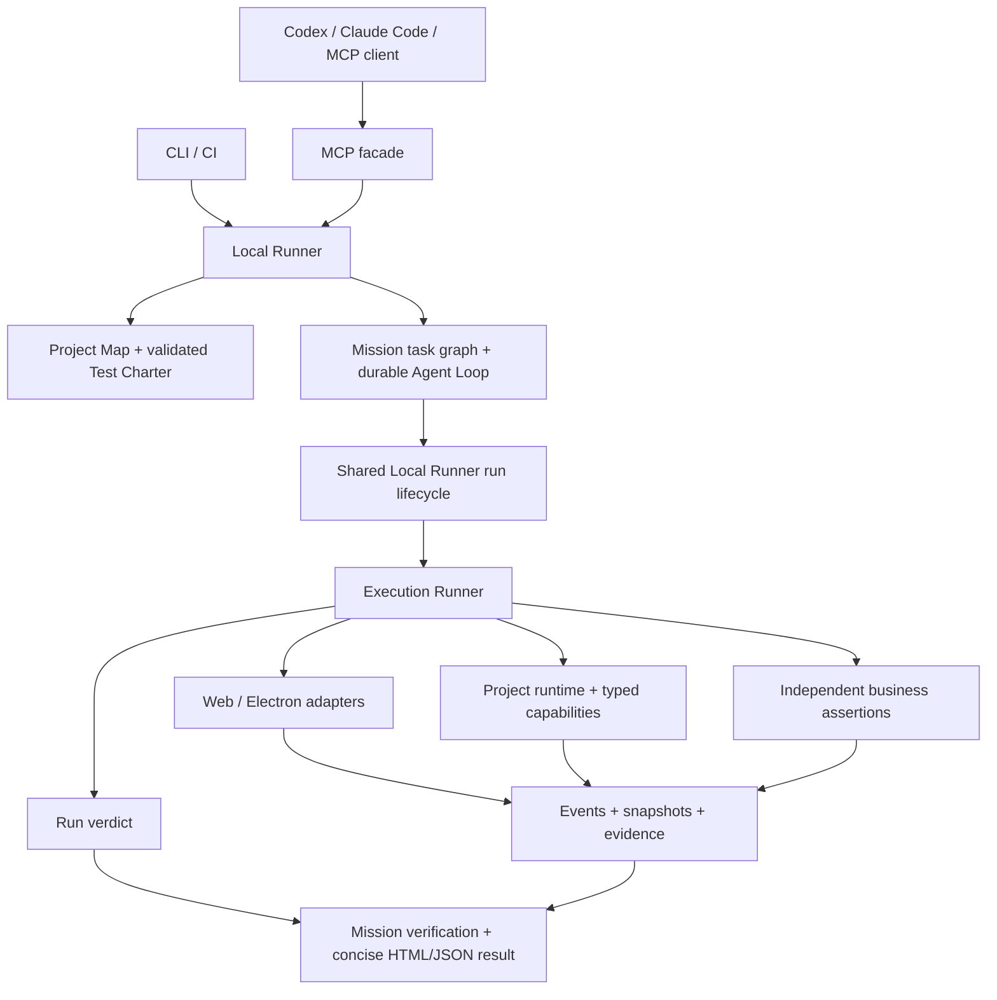

# Detailed capability reference

快速入门、当前配置方式与能力边界见 [README](../README.md)。本文保留详细功能参考；历史验收提到的 outputs 和临时目录仅在原验收主机存在，不随源码发布。

**Evidence-driven system testing for Web, Electron and mobile.**

ProofKit gives host agents a validated test charter, real browser or Electron execution, and evidence behind each verdict. The host authors the plan from observations, or uses an explicitly configured model planner; the default planner generates a navigation-and-observation draft rather than a complete business workflow. Reliable business acceptance also requires declared expected outcomes and suitable independent observations.

It is designed for workflows where a green button is not enough: a resume must be acquired, parsed, attached to the right candidate and position, and reach the expected terminal state. ProofKit is local-first and uses independent business facts where available.

> Early development: Web and Electron have real-browser fixture coverage. Mobile uses a W3C WebDriver adapter verified against an isolated protocol fixture; emulator and device-backed acceptance remain open. CLI and data formats are still evolving.

See the [Chinese architecture overview](architecture-overview.zh-CN.md) for the host-agent integration, execution layers and current capability boundaries.

Public evaluation uses [WebArena-Verified](public-benchmark.md) with pinned tasks and independent official scoring. The latest complete single-site, single-host run scored **6/12**, including one timeout without submission, down from the previous **8/12**. In the expanded set, task 41 failed once and passed once; task 62 timed out three times, then submitted an explicit unverified-result error that the official evaluator rejected. These partial runs do not establish a 24-task score or causal improvement; model identity remains unsealed. The [validation program](validation-program.md) separates framework checks, public tasks and AIHR business acceptance, with 24 WebArena candidates, 20 lightweight interaction candidates and 14 AIHR business candidates at different readiness stages.

## What it does

- Maps workspace manifests and common Web, Electron, and backend entry points.
- Produces a bounded path-level test map with source/test counts, framework signals, conventional entry points, static route hints and an explicit truncation flag.
- Gives host agents a read-only test scope view: source locations, level/surface-compatible plans, plan gaps, registered business checks and bounded capability input hints. Static declarations never count as executed coverage.
- Inspects an optional external `.proofkit/workflows.yaml` business workflow inventory for source freshness, Charter/platform links and explicit exclusions. A bounded source-candidate audit flags discovered entries or routes that lack a workflow owner, linked Charter route target, or consistent exclusion. A fresh, structurally linked inventory can directly generate a `quick`, `core` or `release` whole-project Mission with the declared Charter/platform pairs. Quick checks prove only observable surface assertions; full project acceptance remains gated until inventory completeness can be established.
- Checks configured Web/Electron endpoints or a one-time Web candidate URL, CDP discovery status and local source association before testing, with a bounded deadline and a hashed observation artifact. Login, samples and business readiness remain explicitly unchecked.
- Prioritizes a literal scope focus before retaining bounded routes and entry points; eligible Charter aliases also prioritize their reviewed route targets. Partial scans remain explicit.
- Matches one-sentence requests to curated, workspace-owned Charters by explicit aliases; ambiguous matches require a Charter ID, and missing assertions or business Oracles stop automatic execution.
- Exports a portable `proofkit-test` Agent Skill and native Codex/Claude Code MCP configuration, with optional personal Skill installation and an explicit unconnected setup result.
- Converts intent into a saved YAML Test Charter that can be reviewed and edited.
- Records plan quality, missing inputs and evidence gaps; a model's self-reported confidence cannot make a Mission pass.
- Keeps the original intent in generated plans and rejects changes to explicitly requested execution mode, side-effect policy or independent checks. These structural safeguards do not establish complete business understanding.
- Separates test intensity from acceptance scope: a partial source map does not block a complete declared module scenario, while whole-project acceptance stays gated until workflow coverage can be proved.
- Executes Web and Electron actions through Playwright, including CDP attachment.
- Executes mobile actions through a W3C WebDriver/Appium-compatible server when a mobile surface is configured.
- Starts local project processes with health checks and captures runtime events in the same run timeline.
- Observes read-only business HTTP endpoints through a redacted oracle instead of treating a UI click as proof of success.
- Accepts programmatically registered, schema-validated project capabilities; only an explicit evidence projection is persisted.
- Runs an optional integration preflight before setup, browser connection or capability execution; a failed environment or test-scope check is blocked with a `preflight.json` artifact.
- Lets trusted connectors recheck their actual endpoints after setup and at Run completion. A changed verified listener or gateway configuration makes the product result inconclusive and saves `post-run-check.json`; the AIHR reference connector uses this for its gateway.
- Supports explicit negative Charters such as duplicate submission and requires their expected outcome and evidence to be present in the Mission result. Prefer a `passed` Run that positively observes the rejection. An expected `failed` Run can pass the Mission only when every action and surface assertion completes and a declared business Oracle fails with independent source evidence; an action error or missing proof cannot stand in for rejection. `blocked`, `cancelled` and `inconclusive` never normalize to a pass, nor do listener or integration continuity gaps.
- Keeps configuration, connectors, Missions and run evidence in an external test workspace for new projects, with compatibility for existing project-local layouts.
- Loads an optional workspace-owned `.proofkit/integration.mjs` module for typed capabilities, business oracles, test setup and cleanup.
- Journals scoped setup resources before surface execution and verifies deletion through fresh scoped readback. After an owner process exits, CLI/MCP can recover registered resources using the original versioned connector and intact evidence; recovery keeps the original product verdict and evidence unchanged. See [connector setup and recovery](agent-integration.md#scoped-setup-and-cleanup).
- Lets write setup register its complete isolated resource handle before provisioning, so partial setup can retain recovery evidence. This requires a known scope and idempotent cleanup; it does not recover lost credentials or create a cross-system transaction.
- Enforces a total run deadline and supports cancellation from the CLI or MCP while preserving the evidence directory.
- Enforces a separate Mission deadline across the AI task graph; expiry closes the active step and records a reviewable environment finding.
- Propagates Mission stops to primary, replay and negative Runs, waits up to 10 seconds for cleanup, and links cancelled Run reports to the Mission; unfinished cleanup is reported explicitly.
- Waits up to 5 seconds for an in-flight setup, adapter connection or event subscription to return a cleanup handle after cancellation. If that wait expires, the report states that resources may still be active; a handle returned later triggers a best-effort asynchronous release.
- Polls asynchronous HTTP business state to a bounded terminal verdict; a timeout remains inconclusive.
- Records action receipts, before/after snapshots, network and console events, screenshots, and a JSONL timeline.
- Supports `fill` values supplied by an environment variable reference; the saved Charter and Run record retain the variable name so a replay can use the current test credential.
- Selects prepared `.proofkit/fixtures/` files through unique Web/Electron file inputs, including hidden inputs. `setInputFiles` accepts 1–10 files with a 20 MiB total limit, records file hashes rather than contents, and blocks replay when input identity cannot be verified.
- Classifies configured page errors, console errors and failed responses as linked runtime findings; `record` reports them without changing a passing business verdict, while `fail` makes them a run failure.
- Reports `passed`, `failed`, `blocked`, `cancelled`, or `inconclusive`; missing evidence never becomes a pass.
- Links a replay Mission to its source and compares the same saved scope, Run matrix, and independent business facts. A repair is only `verified-in-scope` when the original evidenced defect is absent from a complete passing replay.
- Records bounded Git source fingerprints before and after a Mission; a detected mid-run change makes the current acceptance verdict inconclusive while preserving the saved Run verdict. Comparison applies the same boundary to repair verification.
- The default `core` mission runs one selected surface with an independent business Oracle and source facts, or the exact Charter/platform pairs of a fresh project workflow inventory. A `release` Mission adds replay for its selected pairs and honors explicitly declared platforms, including Web-only catalog suites. Release plans without an explicit platform declaration retain the legacy Web/Electron default. Every declared negative or recovery case has its own run and cannot supply missing main-path evidence. Passing the declared matrix does not imply whole-project coverage.
- Release suites reconcile reviewed route-to-Charter declarations with the bounded project map. Their result separates discovered, mapped and observed Web/API routes, reports stale or ambiguous mappings, and keeps partial scans explicit. API observation requires a matching successful HTTP response and the same independent business gate as the surface run.
- Produces a compact Mission result with acceptance scope, a scenario/surface execution matrix, first failure, evidence links and scoped repair comparison, plus local JSON and HTML snapshots.
- MCP `inspect_surface` and `plan_test` can start a read-only owned Web session (`keepSession: true`) for observed multi-state planning; reviewed exploratory actions reuse its original inspection pins and the final Charter must replay the whole flow. A terminal Mission may precede the session recording seal: close the retained session and refresh `get_mission_evidence` before claiming playable footage. A provisional report is not a recording-delivery pass.

## Quick start

Requirements for source development: Node.js 22 or newer and pnpm 10.

Until the registry release, install directly from the public GitHub repository with Node.js 22+ and npm:

```bash
npm install -g github:shutu-hub/proofkit-ai
proofkit --version
```

Git installation builds the CLI and MCP bundle from the selected commit and can take several minutes. Pin a commit SHA after `#` for a repeatable installation. It installs its own build-time pnpm dependency; users do not need pnpm beforehand. Then run `proofkit agent setup` with `--harness codex` or `--harness claude-code`, the source and external workspace paths, and `--register-host`. DeepSeek Harness uses `--harness deepseek-harness` and the emitted `--patch` overlay. These connection steps do not run a product test.

For source development:

```bash
pnpm install
pnpm build
pnpm --filter @proofkit/cli dev -- init --root /path/to/your/project
pnpm --filter @proofkit/cli dev -- doctor --root /path/to/your/project
```

The repository also builds one installable `proofkit-ai` npm tarball containing both `proofkit` and `proofkit-mcp`. The internal `@proofkit/*` packages remain development modules; users do not need to install them separately. Registry publication has not happened yet. To verify the artifact and install a locally built copy:

```bash
pnpm test:distribution
pnpm pack --pack-destination /path/to/output
npm install -g /path/to/output/proofkit-ai-0.1.0.tgz
proofkit --version
```

The distribution test packs the project, installs only that tarball in a fresh temporary directory, runs CLI onboarding, and calls the installed MCP server over stdio. A registry release can later use `npm install -g proofkit-ai` with the same two commands.
`pnpm test:git-install` separately installs the current committed source through npm's Git dependency path and checks the installed CLI and MCP connection. CI runs this local Git gate; `pnpm test:git-install:remote` checks the same commit through public GitHub after pushing it.

The tarball also carries the AIHR reference connector and five example Charters. Select it explicitly during first host setup in a separate test workspace:

```bash
proofkit agent setup --harness codex --template aihr --root /path/to/AIHR-Microservices --workspace /path/to/aihr-test-workspace --install-skill
```

This copies reviewable files but does not load the connector, register Charters, start an app, run a test, or assert a product result. Repeating the command reuses identical files; changed files stop installation instead of being overwritten. Review the connector as trusted local JavaScript, configure isolated endpoints and credentials, then adapt each UI action, positive assertion and business Oracle before registering or running a Charter. The ordinary upload example currently has no positive UI assertion and cannot support a `core` acceptance claim unchanged. After review, rerun `agent setup` **without** `--template` and with `--check-connection` or `--register-host` as needed; template selection and connector loading cannot occur in the same command. Standalone installation remains available with `proofkit template install aihr --root <source> --workspace <external-workspace>` before generic setup. An existing generic or custom `integration.mjs` causes a conflict and is preserved; use a fresh external workspace or review and merge it deliberately.

For host-agent use, generate the onboarding bundle and install its testing Skill:

```bash
proofkit agent setup --harness codex --root /path/to/your/project --workspace /path/to/test-workspace --install-skill
# Alternatively: --harness claude-code
# DeepSeek Harness: --harness deepseek-harness, then pass connection.configPath to dsh --patch
# Optional one-command Skill installation, local MCP check and host registration:
proofkit agent setup --harness codex --root /path/to/your/project --workspace /path/to/test-workspace --register-host
```

The command returns an external bundle containing `proofkit-test/SKILL.md`, a Charter reference, a native `mcp.toml` or `mcp.json` fragment, and `setup.json`. Without `--register-host`, use the returned `connection.registration` command and argument array, or merge the fragment through the host's supported MCP configuration workflow. With `--register-host`, inspect the separate `hostRegistration` result; existing entries are never overwritten. Verify the host can call `inspect_test_scope` and confirm its `projectRoot` before testing. The Skill guides default `core` testing, independent business checks, evidence reporting and repair replay; it still relies on the host's reasoning. See [agent onboarding](agent-integration.md#agent-onboarding) for discovery paths and limits.

### First intent run

See [the current README](../README.md#配置模型规划) for a complete first-run example. CLI and MCP read `planning.provider`, `planning.baseUrl` and `planning.model` from the external workspace YAML. Evaluation-script environment variables do not override that config. A ready draft is not a product verdict.

Add `--check-connection` to `agent setup` to launch the emitted MCP server,
verify its high-level tools and check its source/workspace binding. The result
appears under `localConnection`; host registration, model behavior and product
testing remain explicitly unchecked.

Setup always uses an external workspace, including projects with a legacy source-local `.proofkit`. By default it does not register MCP, load connectors, start applications or assert product correctness. `--check-connection` loads trusted connector registration code in the emitted local server, but still starts no application or test. Optional Skill installation preserves custom content and reuses identical files. DeepSeek Harness receives a native Cordis patch and installs the Skill to `${DSH_HOME:-~/.dsh}/skills`; see [agent integration](agent-integration.md). A generic MCP harness uses `--harness generic`; installing its Skill also requires `--skills-dir` pointing to its documented discovery directory.

`--root` identifies the tested source. For a new project, ProofKit writes its test files to `~/.proofkit/workspaces/<project-name>-<path-hash>/.proofkit/`. Add `--workspace /path/to/test-workspace` to any command to select an explicit workspace. An existing source project's `.proofkit` keeps its legacy layout unless you supply `--workspace`.

`proofkit init` also creates a starter integration module in that test workspace. Leave its arrays empty for UI-only checks, or add typed business capabilities and independent oracles when a workflow needs backend proof. Initialization does not add files to the source tree when an external workspace is selected.

For a whole-project workflow declaration, an operator can run `proofkit review-workflows --root <project> --workspace <test-workspace> --key-id <reviewer-id> --private-key <external-private.pem>` after reviewing the inventory, full candidate set and registered Charters. ProofKit saves a signed `.proofkit/workflow-review.json` in the test workspace. Set `PROOFKIT_WORKFLOW_REVIEW_TRUST_PATH` to a JSON map of reviewer IDs to Ed25519 public PEM keys outside both the source project and test workspace; `scope` then reports whether the declaration authenticates. The signature binds the source fingerprint, candidate records, Charter registrations and Charter file and execution digests. A new `core` or `release` Mission admits that reviewed scope only when the signed candidate set is complete, has no exclusions, and exactly matches its Charter/platform matrix. It can pass only after the required Runs, independent business evidence, route observations, source binding, Web/Electron listener ownership and end-of-run continuity, and current trust all pass their audits. Electron HTTP pages require separate ownership and continuity evidence for the page server and Electron CDP process. Mobile lacks an equivalent application-source proof and cannot yet pass reviewed project acceptance. The result is explicitly scoped to **reviewed source workflows**: a signature authenticates the trusted signing key and exact declaration, while semantic completeness still depends on the review. `quick` and older Missions cannot gain this pass retroactively.

Inspect what is available before authoring a test:

```bash
proofkit scope --root /path/to/your/project --surface web --level core --limit 20
# Optionally narrow by a literal source-path or registration substring:
proofkit scope --root /path/to/your/project --focus resume
# Include the bounded Git fingerprint needed to bind a workflow inventory:
proofkit scope --root /path/to/your/project --source-state
```

Scope routes are static candidates. Gin group prefixes are composed within a file; unresolved declarations appear in `inventory.routeDiagnostics` with source locations. Other framework literals may need manual interpretation. Neither route mapping nor inspection proves a business result.

MCP clients use `inspect_test_scope` for the same view, then `inspect_test_environment` for a Web/Electron target and `inspect_surface` to observe the live page. A structurally ready catalog case can proceed to `run_test`; without one, the scope result points to `plan_test` first. Scope inspection defaults to `core`; it returns `not-asserted`, full scanned counts, omitted counts and the inventory's truncation flag with specific `truncationReasons` when a bound is reached. `planReady` checks saved plan structure and registered operations, not login, test data or runtime readiness. Capability input hints omit defaults and user callbacks; runtime Zod validation remains authoritative. Workspace connector registration is trusted code loaded by the service; scope inspection invokes none of its execution hooks.

High-level Mission creation infers an omitted surface only from explicit Web, Electron/desktop, or mobile wording in the intent; otherwise it uses Web. It rejects a Mission whose actual execution matrix omits a platform named in the request. A multi-surface `core` request therefore needs a project workflow inventory with those platform checks, while a `release` Charter or suite can use its declared Web/Electron matrix. The low-level Run and inspection tools retain their explicit Web defaults.

`planningReadiness` summarizes only checked catalog candidates. It separates a usable saved plan from authoring work and incomplete inspection, with bounded gap codes for intensity/surface mismatch, invalid or omitted plans, unmatched source focus and business reader names. A `quick` match never satisfies a `core` request; an unmatched literal focus never proves the feature is absent. A ready plan still needs environment, surface and business execution evidence.

When a same-level external Charter is visible with no reported structural issue, `planningReadiness: candidate-review-needed` points to reviewing its file and source flow, then supplying the exact relative `charterPath` and `charterSha256` to `run_test`. Discovery does not approve writes or prove a product result.

`workspaceCandidates` lists bounded, unregistered Charter hints from the external test workspace, including missing assertions, business readers and write-policy prerequisites. Literal focus matches the file path, intent and declared UI words; a missing endpoint binding still leaves its candidate discoverable and marked invalid. A search with no literal candidate match returns `fallback-unmatched` hints. Candidate files are never automatically registered or marked ready; review the file and the tested workflow before using it.

Direct workspace candidates must declare their supported `surfaces` in the Charter (for example, `[web]` or `[electron]`). A `release` candidate may target Web alone; include both Web and Electron when both are requested. Catalog platform declarations are frozen into saved release plans, and conflicting declarations are rejected. Scope also flags inline HTTP reader name conflicts, missing current-response ID bindings, and URLs that the MCP origin policy would reject. `candidate-review-needed` is withheld for those files; a candidate with no reported issue still needs source review and runtime evidence.

After reviewing a candidate, pass its `path` and `sha256` from the current scope result as `charterPath` and `charterSha256` to MCP `run_test` or `create_test_mission`. CLI `proofkit mission create` accepts `--candidate <path> --candidate-sha256 <digest>`. ProofKit checks that the file is a direct external-workspace Charter, reads at most 128 KiB, rejects changed bytes and applies the ordinary Mission validation and readiness gates. It freezes the parsed Charter in the Mission; catalog registration is optional for one-off tests.

Before creating the Mission, use `inspect_integration_readiness` with that same `charterPath`/`charterSha256`, or CLI `proofkit readiness --candidate <path> --candidate-sha256 <digest> --root <source> --workspace <test-workspace>`. Registered Charters use `charterId` instead. This calls only the connector's explicit read-only hook and creates no Mission or Run. It rejects changed candidates or endpoint bindings; `ready` means connector prerequisites only, with `testVerdict: not-asserted`. Normal plan validation, write policy and execution preflight still apply.

An external candidate may use `url: $env:AIHR_PROOFKIT_API_BASE_URL/resume-collection/runs` in a `captureResponse` action or inline HTTP Oracle. Set the named `PROOFKIT_` environment variable in the ProofKit CLI/MCP process to a reviewed HTTP(S) gateway base URL before scope inspection. The binding accepts no credentials, query or fragment. Scope marks a missing or invalid value `endpoint-binding-unavailable`; its candidate digest covers both file bytes and resolved URLs, so changing the environment value requires another scope inspection. Mission creation checks that digest and saves only concrete URLs, which then receive the usual origin and side-effect validation. This binding applies to direct external candidates, not catalog Charters or ad-hoc Runs.

Observe configured endpoints or a one-time Web candidate before attaching to a page:

```bash
proofkit environment --root /path/to/your/project --surface electron --timeout-ms 10000
# Check a candidate Web listener once without editing the test workspace:
proofkit environment --root /path/to/your/project --surface web --url http://127.0.0.1:5173/ --timeout-ms 10000
# Inspect the configured mobile WebDriver server without creating a device session:
proofkit environment --root /path/to/your/project --surface mobile --timeout-ms 10000
```

MCP uses `inspect_test_environment({ surface: "electron", timeoutMs: 10000 })` or `inspect_test_environment({ surface: "web", url: "http://127.0.0.1:5173/" })` for one candidate Web listener. The override applies only to this observation and its source-process association; it does not change the configured URL for a later Run. MCP accepts loopback or the configured Web origin, while Electron keeps its configured CDP endpoint. Both paths use the same Local Runner and save a JSON artifact plus SHA-256 under the test workspace's `.proofkit/inspections/`. Checks share a total deadline of 100–15000 ms (default 10000 ms) and probe at most eight declared backend health endpoints. An Electron HTTP renderer receives separate source checks for the page server and CDP application listener; a matching page server does not establish which Electron process will be controlled. A reachable loopback health endpoint also records its listener's Git checkout; a known different checkout blocks by default even when the page and health endpoint both return HTTP 200. A Run checks already-running declared local health listeners before setup and rechecks after setup before browser attachment; both blocks save evidence. The command returns exit code 0 for `checks-passed`, 1 for `blocked`, or 2 for `incomplete`. These are environment observations with `testVerdict: not-asserted`; inspect `notChecked` before moving on to page inspection and business testing. Probes use GET, retain the endpoint without its query or fragment, and do not follow redirects or retain raw network errors. Ordinary HTTP probes finish at response headers without retaining bodies; the mobile WebDriver status probe reads a bounded body and retains only the ready boolean. No app, browser or connector operation is started by the inspection; service creation still loads trusted connector registration code.

Mobile inspection shares this CLI/MCP entry point and calls only the configured WebDriver server's `/status` endpoint. It reads at most 8192 bytes to verify a W3C `value.ready` boolean, retains only HTTP status and readiness, and never creates a device session. A false ready value blocks attachment; a malformed or oversized value remains unverified. MCP requires a loopback driver. The driver is test infrastructure, so its process path does not establish ownership of the tested mobile app. The result lists `device-session` among unchecked facts and never establishes product acceptance.

Environment results also return `next` entries with an action, supporting check IDs and short guidance. AI hosts can use them to resolve a local configuration, endpoint, CDP, WebDriver, health, source association or deadline issue, then repeat inspection. `inspect-surface` is suggested only after blocking checks are absent and mobile WebDriver readiness is verified; it still does not mean the product passed a test.

Plan and review a test:

```bash
pnpm --filter @proofkit/cli dev -- plan \
  "Verify the resume page shows a successful result" \
  --root /path/to/your/project \
  --url http://127.0.0.1:5173 \
  --expect "Resume ready" \
  --format json \
  --out resume-check.yaml
```

The plan command produces a draft, not a test result. In YAML mode it keeps
stdout as the Charter and sends status, missing requirements and next steps to
stderr. Use `--format json` for one machine-readable response containing
`status`, `gaps`, `missingInputs`, `next` and `charter`. `--out` always saves
the editable YAML Charter, including incomplete drafts.

- `needs-input` exits 2: author the missing workflow/checks or acquire the
  missing observation before attempting execution. A default core plan without
  independent business checks remains a draft even if an expected text is set.
- `ready-for-review` exits 0: the declared plan has no reported structural
  gaps. Review it and check environment/connector prerequisites before running.
  This is not an executable-readiness certificate or a business pass.
- A model `needs-observation` receipt also exits 2, returns the existing
  observation continuation, and does not overwrite the requested Charter file.

All planning states retain `testVerdict: not-asserted`. `executionStarted: false`
means no product test was started by that planning response; a model plan may
already have collected read-only page observations. `notEstablished` lists
runtime, authentication, data, business, evidence and intent-completeness claims
that this structural summary cannot establish. It does not deny earlier
inspection work. MCP `plan_test` returns the same structural state alongside
its existing Charter; follow the returned action/reason guidance without
weakening the original intent. These states guide review and do not replace
the existing Mission readiness and execution gates.

For one-sentence planning with a local or OpenAI-compatible model, set `planning.provider: openai-compatible`, `planning.baseUrl`, and `planning.model` in `<workspaceRoot>/.proofkit/config.yaml`. The default planner stays deterministic. An optional `apiKeyEnv` names an environment variable; the key is never written to the config file.

For asynchronous business outcomes, register a read-only status endpoint and terminal values in that same config:

```yaml
planning:
  provider: openai-compatible
  baseUrl: http://127.0.0.1:11434/v1
  model: local-model
oracles:
  - name: resume-status
    url: http://127.0.0.1:8080/api/v1/resume-status
    query:
      runId:
        source: runId
    statusPointer: /data/status
    successValues: [complete]
    failureValues: [failed]
    intervalMs: 500
    deadlineMs: 30000
```

Use `--oracle resume-status` with `plan` or `run`. The charter records the oracle name, and the runner waits for a declared terminal state. A project capability can also bind a sanitized ID from an earlier step into an oracle query parameter.

Run it in Chromium:

```bash
pnpm --filter @proofkit/cli dev -- run "resume check" \
  --root /path/to/your/project \
  --charter resume-check.yaml \
  --adapter web \
  --headful
```

Attach to an existing Electron instance. Start that app with remote debugging enabled and point ProofKit at its loopback CDP endpoint or `DevToolsActivePort` file:

```bash
pnpm --filter @proofkit/cli dev -- run "resume check" \
  --root /path/to/your/project \
  --charter resume-check.yaml \
  --adapter electron \
  --devtools-port-file /path/to/user-data/DevToolsActivePort
```

For CDP attachment, ProofKit waits for an application page and requires a unique target. If the browser or Electron app has several windows, set `surfaces.electron.targetUrlPrefix` or `targetTitleContains` in the external workspace's `.proofkit/config.yaml` (the Web surface accepts the same fields). It never picks an arbitrary first tab. A configured Web `baseUrl` also narrows attached pages to that origin when no explicit target is set.

On Windows and Linux hosts with usable `/proc` socket metadata, a loopback Web/Electron target also records the listening process's Git checkout. For an Electron `file:` page, ProofKit checks the configured CDP listener when there is no HTTP page server; a port file is resolved at inspection time. A Run using a port file checks the final leased and pinned CDP endpoint again before connecting, and keeps later association checks on that endpoint if the file changes. A different checkout blocks the run by default, so a server left running from another working tree cannot silently count as this project's test. `unverified` means ProofKit could not establish that association; a matching process path still does not attest the served source bytes. Linux process association passed a privileged Ubuntu runner smoke for stable and replaced listeners plus a foreign checkout. Ordinary-user `/proc` access can still be denied and remains `unverified`; WSL 1 does not expose the required socket table.

When a unique local listener PID is known, `core` and `release` Runs check it again before closing the surface, including after an assertion or Oracle error. A changed or unverified listener makes an otherwise passed or failed Run inconclusive; cancellation and pre-connection blocks keep their own verdicts. Both observations are saved when the final check returns; a probe error records unverified continuity in the Run. The Run report shows this check and its artifacts. `quick` keeps the initial check only. These point-in-time checks cannot detect a replacement that happens and reverses between observations.

For a mobile surface, configure an Appium or W3C WebDriver server in the external workspace:

```yaml
surfaces:
  mobile:
    serverUrl: http://127.0.0.1:4723
    platformName: Android
    deviceName: emulator-5554
    automationName: UiAutomator2
    app: /path/to/app.apk
```

Then run the same Charter with `--adapter mobile`. Mobile selectors may use `accessibility=`, `id=`, `xpath=`, `class=` or `css=` prefixes. The mobile driver must be loopback when invoked through MCP.

Mobile text assertions use WebDriver element lookup and `/displayed`, so hidden source text is not treated as visible. `inspect_surface({surface:"mobile"})` observes the configured driver before Charter authoring and returns bounded, scrubbed non-editable XML labels plus a screenshot; it reports `not-asserted` and does not offer device-validated selector hints. Creating an Appium session may launch or reset the app according to its configured capabilities, even though inspection sends no UI action. The MCP-to-Mission path has a fake-driver HTTP smoke (`pnpm test:smoke:mobile`) covering inspection, a passed core test and an independently confirmed backend defect. Emulator and physical-device acceptance are still pending.

WebDriver responses are limited to 16 MiB before JSON parsing. Missing title or URL facts remain inconclusive for mobile assertions, rather than becoming product failures. When using `MobileAdapter` directly with an existing `sessionId`, `close()` preserves that externally owned session by default; pass `keepSession: false` only when ProofKit should delete it. Sessions created by ProofKit are deleted during cleanup.

Relative Charter and output paths resolve against the selected test workspace. Runs are stored under `<workspaceRoot>/.proofkit/runs/<run-id>/` by default. Each run contains `run.json`, `events.jsonl`, artifacts, and `report.html`.

For a Mission, `get_mission_evidence` returns `summary`, `evidenceIntegrity` for the compact presentation, `acceptanceEvidenceIntegrity` for all saved execution and Finding references (up to 2048), and a `report` path. It retains per-scenario `diagnoses` and a singular headline `diagnosis`; the compact report shows up to ten diagnoses with their own Finding and evidence support, plus an omission count. Repair proposals have separate support checks. Use audited `testVerdict` for the current acceptance claim; `verdict` is the saved historical result. A partial compact presentation can still support a pass when the full acceptance reference audit is intact. A saved failure cannot support a current product-defect claim after its Agent trace, observed Run facts, cited evidence or Oracle classification becomes unverified. CLI users can generate the same result:

```bash
proofkit mission report <mission-id> --root /path/to/source --workspace /path/to/test-workspace
```

Open `<workspaceRoot>/.proofkit/missions/<mission-id>/report.html` for the compact result, or read its adjacent `summary.json`. These are snapshots of a saved Mission revision; regenerate during or after execution to see the latest state. Both show the current audited `testVerdict` alongside the saved `verdict`, missing executions and coverage limits, and a negative case's expected outcome separately from its raw Run verdict. Evidence links become unavailable when a file is missing, outside its Run/workspace boundary, or differs from its recorded digest. A report-write failure returns `reportUnavailable` while retaining the structured result and original evidence.

For CI, `proofkit mission check <mission-id> --root <source> --workspace <test-workspace>` re-audits saved evidence without re-running the product or loading the workspace integration module. Its JSON contains both the historical `verdict` and current `testVerdict`; the nested `summary` follows the versioned `MissionResult` contract. Exit code 0 means audited `passed`, 1 means observed `failed`, and 2 means `blocked`, `cancelled`, `inconclusive`, or `not-asserted`. `mission run` and `mission replay` apply the same exit rule to their audited result. `mission report` only writes a report snapshot; use `mission check` as the acceptance gate. A saved pass whose evidence later changes returns exit code 2 until the scenario is rerun.

The repository also contains a [GitHub Composite Action](ci-action.md) that builds its own ProofKit revision, creates and runs a configured Mission from an intent, or re-audits an existing Mission. Its current action wrapper has a local real-browser regression; publication and GitHub-hosted runner validation remain pending.

For local Web runs, `surfaces.web.executablePath` in the external workspace takes precedence over the optional `PROOFKIT_BROWSER_PATH` environment variable. Without either, Playwright uses its installed Chromium browser.

Set `run.recordVideo: true` in the external workspace config to request a WebM recording for each ordinary Web Run using a new ProofKit-owned browser context. Playwright's FFmpeg binary must be installed (`pnpm exec playwright-core install ffmpeg`); CDP-attached, Electron and borrowed benchmark sessions cannot use this recording mode. The Run seals at most 64 MiB after closing the browser context, links the file in its HTML report, and marks a requested but unavailable recording explicitly; a passing Run becomes inconclusive if its requested recording cannot be sealed. Run reports recheck each manifested artifact's current byte count and SHA-256 (bounded to 512 files and 256 MiB total) and label verified, changed, missing or unverified evidence. This local digest check is not tamper-proof external attestation. Mission evidence audits independently recheck referenced digests. Recording is off by default and may retain sensitive pixels. It is not an independent business check. Ordinary network timeline entries contain redacted method/URL/status metadata, not request or response bodies.

Run reports include every planned Charter action, including actions that were never reached after an earlier failure. These rows are marked `not-run` and are never treated as successful evidence, so a reviewer can distinguish “the plan omitted this step” from “the step was planned but execution stopped before it.” Planned `fill` values, capability inputs, fixture paths and URL query strings are redacted in the HTML report.

When a selector action times out and the contemporaneous surface observation shows that selector is absent, the Run records `surface-selector-drift`, saves a bounded target diagnosis, and instructs the operator to re-inspect before revising the plan. ProofKit does not silently substitute a different selector or claim that the original intent was completed.

The same failure saves a `needs-approval` replan proposal containing at most eight observed candidate controls. The proposal is evidence and guidance only: it does not execute a candidate, alter the Charter, or authorize a side effect. A reviewed caller must inspect the surface and submit an approved revised Charter.

MCP `approve_surface_replan` exposes this boundary. With `approve: false` it only returns the verified proposal; with `approve: true`, the submitted selector must exactly match a proposal candidate. ProofKit records the source Run, original selector and approved selector in the replacement Charter metadata, then starts a new replay-linked Run. Invalid or unobserved selectors are rejected.

The replacement Run report includes a replan lineage section that states the source Run, changed step, original selector and approved selector. Its verdict applies only to the replacement Charter; the source Run remains an independently reported failure or inconclusive result.

`pnpm test:smoke:generic-web` creates three independent project roots and test workspaces, observes each page through `LocalRunnerService`, sends that observation to a local OpenAI-compatible planner fixture, validates generated selectors against observed controls, and executes the resulting Charter: CRUD form submission, cookie-backed authentication, and asynchronous job initiation. It also sends a deliberately unobserved selector plan and verifies planning alone creates no Run, then explicitly submits it and checks execution stops before any action because the target is unbound. The smoke checks project/workspace binding, action evidence, report generation, and final verdicts without project integrations or application-specific runner branches. The planner endpoint is a deterministic acceptance fixture, not a real general-purpose LLM; this is framework integration acceptance, not a claim of arbitrary production-project coverage.

`pnpm test:smoke:planned-targets` reproduces selector reuse with a different button identity, confirms zero unreviewed writes, exercises replacement of the checked DOM element during evidence persistence, and verifies an explicitly approved selector repair preserves the new identity and execution visibility. Its second real-browser fixture covers form fields, native selects/checkable controls, hidden upload, key presses and response capture with a follow-up confirmation, including independent server counters and structured-evidence privacy checks. These are deterministic framework fixtures, not measured real-model planning quality.

`analyze_surface_replan_stability` aggregates 1–20 approved replacements for one source Run. It verifies replay linkage, reports pass/fail/inconclusive counts, repeated approved selectors and mean approval latency, and returns `inconclusive` with gaps when unrelated or unverifiable Runs are supplied. It does not infer that a replacement caused the outcome.

For a reviewed API boundary, a Charter `captureResponse` action can also declare `response.requestFields` using bounded JSON pointer projection. Supported request bodies are JSON and UTF-8 `application/x-www-form-urlencoded` forms; the selected response must be JSON. Form values remain strings: one occurrence is a string, repeated names are arrays addressed explicitly with pointers such as `/topping/0` and `/topping/1`. A repeated name cannot silently become one scalar. ProofKit records only selected scalar fields, byte counts and SHA-256 hashes. Unsupported encodings, invalid form escapes, oversized bodies and multiple matching requests are rejected; raw request and response bodies are never persisted by this action. This action requires `sideEffectPolicy: allow`; an independent Oracle is still required for business acceptance.

For an AI client, register `proofkit-mcp` after installing the tarball, or run the server from a source checkout. It exposes only project discovery, charter planning, run start, status, bounded evidence, and replay, and it uses the same Local Runner as the CLI. MCP does not execute the configured project start command; start your test environment first:

An agent can call `run_test` with a reviewed catalog ID or submit a schema-validated `charter` inline for a new workflow. Inline Charters are stored in the Mission, reassessed for evidence gaps, and executed without adding files to the tested source. See [Agent integration](agent-integration.md) for the request shape and side-effect rules.

For a new workflow with a read-only terminal-status API, the Charter can also declare bounded `httpOracles` that bind a `captureResponse` ID to an independent GET result. This avoids pre-registering a simple business reader; authenticated or multi-entity checks still use an external workspace connector. See [the response identity example](agent-integration.md) for the contract and limits.

Response projections distinguish `type: id` (a positive decimal integer, serialized as a string) from `type: identifier` (an exact, nonempty ASCII identifier up to 128 characters using letters, digits, `.`, `_`, `:` or `-`, starting with a letter or digit). Declare `identifier` for UUIDs or application IDs such as `request-42`; ProofKit neither coerces a number into this type nor accepts whitespace, slash or query delimiters. Both types can bind an inline read-only HTTP Oracle to a current Run's response. A configured Oracle may also match other explicitly selected scalar fields, such as quantity, to distinguish a record with the correct ID but wrong business content. Request and response bodies are not persisted.

When the application uses a separate API domain, configure `surfaces.web.apiOrigins` with up to eight exact origins, for example `["https://api.example.test"]`. In MCP/restricted mode these origins permit selected `captureResponse` observations and independent HTTP readers. They do not grant browser navigation to that domain. No wildcard, credentials, path, query or fragment is allowed in this list; other origins remain rejected. The browser target stays bound to `surfaces.web.baseUrl`, and the existing loopback allowance is preserved.

For asynchronous native form fields, an observed Charter can use `{ "kind": "waitForValue", "selector": "#street", "value": "Reviewed final street", "stableForMs": 750, "timeoutMs": 5000 }`. It samples one unique native input, textarea or single select, checks the observed control identity throughout, and requires matching samples for the declared interval. Gaps over 250 ms restart the interval. Observe completion of relevant backend work first; a bounded sampled interval cannot prove that the field will never change later. A mismatch, control replacement/identity drift, unsupported control or timeout stops before later actions. The checkpoint is read-only and does not prove business persistence. Use an independent Oracle to check every required submitted field. Formal Charters may use an environment reference for the expected value; runtime values are excluded from the checkpoint facts, and the report hides the expected value. `pnpm test:smoke:form-value` verifies overwritten/changed/duplicate controls, zero unintended writes, cancellation, independent server state and tampered-evidence withdrawal.

For a new UI workflow, `inspect_surface` (or `proofkit inspect`) first records a read-only Web/Electron observation with visible control hints and evidence links. Its `not-asserted` result is not a product verdict; use the observed selectors in a Charter and verify them during the test Run.

**Popup workflows in owned Web contexts.** Ordinary owned Web snapshots and retained-session inspections expose a bounded `pages` inventory with sanitized title/URL, `active` and `eligibleForSwitch`, plus `pagesTruncated` when more than 16 pages are open. After an observed action opens another page, select it explicitly with `{ "kind": "switchPage", "title": "Exact observed title", "timeoutMs": 5000 }` through `interact_surface` or a Charter action. Only one same-origin page with that exact, unredacted title can be selected. Duplicate titles, foreign origins, missing pages and inventory overflows stop with explicit codes. This selection does not itself navigate or submit a form; ordinary interactive actions retain their existing policy and identity guards. The selected page persists across calls in the same live retained session, and subsequent screenshots, controls and response captures use it. Encrypted recovery restores storage state, not a saved popup/window layout. Electron, CDP-attached and mobile contexts currently cannot execute this action; the runner rejects unsupported page switching before setup or attachment.

Inspect the newly selected page and save its original read-only inspection pin before drafting later controls. Observed model/host plans retain a `surface-page` gap for an unseen or ineligible title, and a model observation request cannot propose an unobserved title. Explicit old Charters without observed planning metadata still perform the live title/origin checks. Run reports show a digest-checked page inventory beside selected-page screenshots; modified screenshots or inventories lose their embedded presentation. Steps use vertically stacked cards on narrow screens so the selected-page evidence remains visible. Network listeners for previously selected pages remain active within a Run to retain late responses with the original request identity, and are detached when the Run ends. Continuous session metadata still covers the owned context across calls; neither trace proves action causality.

With `sessions.recordVideo: true`, the initial primary page retains its own clip. ProofKit additionally saves **each distinct explicitly selected popup within the bounded page inventory** as a separate clip when its owned video source and all saved final files fit the session's shared byte budget. The capture records `selectedPages.observed`, `artifacts` and `omitted`; if a failed seal or exceeded budget leaves any selected window unrecorded, capture completeness is `partial`. No clip substitutes for the selected-page screenshots or independent business read. The clips begin when their respective pages opened, may include context outside the Mission and never prove action causality. Missing/changed selected footage withdraws all session video links on report regeneration, without altering a separately evidenced product verdict. `pnpm test:smoke:popup-workflow` verifies explicit visible selection, exactly one formal submission, an independent current-ID read, three decoded clips (blue primary, green review and orange details), report playback and tampering withdrawal. Cross-origin authentication, automatic window discovery, visual redaction and model quality remain open.

For a long result table, the MCP tool accepts `readTable: { selector: "#results", offset: 0, limit: 20, columns: [0, 2] }`. Continue with `snapshot.tableRead.nextOffset` and its `sourceSha256` as `expectedSourceSha256`; a changed table rejects continuation. `allPagesVerified` is always `false`: the rows cover only the current rendered page, so check pagination, filters and an independent business result before claiming full coverage. Table cells follow the normal sensitive-data redaction policy.

For an unfamiliar Web or Electron workflow, MCP `interact_surface` performs one exploratory action and returns a compact, scrubbed page observation. Each call saves its own Run and always returns `testVerdict: "not-asserted"`; the Run records the adopted session ID when one is used. Ordinary Web calls launch separate browser contexts by default. For stateful Web exploration, send `keepSession: true` on each new context and pass its returned `sessionId` on subsequent calls; multiple owned sessions may remain active concurrently, each with an independent cookie store and target binding. Use the optional `sessionLabel` only as operator metadata, and `list_surface_sessions` to inspect labels, target origins, busy/reusable state and borrowed Run IDs without exposing cookies or storage. Persistence is disabled by default. To survive a Runner restart, configure `sessions.persistence: encrypted` and `sessions.keyEnv`, with the key supplied only through the named process environment variable; browser storage state is AES-GCM encrypted on disk under the test workspace and is deleted when the session is closed. A reviewed direct `start_run` or `run_test`/Mission may pass that `sessionId` to execute its Charter in the same browser context; the formal Run records the session ID and releases the context when complete without closing it. `close_surface_session({sessionId})` closes only that context, which also expires after ten idle minutes or when the MCP server closes. Sessions are bound to their original target URL and origin; CDP and benchmark-owned contexts cannot use this opt-in mode. Electron still uses its configured CDP application. Web navigation is limited to loopback or the configured origin. Click, fill, and press require `policies.sideEffects: allow` in the isolated test workspace. A persisted Mission retains the selected session ID and fails closed if the process-local session is gone after restart; it never silently creates a replacement context. A visible page or successful exploratory action alone is never a product acceptance result.
A connector that must create isolated resources before multi-state exploration can use the explicit write tool `prepare_surface_session({ sessionId, charter })` after a retained Web session is opened. The connector must have a versioned recovery hook and register exact resource ownership before writing; the workspace needs `policies.sideEffects: allow` and operator write permission (`PROOFKIT_ALLOW_CAPABILITY_WRITES=1` for the MCP server). This returns a separate preparation Run ID with `testVerdict: not-asserted`. Reviewed exploratory actions reuse its scope without repeating setup; a formal Run in that same session passes `preparedSession.preparationRunId` to the trusted connector so it can independently verify and adopt the exact resource rather than creating a second one. Normal `close_surface_session` reports its readback-verified cleanup. After a process crash, use `inspect_run_resources` and `recover_run_resources` on the preparation Run ID; never replay the write or delete an unverified scope. Encrypted browser-state persistence is deliberately unsupported for prepared-resource sessions. A connector must make cleanup idempotent, including when the formal Run already removed the resource. Preparation alone never establishes a product verdict or independent business acceptance.


`plan_test` can receive the exact `surfaceSnapshot` returned by `inspect_surface`. ProofKit checks primary and negative-case selectors against uniquely observed controls, records missing/ambiguous selectors as `surface-selector` gaps, and independently attaches `expectedTarget` identities to the resulting actions. Provider-authored identities are replaced with observed tag, role, sanitized name, field group and input type, with observation time and an HTTP origin when available. `surfaceObservation` marks a plan generated from an observation; any unbound interactive target in such a plan stops execution before setup or browser attachment. The same pre-action check covers native forms, hidden file inputs, response triggers and optional follow-up clicks. A changed identity stops before that target is mutated and produces `surface-target-changed` with a step-owned JSON comparison; an adapter without this capability cannot execute a guarded action. The adapter acts on the checked DOM element instead of resolving the selector again after writing evidence. Run reports present the comparison only while its original saved artifact and summary contents agree. One bounded observation does not establish full workflow coverage, DOM checks are not atomic with every application event, and unchanged names do not prove unchanged backend behavior. Existing explicit Charters without these bindings remain readable; they are not retroactively verified.

With a configured model planner, omitting `surfaceSnapshot` makes `plan_test`, an ad-hoc `create_test_mission`, and an ad-hoc `run_test` first save a bounded read-only surface inspection. The provider receives that observed page, not invented selectors from the intent alone. Planning never starts `project.start` or dispatches proposed test actions; opening a page still runs its own application scripts and network behavior. Configure the existing `readyWhen` condition when the entry state must finish loading. The returned Charter pins the original inspection manifest and snapshot digest in `surfaceObservation.source`. Execution verifies that source before setup or attachment, and Run/Mission reports show it separately from business proof. Preserve the original inspection bundle; use its saved manifest pin to verify it rather than regenerating the source manifest. A caller-supplied snapshot stays explicitly caller-supplied, without an invented saved source.

Use `plan_test` with `sessionId` to observe an existing retained Web session, then run the returned Charter with that same session; another session or a fresh context is rejected before attachment. Pass either a snapshot or a session ID, since a bare supplied snapshot does not establish session ownership. CLI planning exposes `--adapter`, `--headful`, and `--session` (cross-process session recovery still requires encrypted persistence). A pure deterministic plan remains available without opening a browser unless a retained session is explicitly selected. Observation failures from `plan_test`, `create_test_mission` and `run_test` return `status: needs-observation`, `testVerdict: not-asserted`, the inspection receipt when available, and next actions; they do not return an executable Charter or start a Mission. Cancellation is forwarded to observation and the configured provider HTTP request. Explicit selector repair still needs approval and is presented as a revised caller-reviewed observation rather than falsely rebinding the old saved snapshot to a new control.

`pnpm test:smoke:automatic-planning` exercises the public model-planning/Mission/MCP path with a deterministic provider fixture and a real browser: source capture before the provider call, no proposed planning writes, changed-source rejection, unbound selectors, provider-side observation mutation, two authenticated sessions, wrong-session rejection, high-level Mission source presentation, missing-readiness receipts on all three tools, and cancellation. This verifies framework orchestration; it does not measure real-model understanding or complete multi-page business coverage.

For a workflow spanning several already observed pages, use the existing retained session and `inspect_surface({ surface: "web", sessionId })` at each required state. A successful inspection returns its `inspectionId` and original `manifest.sha256`. Pass those receipts to `plan_test.inspections` as `{ runId: inspectionId, manifestSha256: manifest.sha256 }`, together with the same `sessionId`, intent, expected outcomes and configured business Oracles. This accepts 1–10 distinct inspection Runs and at most 256 KiB of projected observation context. Choose either `inspections` or `surfaceSnapshot`. An invalid pin produces a planning failure; it does not silently observe a replacement page or regenerate the original manifest. CLI provides repeatable `--inspection <run-id:sha256>` arguments.

The provider receives `surfaceObservations: [{ observationId, snapshot }]`. If a selector identifies different controls in different states, each action, response trigger or follow-up must declare the intended `observationId`; ProofKit independently binds its expected identity to that original source. An ambiguous or unknown state remains an unbound planning gap. The formal Charter must still navigate and replay the whole intended workflow, checking each target before acting and independently verifying the resulting current business state. Planning observations and preparatory interactions remain context; they cannot satisfy that final check. Review any exploratory interaction that can write data before using it to reach a later state.

`pnpm test:smoke:multi-state-planning` verifies this path with a real browser and a deterministic provider: two pages reuse `#next` for different controls, preparation creates no order, ambiguous state references produce no executed steps, a wrong state stops before submission, changed sources and bad pins stop execution, and the reviewed workflow creates exactly one order. Selected request fields and the returned order ID are captured; a separate read verifies the persisted order. Reports link both original observations and the sealed continuous primary-page video. The runner does not automatically discover unknown workflow states; the host or developer must acquire these observations through the existing inspection/interaction tools.

When a configured model needs an unseen page before authoring the full workflow, it can return a bounded observation request instead of guessing its controls:

```json
{
  "status": "needs-observation",
  "reason": "The checkout controls have not been observed",
  "expectedObservation": "Inspect the checkout form before planning confirmation",
  "action": { "kind": "click", "selector": "#next", "observationId": "cart-inspection-id" }
}
```

The optional `action` proposes one existing exploratory operation; its selector and identity are independently rebound to the observed source. Missing/ambiguous controls, unknown state IDs, navigation outside the approved origin, unsupported operations and exceeded input bounds are rejected. Planning does not execute the proposal. MCP `plan_test`, ad-hoc `create_test_mission` and ad-hoc `run_test` return `needs-observation`, `testVerdict: not-asserted` and an `observationRequest` with `requiresApproval: true`, original inspection pins and the selected session when available. They return no executable Charter or Mission. CLI `plan` prints the same receipt and exits 2 without writing its requested Charter output file. A supplied snapshot without a saved inspection source receives a diagnostic rather than invented provenance.

The host reviews the proposal under the existing workspace policy and task authorization. To continue in a retained Web session, call `interact_surface` with the same `sessionId`, the proposed `action`, and `inspection` set to that action's original `{ runId, manifestSha256 }`. Interactive actions still need `sideEffects: allow`. This guarded path verifies the original bundle before borrowing the session, recomputes the expected target identity and checks the live DOM before acting. Invalid pins, source/session/state mismatches or a missing observed control stop without borrowing or destroying the existing session. A live identity change stops before mutating that control and saves its comparison/failure evidence. The interaction remains `not-asserted`. Next call `inspect_surface` to obtain a new read-only source pin, then call `plan_test({ continuation: observationRequest.continuation, inspections: [newPin] })`. The saved digest reference restores the original intent, expectations, independent checks, approved target, surface, visibility and selected session, and merges prior inspection pins. Do not retype requirements unless intentionally repeating identical values; changes require a new plan. CLI uses `proofkit plan --continuation <id:sha256> --inspection <new-run-id:manifest-sha256> --root <source> --workspace <workspace>`. A new plan still requires intent. Keep host exploration bounded and stop on repeated missing information; there is no automatic cross-state exploration scheduler. The final model Charter must retain every explicitly requested visible `expect` assertion and the requested Oracles. Preparatory interaction evidence cannot replace formal replay or its independent current-business-state check.

The multi-state smoke also verifies this incremental path through MCP: the first observed state causes an explicit observation request, no checkout navigation occurs during planning, a reviewed guarded action reaches the second state, and stale/invalid source references produce zero order writes. It then plans and executes the complete workflow and independently verifies exactly one current order. This is a deterministic-provider orchestration fixture, not a measurement of a real model's ability to discover all branches of an unfamiliar application.

**Host-authored plans.** If the connected AI host has already written a Charter, pass it to `plan_test({ intent, charter, inspections, sessionId, expect, oracleNames })`. The `inspections` array contains the original `inspect_surface` `{ runId: inspectionId, manifestSha256: manifest.sha256 }` pins. ProofKit limits the draft to 128 KiB, applies its policy, level, URL, coverage, requested outcome and Oracle-name checks, independently replaces any claimed target identity with the saved observed identity, and recomputes planning gaps. It does not call its configured model provider again. A missing observed control remains a `surface-selector` gap and cannot produce an accepted Mission. The returned Charter is still reviewable, not an execution receipt; submit it to the existing `run_test`/`create_test_mission` path with the same retained session for a complete formal replay. The host may include an inline `httpOracles` read-only reader bound to fields captured in that *current* Run. Core/release business acceptance requires its independently verified result; a visible success message or a successful POST does not suffice. Project-specific authenticated or multi-entity invariants still require a reviewed external-workspace integration.

For CLI use `proofkit plan "<intent>" --charter .proofkit/charters/draft.yaml --inspection <run-id:original-manifest-sha256> [--inspection ...] [--session <id>]`. This reads a bounded YAML file only from the external workspace Charter directory, preserves its declared mode, and uses the same planning gate without a second provider. A conflicting whole-project request and `--coverage declared` are rejected before opening a browser. This path does not write to the tested project's source. `pnpm test:smoke:host-planning` tests two observed pages, a host-authored core Charter, selected request parameters, string response IDs and an inline independent reader against a real browser. Four terminal cases distinguish persisted success, absent record, wrong quantity and unavailable reader as pass/fail/fail/inconclusive. The fixture is not proof of real-model plan quality or arbitrary application support.

The Run report presents selected API facts only if their original saved response artifact is intact and matches the summary. For declared inline HTTP Oracles it also shows a bounded digest-checked independent-read excerpt: HTTP status, state, current-record match and selected expected/observed identity fields. A modified source or verdict artifact withdraws the excerpt; the Mission's own evidence audit separately governs its current `testVerdict`. These local hashes do not attest to an external, immutable audit trail. All opt-in recordings and screenshots may contain sensitive pixels; review the tested environment and capture policy first.
A reviewed connector may attach `fieldMismatches: ["note.title"]` to a **failing independent business Oracle** after comparing the current record with the expected fields. This names differences without automatically exposing field values. The Mission report shows those names near the failure only while the original Run summary and matching source artifact remain verifiable; the linked source and Run report provide the full context. Do not invent field names from a UI toast or use this hint to turn an unavailable reader into a product failure. Repeated findings across a primary Run and replay are labeled occurrences, not deduplicated defects.

For query-bearing requests, `captureResponse.response.url` remains the reviewed query-free origin and path. Declare `response.queryFields` with a distinct single-segment pointer for **every** query key (for example, `tenant: { pointer: "/tenant", type: "identifier" }`). Only selected scalar values are saved; the full request URL query is never saved as a response fact. An undeclared, missing, repeated, malformed or over-budget query cannot establish the response contract, even if the server already accepted the write. Inspect the gap and current business state before considering another submission; never retry solely because capture was inconclusive. Sensitive selected values still require a reviewed evidence policy.


```bash
pnpm --filter @proofkit/mcp build
PROOFKIT_ROOT=/path/to/your/project PROOFKIT_WORKSPACE_ROOT=/path/to/test-workspace node packages/mcp/dist/server.js
```

The shortest agent workflow is `run_test({ intent, level, surface })`, followed by bounded `await_test_result({ missionId })` calls and `get_mission_evidence` for detail. The supported levels are `quick` (fast observable path), `core` (the default, with an independent business Oracle), and `release` (pre-release regression scope). When no level is supplied, ProofKit infers one from the intent or defaults to `core`; an explicit `suiteId` selects `release`. Register suites in the external workspace, inspect them with `proofkit suites` or MCP `list_test_suites`, then run one with `run_test({ intent: "上线完整回归", suiteId: "release-critical", surface: "web" })`. See [docs/agent-integration.md](agent-integration.md) for Codex, Claude Code and DeepSeek Harness usage.

After changing the tested application, review the saved scenario and call `replay_mission({ missionId, approve: true })` to authorize the new execution, wait for it to finish, then read `get_mission_evidence` or call `compare_missions({ baselineMissionId, candidateMissionId })`. CLI offers `proofkit mission replay <missionId> --approve` and `proofkit mission compare <baselineMissionId> <candidateMissionId>`. Omitting approval leaves a replay awaiting review when the original required approval or its scenario allows interactions; it produces no test verdict. The comparison pairs primary, replay, and declared negative Runs; it reports missing scope or source facts as `inconclusive`. It rechecks each Run's saved adapter and continuity facts against its Mission observation. Failed cleanup or changed/unverified target continuity prevents both repair certification and a reproduced-defect claim. Each read checks the candidate's final Git source fingerprint against the current checkout; a changed or now unavailable source makes the current comparison `inconclusive` while retaining the former result in `historicalStatus`. `mission compare` exits 0 for `verified-in-scope`, 1 for `defect-reproduced`, and 2 for `inconclusive`. When replaying a failed baseline, `mission replay` applies that repair gate even if the new Mission passed; a passing candidate with an inconclusive repair comparison exits 2. `verified-in-scope` means the original business defect was not reproduced in the same configured test scope, not that a particular code edit was proven causal.

For repeated observations, collect three to five independently executed Missions in direct replay order and call `analyze_mission_stability({ missionIds: [...] })` or `proofkit mission stability <first-id> <second-id> <third-id>`. This nonexecuting check requires the same saved scope and Git source, current evidence and business proof, the same observed Run slots, distinct Run IDs, verified start and end target ownership, matching target origins and unchanged file-input facts. Electron also needs verified application-process continuity. It may refresh report snapshots in the external test workspace. It reports `uniform-pass`, `uniform-failure`, `variable-outcome` or `inconclusive`. Variable outcomes warrant investigation; they do not by themselves diagnose a flaky test or a repaired product. Creating and authorizing each replay remains explicit.

To persist that sequence, start from one evidenced terminal Mission with `create_mission_repeat({ baselineMissionId, targetSamples: 3 })`, then call `advance_mission_repeat({ seriesId })` and poll the returned Mission before advancing again. `get_mission_repeat_status` reconstructs progress after a host restart. CLI offers `proofkit mission repeat create <baseline-id> --samples 3`, `repeat status <series-id>`, `repeat advance <series-id>` and `repeat run <series-id>`. `repeat run` drives approval-free slots to completion; `--approve` authorizes only the next interactive replay, so later interactive slots pause for fresh approval. Each replay has a deterministic, exclusive Mission slot outside the tested source. A changed source or incomplete business evidence stops the series as `inconclusive`; the final status includes the same stability analysis above.

For known business flows, add `charters` entries to the external workspace config with an ID, path, natural-language aliases, level and surfaces, then keep the validated YAML Charter in that workspace. `proofkit charters` or MCP `list_test_charters` lists them. An MCP server can run trusted write capabilities only when its operator sets `PROOFKIT_ALLOW_CAPABILITY_WRITES=1` and the workspace, Charter and capability all permit the isolated test operation; a project integration can add a preflight gate.

Planner quality can be checked without starting a browser or the tested project:

```bash
pnpm benchmark:planner
```

The benchmark reports level selection, action safety, assertion and Oracle presence for fixed quick/core/release cases, and can separately gate whether planned interactive selectors exist in the supplied observed surface snapshot. It is a planning-structure and observed-control check; a passing benchmark does not replace a real business run.

The generic Web acceptance smoke defaults to a deterministic OpenAI-compatible fixture so framework regressions stay reproducible. It exercises CRUD, cookie-backed authentication and asynchronous submission across three independent Web projects; requires per-action screenshots and correlated network timelines; requires the provider plan itself to preserve reviewed visible outcomes and the independent fixture business Oracle (no post-hoc injection); verifies every Run artifact through its manifest; and blocks an omitted Oracle before mutation in its deterministic negative case. For repeatable **real-provider fixture** scoring, set `PROOFKIT_PLANNER_BASE_URL`, `PROOFKIT_PLANNER_MODEL` and optionally `PROOFKIT_PLANNER_API_KEY`, then run `pnpm test:evaluate:web:model` (three isolated trials per project; `node tests/model-web-evaluation.mjs --trials 1 --output-dir <directory>` for a shorter run). It retains each trial's workspace and writes an incremental JSON report with valid/missing attempts, evidenced completion, independent-state false passes and unverified outcomes. Missing provider configuration fails before running rather than falling back to the fixture. The one-shot `pnpm test:smoke:generic-web:model` remains a fail-fast regression check. These are known synthetic projects, **not an unfamiliar holdout or production certification**; do not infer general task completion from the metric.

For operator-authored external applications, add `--suite <reviewed.mjs> --suite-sha256 <digest>` to the evaluator. Each task prepares isolated state, requires an independently unmet baseline, then uses the existing retained-session planning and Mission report path. See `docs/external-web-evaluation.md` for the trusted module interface, independent-reader rules and retained evidence. External source selection is not proof that a project is an unseen holdout. `pnpm test:smoke:model-evaluation` validates the scoring instrument with mock providers, including an out-of-tree app and an unavailable business reader.

When creating a Mission with a retained Web `sessionId`, ProofKit freezes up to 20 preceding completed session Runs in `sessionContext`. The Mission report's **Prior session context** section links their summaries, reports, network logs and screenshots after checking the saved hashes. Missing or changed context evidence is labeled unavailable; these historical observations do not substitute for the Mission's current execution or business checks. Encrypted session persistence retains up to 100 recent Run IDs and restores only references whose saved Run identifies the same session. To retain a synthetic report for manual inspection, build first and run `node tests/multi-session-smoke.mjs --keep-artifacts`; it prints the report and workspace paths. The smoke also restores the browser state and report in a separate Node process.

Retained owned Web sessions also record a bounded, continuous network-metadata segment across calls, including HTTP requests that occur between Runs and responses that arrive during a later Run. `list_surface_sessions` exposes its `networkCapture` Run ID and live status; `close_surface_session` seals the segment and returns its report and pinned manifest. The report separates the Run active when a request started from the Run active when an event was observed; neither proves action causality. Capture is on by default for retained sessions and can be disabled with `sessions.recordNetwork: false`. It stores redacted origins, methods, statuses, request IDs and timestamps; headers, raw URL paths, bodies and WebSocket messages are excluded. Each segment allows at most 10,000 events, 8 MiB of event metadata and 256 queued writes. Overflow, unresolved requests, interruption or finalization failure stays `partial` or `unavailable`; the capture Run always has an inconclusive product verdict. Restart creates another segment and does not cover downtime. Run `pnpm test:smoke:session-network` to verify late responses, idle traffic, context isolation, redaction, manifest integrity and opt-out in a real browser. Add `--keep-artifacts` when invoking its Node script to retain the report.

For continuous video across retained-session calls, set `sessions.recordVideo: true` before opening the owned Web session. Recording is off by default and independent of `sessions.recordNetwork`. `close_surface_session` returns the optional `networkCapture.recording` status and a report with WebM playback; the same manifest covers video and network evidence. The initial primary-page clip includes time between calls; when a popup is explicitly selected, each distinct selected-page clip can be saved within the shared byte budget. Process downtime and unselected windows are outside saved clips. Playwright FFmpeg is required. Context closure finalizes files within the configured ceiling (64 MiB maximum); missing, interrupted, oversized or uncleaned output cannot claim sealed complete capture. Pixels can contain application data and do not establish business correctness. `run.recordVideo` remains the separate per-Run mode for newly owned contexts; retained sessions use `sessions.recordVideo`. `pnpm test:smoke:session-video` exercises separate red and green actions in the primary page, decodes the resulting clip, opens the report player and verifies its manifest with network capture both on and off.

Mission reports include a separate **Session evidence** section for the selected capture segment and segments used by original Mission Runs, bounded to ten segments with an explicit omission count. Close the retained session, then regenerate `get_mission_evidence` or `mission report` to expose verified primary and separate selected-window playback plus network context. A durable local seal under `<workspaceRoot>/.proofkit/sessions/capture-seals/` pins the original manifest digest across process restarts. Missing seals remain explicit gaps; changed bundles withdraw all segment evidence links and playback when the report is regenerated. The report rechecks selected digests before publishing its HTML/JSON snapshot. Preserve the seal directory with the workspace; these pins are local integrity metadata, not external signatures. Session context can include time outside the Mission and never supplies independent business acceptance evidence.

Both recording modes have a live budget: `run.videoBudget` for ordinary owned Runs and `sessions.videoBudget` for retained sessions. Each accepts `maxDurationMs` (1,000–3,600,000; default 600,000) and `maxBytes` (1–64 MiB; default 64 MiB). These settings do not enable recording themselves. A context records at most 16 pages; temporary inventory and cleanup inspect at most 64 regular files without traversing directories. Total temporary bytes across pages are checked every 250 ms and again after context closure; disk polling and browser shutdown can overshoot the trigger, so this is a bounded stop mechanism rather than an OS disk quota. Final sealing also enforces the configured byte ceiling. On a duration/size/page limit or failed inspection, ProofKit closes the owned recording context, removes unsealed video, and records a finite `stopReason` with the effective budget. Interrupted active Runs remain inconclusive unless an evidenced assertion/business failure or cancellation already determines the result. A stopped retained session is not reusable, its encrypted recovery state is removed, and its capture report remains incomplete context. A completed Mission keeps its independent acceptance result while its session-evidence section shows the later recording gap. Regenerate reports to recheck current files. `pnpm test:smoke:recording-budget` exercises these boundaries with real browser recording; add `--headful --keep-artifacts` when running the smoke file directly to inspect its reports.

A budget stop can retain useful primary-page footage as `recording.status: partial`. ProofKit awaits the same context-close operation, checks the final video source belongs to its recording directory, and seals files only after successful closure and bounded cleanup. The final primary and all saved selected popup clips together must fit `maxBytes`, even when aggregate temporary bytes across several pages caused the stop. Ordinary Run, capture and Mission reports play verified clips alongside the stop reason and an explicit incomplete-capture label. An active interrupted Run cannot pass on the strength of this clip; prior independently evidenced failures and cancellation keep their meanings. A partial clip is never promoted to a complete recording or sealed capture. Missing, redirected, oversized or uncleaned video remains unavailable, and changed saved bytes withdraw playback. When the primary clip itself exceeds the byte limit it is discarded; retaining earlier chunks through rotation, unselected windows and visual redaction remain open.

For host integration, `pnpm benchmark:host:baseline` exercises six synthetic
cases through the generated native MCP launcher and real Chrome. It verifies
saved Mission/Run results and evidence, but uses scripted calls. After that,
`node tests/host-evaluation.mjs --run --cases core-pass,core-defect` evaluates
actual Codex Skill/MCP behavior using the configured provider; add
`--implicit-skill` to test discovery without an explicit Skill mention. The
host evaluator stops on provider access or MCP cancellation and reports those
cases as infrastructure-blocked. See [host effectiveness check](agent-integration.md#host-effectiveness-check).
For Claude Code, run `pnpm benchmark:host:claude --run --cases quick-pass`.
It uses the same fixture and evidence verifier with an isolated Claude Skill
directory and one explicit MCP config; provider authentication is required.
`pnpm benchmark:host:claude:protocol --cases quick-pass,core-pass,core-defect`
first checks the Claude event parser against real ProofKit MCP calls and saved
evidence without using a model. Its synthetic Claude transcript and passing
result do not establish Claude Code model behavior.
Add `mobile-quick-pass,mobile-core-pass,mobile-core-defect` to exercise the same
host-facing path through an isolated W3C WebDriver fixture. The core cases
bind a fresh ID observed after a native click to an independent business read,
including a seeded wrong-job defect. They do not use an emulator or device.

Set `PROOFKIT_ELECTRON_PATH` and run `pnpm benchmark:host:electron` for the
two optional native-MCP Electron/CDP cases.
With the same executable, `node tests/host-evaluation-baseline.mjs --cases inline-electron-pass,inline-electron-defect` checks first-use desktop Charters with no catalog or pre-registered business Oracle. The corresponding real Codex cases use `node tests/host-evaluation.mjs --run --implicit-skill --cases inline-electron-pass,inline-electron-defect`; on this Windows host the isolated evaluator needed `--windows-sandbox unelevated`.

To evaluate an OpenAI-compatible or local model with the same cases, set the endpoint and model before running it:

```bash
PROOFKIT_PLANNER_PROVIDER=openai-compatible \
PROOFKIT_PLANNER_BASE_URL=https://api.example.com/v1 \
PROOFKIT_PLANNER_MODEL=your-model \
PROOFKIT_PLANNER_API_KEY=... \
pnpm benchmark:planner
```

The key is read only from the process environment and is not included in the report.

Project-specific capabilities can live outside the tested source under `<workspaceRoot>/.proofkit/integration.mjs`. The module is trusted local code and may export a `name`, typed `capabilities`, business `oracles`, and a setup function that returns cleanup:

```js
export default {
  name: "aihr-test-integration",
  version: "1",
  capabilities: [],
  oracles: [],
  async setup({ runId, emit, signal }) {
    await emit({ type: "finding.created", timestamp: new Date().toISOString(), payload: { runId, message: "integration ready" } });
    if (signal.aborted) throw signal.reason;
    return async () => {};
  },
};
```

Set `run.timeoutMs` in the workspace's `.proofkit/config.yaml` to bound the complete run. Press `Ctrl+C` during a CLI run or call the MCP `cancel_run` tool to cancel it; its report and evidence are retained with a `cancelled` verdict.

Mission execution also has its own `MissionPolicy.timeoutMs` deadline. It covers project discovery, all surface runs, recovery and final verification; expiry remains `cancelled` and includes a `Mission timed out` finding so an AI client can distinguish it from a user cancellation.

## Architecture



The repository is a pnpm workspace with explicit package boundaries:

| Package | Responsibility |
| --- | --- |
| `@proofkit/contracts` | Runtime schemas for charters, actions, receipts, events, evidence and verdicts |
| `@proofkit/project` | Project scan, `doctor` inputs, local configuration |
| `@proofkit/planner` | Deterministic intent scaffolding and YAML charter validation |
| `@proofkit/agent` | Mission task graphs, recoverable task scheduling, evidence gates and failure analysis |
| `@proofkit/runner` | Execution lifecycle, step receipts, assertions and verdicts |
| `@proofkit/adapters` | Playwright Web, Electron CDP and W3C WebDriver mobile surfaces |
| `@proofkit/runtime` | Application process startup, health checks and runtime events |
| `@proofkit/oracles` | Independent business checks and bounded read-only HTTP polling |
| `@proofkit/evidence` | JSONL timeline, artifacts, redaction and static report data |
| `@proofkit/local-runner` | Shared CLI/MCP/CI orchestration, test scope inspection, status, replay and evidence lookup |
| `@proofkit/mcp` | Narrow MCP facade over the shared Local Runner |
| `@proofkit/cli` | Local user interface and CI entry point |

## Verdicts

Web discovery can offer a bounded CSS-class fallback for native input/select/textarea/button controls that lack a usable test ID, ID or accessible-name locator. It uses only observed safe class tokens and requires a unique live match; repeated classes do not become positional guesses. A saved plan still checks the observed control identity before mutation. Class uniqueness establishes addressability, not record identity or business correctness. `pnpm test:smoke:anonymous-controls` verifies two distinct anonymous checkboxes, two ambiguous controls, the intended business write and a changed-control stop.

Mission HTML includes a bounded **Workflow actions and checks** overview before the audit details. It reads the original hash-verified Run summary, shows planned actions with saved execution status (including `not-run`), visible outcome checks and classified independent checks, and embeds only selected screenshots whose own original hashes verify. Each action links to its row in the detailed Run report for the timeline and selected API facts. Typed input values and raw selectors are omitted from the overview. Changed or missing summary bytes withdraw the derived details; changed screenshots withdraw their preview. The overview shows at most ten execution rows, twenty actions per row, ten surface checks and eight independent checks, with explicit omission labels. Its bounded presentation never upgrades a saved action into business acceptance.

| Verdict | Meaning |
| --- | --- |
| `passed` | Every declared business assertion passed against an observed state. |
| `failed` | An action or assertion produced a concrete failure. |
| `blocked` | An explicit human, permission, authentication, or environment condition stopped execution. |
| `cancelled` | The user cancelled the run or its total deadline expired; the evidence remains available. |
| `inconclusive` | Execution ended without enough business assertions to prove success or failure. |

Screenshots are supporting evidence. They do not override failed API, worker, file, or business-state assertions. New Web screenshots mask top-level password, one-time-code and card-number/security-code inputs, any element the application marks `data-proofkit-mask`, and up to 16 additional `surfaces.web.screenshotMaskSelectors` configured in the workspace (for example `["#private-profile"]`). A masking error makes that screenshot unavailable; it does not retry unmasked. `pnpm test:smoke:screenshot-mask` compares actual browser pixels in standard fields, a configured project field and ordinary content. This is not comprehensive visual redaction: historical screenshots, arbitrary text, iframes, canvas, Electron/mobile screenshots and **all WebM video frames** may contain sensitive data. Review and restrict access before sharing evidence; video remains opt-in.

## Offline evidence delivery

Export an already saved terminal Mission into a new directory, keeping original
Run files and report links. Close retained sessions first to include their final
recordings. The output parent must exist and the new directory must be outside
the source workspace.

```bash
proofkit mission export <mission-id> --root /path/to/project --workspace /path/to/test-workspace --out /path/to/new-archive
proofkit verify-archive /path/to/moved-archive --archive-sha256 <separately-retained-archive-sha256>
```

Copy the whole directory, including `.proofkit`, and open `index.html`. Verification
needs neither the original workspace nor the application network. Export and
verification report `testVerdict: not-asserted`; `savedTestVerdict` and `savedScope`
retain the saved business result, network `partial` state and omitted context.
Keep the returned `archiveSha256` separately: without it, verification establishes
only consistency with the archive’s own description. Local hashes are not an
external signature or a new business acceptance.

Original manifests and evidence bytes stay unchanged; supported historical context
without manifests uses the snapshot-pinned summary/report and sealed artifact log,
explicitly labeled in the archive. Project configuration, code and browser session
state are excluded. Evidence already retained may contain sensitive values or video.
See [usage and limits](evidence-archives.md) and the
[real moved-directory validation](mission-archive-validation.md).

## Evidence retention audit

ProofKit keeps saved Run and Mission evidence until an operator manages the external test workspace. To inspect Run storage without loading the project connector or changing evidence:

```bash
proofkit workspace retention --root /path/to/project --workspace /path/to/test-workspace --older-than-days 30
```

The JSON result reports byte counts and marks each Run `retain`, `review`, or `unverified`. Mission records, report snapshots, replay references, active Run owners and integration resource history cause retention. Missing or malformed records make the audit incomplete. `review` means only that no known reference was found; it does not authorize deletion. ProofKit currently has no automatic or CLI evidence deletion, so a Run needed for replay or recovery remains available by default.

`proofkit report <runId>` returns the saved HTML report path for a completed Run. It holds the Run while verifying that file and does not regenerate historical evidence. Independent replay holds the source Run through child completion, so a later retention operation can distinguish an active source from an unreferenced one.

MCP `get_evidence({ runId, section: "manifest" })` or CLI `proofkit manifest <runId>` creates and previews a bounded `manifest.json` beside the Run evidence. `verify_evidence_manifest` or CLI `proofkit verify-manifest <runId> --manifest-sha256 <digest>` independently rechecks the manifest, every listed file and the current inventory. Files added after export appear in `unexpectedFiles` and make the bundle `changed`; missing files return `missing`. Empty, malformed, duplicate, redirected or oversized manifests and incomplete audits remain `unverified`. CLI exit codes are 0 for intact, 1 for changed/missing and 2 for unverified. Generation and verification limit manifest input to 16 MiB, evidence to 10,000 files with at most 64 MiB per file and 256 MiB total, and traversal to 20,000 entries and 32 directory levels. The manifest lists each saved file's relative path, byte count and SHA-256, excluding itself. Supply the original digest to pin the handed-off manifest; without it, this is local consistency checking. It is local integrity evidence, not an external signature.

New completed Runs and session captures additionally save an `eventLog` byte count and SHA-256 in their summary after their final event. Regenerated HTML checks those bytes again while reading: a changed, missing, oversized or unreadable log withdraws step timings, network entries and the artifact previews whose creation digests came from that log. If the Runner cannot establish its original event pin, it cannot return a new passing result. Older Runs remain readable but explicitly show an unverified historical event log. This protects consistency with the saved summary; editing the summary and its log together requires an original external manifest pin or session seal to detect and is not external tamper-proof attestation.

## Safety and data

- Use a dedicated test profile and test data. CDP attachment controls the selected browser session.
- File selection requires an allowed scenario and workspace side-effect policy. Input facts prove selected bytes; business Oracles prove the outcome. Fixtures are checked at the file step, and page snapshots or screenshots can retain application echoes of file contents.
- Keep CDP bound to loopback; never expose a debugging port to a public network.
- MCP model planning and configured business oracles accept loopback endpoints only. Model-generated navigation stays within the configured or explicitly supplied Web origin; interactive model actions require `sideEffects: allow` in the project config.
- ProofKit core does not seed or mutate application databases. Project-specific test writes must be explicit typed capabilities in the project integration, restricted to test environments and paired with cleanup.
- Authorization, cookies, passwords, secrets, tokens, and phone fields are redacted from structured evidence by default.
- Do not use production accounts or real candidate data for exploratory runs.

## Development

```bash
pnpm install
pnpm build
pnpm typecheck
pnpm test
pnpm test:smoke:suite
pnpm test:smoke:target-continuity
pnpm test:smoke:target-linux
node tests/web-smoke.mjs
node tests/electron-smoke.mjs
```

The Electron smoke test uses an isolated temporary profile. The Web smoke test serves a local fixture page. Neither contacts a production system.
On Windows, the target-continuity smoke starts two real Node listeners from a temporary Git checkout, uses Chrome for a core Mission, replaces the listener during its business Oracle, and verifies the Run, Mission, and report verdicts. It removes its temporary source and external test workspace afterward.
On Linux, the target-binding smoke checks `/proc` socket ownership, stable and replaced listener PIDs, and a different Git checkout. The Ubuntu CI job requires this check; local WSL 1 skips because its socket table is unavailable.

For real file-input verification across Web and Electron, set
`PROOFKIT_ELECTRON_PATH` to a local Electron executable and run
`pnpm test:smoke:upload`. Set `PROOFKIT_BROWSER_PATH` when Chromium is not at
the default location. This smoke creates its own Electron app and profile,
checks multipart bytes against independent server facts, and retains local
reports for passing, defective and repaired scenarios.

With the same browser/Electron paths, `pnpm test:smoke:response` verifies
current-submission response IDs, independent identity/status checks, fresh
IDs on replay, and evidence-backed defect/fix comparison. Its isolated fixture
also covers ambiguous requests, delayed processing and chunked/compressed JSON;
live application business acceptance remains a separate validation step.

## Design principles

1. Reuse mature execution engines; focus on project understanding, cross-layer observation, business oracles and evidence.
2. Keep CLI, MCP and CI attached to the same local Runner and result model.
3. Persist every natural-language plan as a reviewable Test Charter.
4. Distinguish action receipts from assertions: an action receipt proves dispatch, not business success.
5. Keep the core deterministic and make AI planning an optional provider behind a validated schema.

See [docs/architecture.md](architecture.md) for package boundaries, extension points, and the first end-to-end vertical slice. See [docs/research.md](research.md) for the open-source project comparison and reuse decisions. See [docs/aihr-resume-integration.md](aihr-resume-integration.md) for the first business-flow integration contract. The concrete AIHR gateway connector is [.proofkit/integration.mjs](../.proofkit/integration.mjs), with the manual-intake and desktop-acquisition helpers beside it; `proofkit template install aihr` exports the complete reference set to an external test workspace. Starter Charters include [.proofkit/charters/aihr-resume-upload.yml](../.proofkit/charters/aihr-resume-upload.yml) and [.proofkit/charters/aihr-online-resume.yml](../.proofkit/charters/aihr-online-resume.yml). See [docs/aihr-resume-testing-map.md](aihr-resume-testing-map.md) for the verified source flow. The ordinary PDF upload Charter is the default AIHR path; online intake remains a compatibility flow. Manual intake has an independent submission-bound Oracle; its live page actions and positive assertion still require inspection.
See [docs/product-direction.md](product-direction.md) for the current status, adoption path, and next implementation decisions.

## License

MIT. See [LICENSE](../LICENSE).
